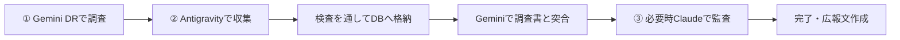

# サブエージェント体制と運用ワークフロー仕様書

- 策定日: 2026-10-26
- 基本方針: **「作る担当」と「検査する担当」を、別のツール・別のAIに分ける**

---

## 1. ツールごとの担当（誰が何をするか）

| 工程 | 担当ツール | 検査する側 | 役割 |
| :--- | :--- | :--- | :--- |
| **① 事前調査** | **Gemini Deep Research** | Antigravity（形式・抜け漏れ確認） | 公的統計・法令・制度階層・API所在のリサーチ |
| **② データ収集・格納** | **Antigravity** | Gemini（調査書との突き合わせ） | スクリプトによるデータ収集、検査を通したDB格納 |
| **③ 外部監査（時々）** | **Claude** | ― | 難関国や迷ったときの第三者・客観チェック |
| **④ 目視確認** | **Google スプレッドシート**（ユーザー） | ― | 初心者向けの一覧確認・手動チェック用 |
| **⑤ 仕様の質問窓口（任意）** | **Google NotebookLM** | ― | 仕様書（docs）を投入した質問・検索用（閲覧専用） |
| **⑥ 大量翻訳（過去分収集時）** | **Google AI Studio** | 原文照合 | 長文年表・百科事典の構造化抽出と翻訳 |

* **必須のツール**: ①（Gemini DR）、②（Antigravity）、③（Claude：時々）。④〜⑥は必要に応じて利用。

---

## 2. Antigravity内部の役割分担

Antigravity内部では、1つのAIが作業分野ごとに手順を切り替えて作業し、抜けや混同を防ぎます。

| 担当名 | 担当内容 | 出力・作業 |
| :--- | :--- | :--- |
| **行政収集** | 国、第1級〜基礎自治体、境界、代表点座標 | `data/raw/` 配下に生データ保存 |
| **気象収集** | 気象予報区階層、地上気象観測所ネットワーク | `data/raw/` 配下に生データ保存 |
| **交通収集** | 鉄道、道路、バス、旅客航路、定期航空路、ノード、エッジ | `data/raw/` 配下に生データ保存 |
| **格納・検査** | 生データの自動検査（防壁）と正規DBへの安全な書き込み | `data/master/*.csv` に反映 |
| **画面** | Web GIS探索ツール（`web/explorer`）、公開サイト、管理画面 | 画面の保守・改修 |
| **広報** | note記事のドラフト作成、SNS（X等）告知文の作成 | 記事・広報文の作成 |

---

## 3. 1カ国分の作業手順

1. **調査**: Antigravityが発行したプロンプトをGemini Deep Researchに貼り付けて調査し、結果を `docs/research/` に保存。
2. **収集**: Antigravityが分野別（行政・気象・交通）にデータを集め、`data/raw/` に仮置き。
3. **格納**: 検査プログラム（`collector_guard.py`）を通してエラーがないことを確認し、マスターDB（`data/master/`）に格納。
4. **突合**: Geminiで「事前調査書の内容とDBデータが合っているか」を突き合わせ確認。
5. **外部監査（必要時）**: 複雑なデータや迷う箇所がある場合、Claudeに判定を依頼。
6. **完了**: 問題がなければ完了。必要に応じて広報担当がnote記事のドラフトを作成。

---

## 4. データ収集の6大禁止事項（厳守ルール）

1. **マスターDBへの直接書き込み禁止**: 生データは必ず仮置きし、検査を通してから格納する。
2. **Wikipedia/Wikidata単体頼みの無差別スクレイピング禁止**: 公的オープンデータを優先し、車両や博物館などを路線・駅として登録しない。
3. **ダミー値（偽装日付・固定事業者）の埋め込み禁止**: 不明な項目は空欄（NULL）とする。
4. **ワープエッジ（異常な長距離接続）の禁止**: 同一路線・同一地域に限定し、異常な距離のエッジを作らない。
5. **未登録親ID（幽霊キー）の参照禁止**: 親テーブルに存在しないIDを指定しない。
6. **精度基準マスタの後付け改ざん禁止**: 集まらなかったからといって基準マスタを勝手に削らない。

---

## 5. ストレージ・バックアップ・翻訳の基本ルール

- **PC故障対策**: フォルダをGoogleドライブに移すとエラーの原因になるため行わない。すでに設定されている **GitHub（`sasamichi/PJT_Main`）への定期的なバックアップ（git push）** を行う。
- **データ容量対策**: 画像や詳細地図はPCに保存せず、URLで参照する。文字データ（CSV）中心のためPC容量は当面問題にならない。
- **誤訳防止**: 現在の名称はWikidataの公式多言語リンクから取得する。過去の地名・駅名はWikidataにないことが多いため、**DB内に現地の公用語（原文）を必ず残す**。
- **仕様書の管理**: 正本はPC内の `docs/` に置く。NotebookLMを使う場合は、仕様書を更新したときに入れ直す。
