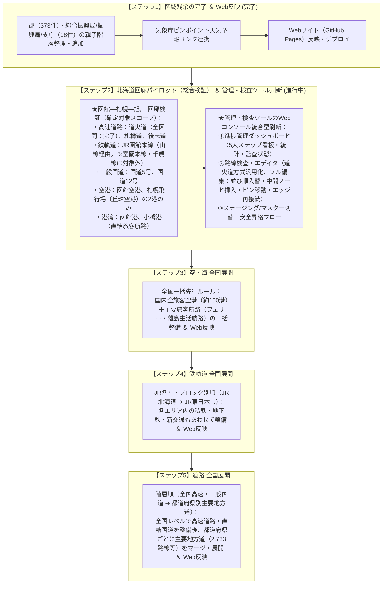

# 01. 基本方針とデータ収集ロードマップ

- 最終更新日: 2026-11-02
- 位置づけ: プロジェクト全体の基本思想・収集対象範囲・権利規約・進行ロードマップを定義する正本。
- 原点ドキュメント: [構想.md](../構想.md)（編集不可・永久保存）

---

## 1. プロジェクトの目的と基本設計思想

世界中の過去から現在・計画に至るまでの「交通網」と「国・地域・区域」のデータを収集・統合し、それらの**「繋がり」**と**「歴史的変遷」**を可視化・探索・ゲーム化する。

| 項目 | 確定した仕様・基本ルール |
| :--- | :--- |
| **① 歴史・変遷（時間軸）** | **日単位（YYYY-MM-DD）管理を原則**とする。 ・年のみ判明 ➔ **その年の大晦日（12月31日）**を格納（例: `1890-12-31`）。 ・年月のみ判明 ➔ **その月の末日**を格納（例: `1890-04-30`）。 |
| **② 変遷の繋がり（前身・後継）** | 自治体の合併（新設・編入・分立）、路線の改称・移管、駅の移転・改称など、複数対複数の歴史的繋がりや隣接・通過関係を保持する**意味関係エッジテーブル（`relations.csv`）**で一元管理する。 |
| **③ 線の表現 ＆ グラフ構造** | 「ノード（点：`nodes.csv`）」と「物理エッジ（区間：`edges.csv`）」および「意味関係エッジ（`relations.csv`）」の**グラフ構造（全14テーブル体系・スキーマv3凍結）**で表現する。 |
| **④ データ管理 ＆ DB移行** | 初期は費用0円のローカルCSV（Git管理）を正本とし、検索高速化時はSQLiteキャッシュを自動生成する。 データ構造を「ノードとエッジ」に統一しておくことで、将来的にNeo4j等の本格グラフDBへスクリプト1つでそのまま移行可能とする。 |
| **⑤ 品質担保と独立監査ゲート** | **「データ収集6大禁止事項」および「独立品質監査ゲート（ALL PASS必須）」を厳格適用**する。 ・収集スクリプトは必ず共通防壁（`collector_guard.py`）を通す。 ・マスタ反映時は `scripts/validators/audit_integrity.py`（全14テーブル監査＋回帰防止ゲート）および路線別の `tools/gate_audit.py`（Gate 1〜4）を実行し、全項目合格（ALL PASS）が出るまで次工程・公開への進行を禁じる。 |
| **⑥ 費用・システム制約** | 月額上限1万円以内（原則0円）を厳守。高額な商用クラウドDBや有償APIの継続課金は行わず、GitHub Pages等の無料静的配信を活用する。 |

---

## 2. 収集対象範囲の定義

### 2.1 交通網の範囲
- **鉄道・軌道**: JR、大手・準大手・地方私鉄、公営地下鉄、路面電車、鋼索鉄道（ケーブルカー）、トロリーバス。
  - ※特急・快速等の優等列車（運転系統）は初期収集対象から除外し、各駅停車ベースを標準とする。
- **索道**: 都市型ロープウェイ、主要な観光ロープウェイ（普通索道）。※スキー場内リフト（特殊索道）のみ除外。
- **道路**: 高速道路、一般国道、主要地方道（各都道府県指定の幹線道路・海外の主要州道相当）。
  - ※一般県道、市町村道、林道、農道は初期自動取得から除外（探索時に気になった旧道・酷道のみ個別追加）。
- **バス**: 都市間長距離バス ＋ 空港連絡バス ＋ 地域運輸連合の幹線路線・GTFSデータ。
- **空・海（航路・航空路）**:
  - **空港・港湾**: 旅客空港・主要港湾をノード（点）として先行収集。
  - **旅客航路**: 一般旅客定期航路、中長距離フェリー、公営渡船（道路法による渡船を含む）を網羅収集。
  - **国内航空路**: 主要幹線および離島生活路線を含む国内定期航空路線を網羅収集。
- **インフラ構造物・自然地形**:
  - **トンネル・橋梁・峠**: ノードの種別として定義し、探索工程で駅間エッジの中間構造物として順次追加。
- **対象外**: 電気・水道・ガス・通信・パイプライン等の供給インフラライン。

---

## 3. 権利・外部サービス利用規約ルール

1. **ストリートビュー・パノラマ（Google / Apple / Yandex / Baidu / Mapillary）**:
   - 画像キャプチャ等をローカルDBに直接保存・再配布しない。公式URLリンクまたは埋め込みタグを使用し規約を遵守する。
   - 探索時の目視確認による手作業での座標修正は、通常の事実参照として安全に実施する（APIスクレイピングは禁止）。
   - Googleストリートビューに加え、Apple Look Around、Yandex Panoramas、百度全景（Baidu Total View）、Mapillary等の国内外カバレッジ状況を事前調査で特定し、探索環境を整備する。
2. **背景地図タイル（Leaflet / MapLibre）**:
   - 全世界共通は OpenStreetMap（OSM）およびグローバル衛星写真を標準とし、国別の公的地図タイル（日本の国土地理院地図、オーストリアの basemap.at 等）は各国の事前調査時に特定・導入する。
3. **オープンデータ・Wikipedia / Wikidata**:
   - Wikidata（CC0）、国土数値情報（政府標準利用規約2.0・出典明記）、各国の政府オープンデータポータル（data.gv.at等）、Wikipedia（URL・出典明記）の規約に従い、`data_sources.csv` にクレジット表示仕様を完全に登録する。
4. **気象機関の天気予報・観測データリンク**:
   - 日本（気象庁等）やオーストリア（GeoSphere Austria等）の公式データ・API仕様を遵守し、適法かつ安全に連携する。

---

## 4. データ収集ロードマップ（5大ステップ体系・2026-11-01確定）

構想.md の「まず形を作る」「深追いしない」「10年単位」の原則に基づき、Web先行公開（α版）の達成を受け、今後の全体進行ロードマップを以下の**5大ステップ体系**として正式確定する。

### 4.1 作業・品質管理の5大基本ルール（2026-11-01制定・改定）

1. **セッション完了ルール（時間・柔軟区切りルール）**:
   - 1スレッドまたは1日の作業において無理なタスク完結を求めず、キリの良いところで安全にバックアップを取り、引継ぎボード（`docs/04`）に現在地を記録して次スレッドへ引き継ぐことを標準とする。
2. **バックアップ・コミットルール（自動退避＋セッション終了時Gitルール）**:
   - マスターデータ（`data/master/`）更新時は、スクリプトまたはツール側で自動的に `data/backup/{filename}_{timestamp}.bak` へ退避する。
   - 作業区切りおよびセッション終了時には、変更差分をGitコミットして状態を確定する。
3. **品質監査ゲート実行ルール（ステージング分離＋マージ前監査ルール）**:
   - データの収集・加工・初期編集はステージング（`data/staging/` 等）で行う。
   - マスター（`data/master/`）へ昇格・マージする際は路線検査（`tools/gate_audit.py`）および全テーブル整合性・回帰防止監査（`scripts/validators/audit_integrity.py`）を実行し、「ALL PASS（完全合格）」を必須条件とする。
4. **例外・欠損データ対処ルール（未定フラグ＋備考記録ルール）**:
   - 座標・履歴・属性等の欠損や矛盾が発生した場合、推測による穴埋めやダミー値の捏造を固く禁じる。
   - 空欄または確定ステータス「要調査」「計画・事業中」「廃止・休止」として登録し、備考欄に事実・経緯を記録して、全体の作業を止めずに安全に進行する。
5. **本番直プッシュ禁止 ＆ ローカル事前検証・承認ゲート（3段階ゲート絶対遵守）**:
   - データや画面の修正後は、**本番環境（GitHub Pages）への直接プッシュを固く禁止**する。
   - ①ローカルテスト環境（手元ブラウザ）で動作・目視確認 ➔ ②ユーザーへの確認提示 ➔ ③ユーザーからの承認（GOサイン）を得て初めて本番（GitHub）へプッシュする。

### 4.2 各国収集順序と優先度ルール（正本: `各国作業順.csv`）

国別の詳細データ収集にあたっては、[各国作業順.csv](../各国作業順.csv) に定義された「作業順」および「優先度」に厳格に従って進行する。

1. **最優先対象（フェーズ2・フェーズ4・フェーズ5初動）**:
   - `001`: **日本 (JP)**（優先度0：本基盤の基準国・フェーズ2）
   - `002`: **オーストリア (AT)**（優先度1：海外パイロット・フェーズ4）
   - `003`: **台湾 (TW)**（優先度1：東アジア展開・フェーズ5）
   - `004`: **韓国 (KR)**（優先度1：東アジア展開・フェーズ5）
   - `005`: **スイス (CH)**（優先度1：山岳鉄道・ヨーロッパ展開・フェーズ5）
2. **優先度2（G20 / 主要国）**:
   - `006` イタリア(IT)、`007` ドイツ(DE)、`008` フランス(FR)、`009` イギリス(GB)、`010` アメリカ(US)、`011` カナダ(CA)、`012` メキシコ(MX)、`013` アルゼンチン(AR)、`014` オーストラリア(AU)、`016` 中国(CN)、`017` インドネシア(ID)、`018` インド(IN)、`019` ロシア(RU)、`020` サウジアラビア(SA)、`021` トルコ(TR)、`022` 南アフリカ(ZA)
3. **優先度3（OECD諸国等）**:
   - `023` ベルギー(BE) 〜 `047` ニュージーランド(NZ)
4. **優先度4〜9（地域別順次展開）**:
   - `各国作業順.csv` の更新に伴い、作業順が確定した国から優先して収集・構築を行う。

### 4.3 国別作業の厳格ゲート（事前調査スキップ・読み飛ばし防止ルール）

いかなる国のデータ収集においても、以下の**6ステップの順序を絶対に飛び越えてはならない**。特にステップ1の「事前調査」を省略したり、スキル定義書を途中までしか読まずにデータ収集スクリプトを作成することは厳禁とする。

1. **【ステップ1：事前調査（必須ゲート）】**
   - [`.agents/skills/country-pre-research/SKILL.md`](../.agents/skills/country-pre-research/SKILL.md) および [`docs/research/事前調査テンプレート.md`](research/事前調査テンプレート.md) を**1行目から最終行まで全文読了**する。
   - `docs/research/[国コード]_行政・気象_制度調査.md` と `docs/research/[国コード]_交通_制度調査.md` の2分冊を作成する。
   - 制度構造・階層の定義（`area_types.csv`）、および公式リスト・API等の一次入手先・調達仕様（`data_sources.csv`）を確立する。
2. **【ステップ2：種別・出典マスタ登録 ＆ ユーザー承認】**
   - 事前調査で確定した区域種別を `area_types.csv` に、公的オープンデータ出典を `data_sources.csv` に登録し、調査内容とあわせてユーザーの承認を得る。
3. **【ステップ3：行政区画・気象データの収集 ＆ 品質防壁通過】**
   - `municipalities.csv`, `weather_zones.csv` をステージングに作成し、`scripts/common/collector_guard.py` の自動バリデーションを通過して保存する。
4. **【ステップ4：交通網（事業者・路線・ノード・エッジ）の収集 ＆ 品質防壁通過】**
   - `operators.csv`, `transport_routes.csv`, `nodes.csv`, `edges.csv` をステージングに作成し、路線データについては `tools/gate_audit.py`（Gate 1〜4）を通過させる。
5. **【ステップ5：独立品質監査（ALL PASS必須ゲート）】**
   - `scripts/validators/audit_integrity.py` を実行し、全14テーブルのスキーマ・主キー・外部キー・座標境界・ベースライン回帰防止検査を実施。
   - 1件でも不合格（FAIL）があれば修正し、**「ALL PASS（完全合格）」が出るまで完了を認めない**。
6. **【ステップ6：承認 ＆ 進捗更新】**
   - ALL PASSを確認後、`country_progress.csv` / `pilot_progress.csv` のステータスを更新し、ユーザー承認を経て公開・机上探索ツールに反映する。

---

## 5. データ収集 6大禁止事項（再発防止ガードレール）

1. **マスターDBへの直接書き込み禁止**: 生データ・加工中データは必ずステージング（`data/staging/`）に仮置きし、論理検査（`gate_audit.py` / `audit_integrity.py`）を通過してからマスターへ格納する。
2. **Wikipedia/Wikidata単体頼みの無差別スクレイピング禁止**: 公的オープンデータを一次ソースとし、車両・博物館・法文・構想の路線・駅混入を厳禁とする。
3. **ダミー値（偽装日付・固定事業者）の埋め込み禁止**: 取得できない項目は「空欄」とし、`1970-01-01` や特定事業者の機械的一律ハードコードを厳禁とする。
4. **文字列単体での全国ノード結合（ワープエッジ）の禁止**: エッジ構築時は「同一路線・同一地域」に限定し、異常な長距離駅間結合を厳禁とする。
5. **未登録の親ID（幽霊外部キー）および主キー空欄の禁止**: 親テーブルに存在しないIDの外部キー参照や、主キー空欄レコードの登録を厳禁とする。
6. **「精度基準マスタ・ベースライン」の後付け改ざん禁止**: 収集漏れや意図しないデータ消失をごまかすために基準値を勝手に引き下げる帳尻合わせを厳禁とする。
