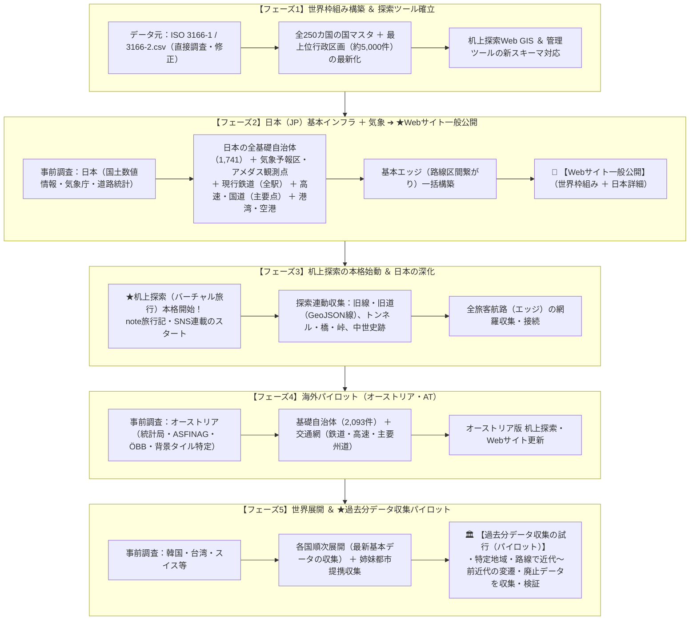

# 01. 基本方針とデータ収集ロードマップ

- 最終更新日: 2026-10-21
- 位置づけ: プロジェクト全体の基本思想・収集対象範囲・権利規約・進行ロードマップを定義する正本。
- 原点ドキュメント: [構想.md](../構想.md)（編集不可・永久保存）

---

## 1. プロジェクトの目的と基本設計思想

世界中の過去から現在・計画に至るまでの「交通網」と「国・地域・区域」のデータを収集・統合し、それらの**「繋がり」**と**「歴史的変遷」**を可視化・探索・ゲーム化する。

| 項目 | 確定した仕様・基本ルール |
| :--- | :--- |
| **① 歴史・変遷（時間軸）** | **日単位（YYYY-MM-DD）管理を原則**とする。 ・年のみ判明 ➔ **その年の大晦日（12月31日）**を格納（例: `1890-12-31`）。 ・年月のみ判明 ➔ **その月の末日**を格納（例: `1890-04-30`）。 ・各テーブルに `開始日_精度`, `終了日_精度`（`日`, `月`, `年`, `世紀`, `推定`）を持たせる。 |
| **② 変遷の繋がり（前身・後継）** | 自治体の合併（新設・編入・分立）、路線の改称・移管、駅の移転・改称など、複数対複数の歴史的繋がりを保持する**専用テーブル（`historical_transitions.csv`）**で一元管理する。 |
| **③ 線の表現 ＆ グラフ構造** | 「ノード（点：`nodes.csv`）」と「エッジ（区間：`edges.csv`）」の**グラフ構造**で表現する。 ・エッジ自身に「起点ノードID」「終点ノードID」「開始日」「終了日」「ライン座標（GeoJSON）」を持たせる。 ・探索箇所（旧線・旧道・手動記録）から順次ライン座標を蓄積し、未登録区間はノード間直線で自動補完描画する。 |
| **④ データ管理 ＆ DB移行** | 初期は費用0円のローカルCSV（Git管理）を正本とし、検索高速化時はSQLiteキャッシュを自動生成する。 データ構造を「ノードとエッジ」に統一しておくことで、将来的にNeo4j等の本格グラフDBへスクリプト1つでそのまま移行可能とする。 |
| **⑤ 品質担保と探索サイクル** | 初期は「事前調査シートとの数量チェック＋基本エラー検知」に留めて軽快に進め、日本の基本データが揃った段階で即座に机上探索（note旅行記・SNS発信）を開始する。 |
| **⑥ 費用・システム制約** | 月額上限1万円以内（原則0円）を厳守。高額な商用クラウドDBや有償APIの継続課金は行わず、GitHub Pages等の無料静的配信を活用する。 |

---

## 2. 収集対象範囲の定義

### 2.1 交通網の範囲
- **鉄道・軌道**: JR、大手・準大手・地方私鉄、公営地下鉄、路面電車、鋼索鉄道（ケーブルカー）。
  - ※特急・快速等の優等列車（運転系統）は初期収集対象から除外し、各駅停車ベースを標準とする。
- **索道**: 都市型ロープウェイ、主要な観光ロープウェイ（普通索道）。※スキー場内リフトのみ除外。
- **道路**: 高速道路、一般国道、主要地方道（各都道府県指定の幹線道路・海外の主要州道相当）。
  - ※一般県道、市町村道、林道、農道は初期自動取得から除外（探索時に気になった旧道・酷道のみ個別追加）。
- **バス**: 都市間長距離バス ＋ 空港連絡バス（※一般市内路線バス・コミュニティバスは除外）。
- **空・海**:
  - **空港・港湾**: 旅客空港・主要港湾をノード（点）として先行収集。
  - **旅客航路**: すべて対象。港湾（点）を先行収集し、航路（エッジ）は後工程（フェーズ3）で網羅接続。
- **インフラ構造物・自然地形**:
  - **トンネル・橋梁・峠**: ノードの種別として定義し、探索工程（フェーズ3〜）で駅間エッジの中間構造物として順次追加。
- **対象外**: 電気・水道・ガス・通信・パイプライン等の供給インフラライン。

### 2.2 国と地域・気象・史跡の範囲
- **国**: 全世界250カ国・地域（ISO 3166-1準拠）および過去の歴史的国家。
- **地域・自治体**: 各国の最上位行政区画（都道府県・州等）、中間行政区画（郡・振興局等）、基礎自治体（市区町村・ゲマインデ等）、および消滅した旧自治体。
- **都市間提携**: 国内外の姉妹都市・友好都市・提携都市（専用テーブル `city_partnerships.csv` で管理、各国データ完成後の後工程で収集）。
- **気象**: 気象庁等の気象予報区（一次・二次細分区域：`weather_zones.csv`）および気象観測点（アメダス：`nodes.csv`）。日本分をフェーズ2で早期先行収集。
- **テーマ別スポット（中世史跡等）**: 交通・行政とは独立した `theme_spots.csv`（プラグイン拡張方式）にて、日本中世の城跡・古戦場・関所・寺社等を収集。

---

## 3. 権利・外部サービス利用規約ルール

1. **Google Maps / ストリートビュー**:
   - 画像キャプチャ等をローカルDBに直接保存・再配布しない。公式URLリンクまたは埋め込みタグ（iframe）を使用し規約を遵守する。
   - 探索時の目視確認による手作業での座標修正は、通常の事実参照として安全に実施する（APIスクレイピングは禁止）。
2. **背景地図タイル（Leaflet / MapLibre）**:
   - 全世界共通は OpenStreetMap（OSM）およびグローバル衛星写真を標準とし、国別の公的地図タイル（日本の国土地理院地図、オーストリアの basemap.at 等）は各国の事前調査時に特定・導入する。
3. **オープンデータ・Wikipedia / Wikidata**:
   - Wikidata（CC0）、国土数値情報（政府標準利用規約2.0・出典明記）、Wikipedia（URL・出典明記）の規約に従う。
4. **気象機関の天気予報・観測データリンク**:
   - 日本（気象庁、日本気象協会 tenki.jp、ウェザーニュース、Yahoo!天気）等の公式ページへは、埋め込み（iframe）やロゴ画像の無断使用を避け、**「提供元明記＋別タブで開く通常のテキストリンク（`target="_blank"`）」** として適法かつ安全に案内する。

---

## 4. データ収集ロードマップ（全5フェーズ）

既存CSVデータはすべてリセットし、以下の5フェーズでゼロから高品位に再構築する。

### 4.1 各国収集順序と優先度ルール（正本: `各国作業順.csv`）

国別の詳細データ収集にあたっては、[各国作業順.csv](../各国作業順.csv) に定義された「作業順」および「優先度」に厳格に従って進行する。

1. **最優先対象（フェーズ2・フェーズ4・フェーズ5初動）**:
   - `001`: **日本 (JP)**（優先度0：本基盤の基準国・フェーズ2）
   - `002`: **オーストリア (AT)**（優先度1：海外パイロット・フェーズ4）
   - `003`: **台湾 (TW)**（優先度1：東アジア展開・フェーズ5）
   - `004`: **韓国 (KR)**（優先度1：東アジア展開・フェーズ5）
   - `005`: **スイス (CH)**（優先度1：山岳鉄道・ヨーロッパ展開・フェーズ5）
2. **優先度2（G20 / 主要国）**:
   - `006` イタリア(IT)、`007` ドイツ(DE)、`008` フランス(FR)、`009` イギリス(GB)、`010` アメリカ(US)、`011` カナダ(CA)、`012` メキシコ(MX)、`013` アルゼンチン(AR)、`014` オーストラリア(AU)、`016` 中国(CN)、`017` インドネシア(ID)、`018` インド(IN)、`019` ロシア(RU)、`020` サウジアラビア(SA)、`021` トルコ(TR)、`022` 南アフリカ(ZA)
3. **優先度3（OECD諸国等）**:
   - `023` ベルギー(BE) 〜 `047` ニュージーランド(NZ)
4. **優先度4〜9（地域別順次展開）**:
   - `各国作業順.csv` の更新に伴い、作業順が確定した国から優先して収集・構築を行う。
