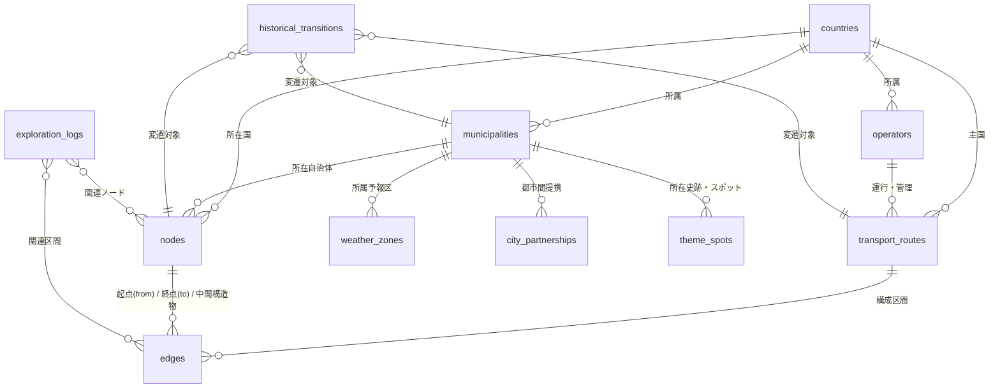

# 02. データベース設計書（全12テーブル確定スキーマ）

- 最終更新日: 2026-10-21
- 位置づけ: 正本CSV（`data/master/*.csv`）の全12テーブル構造、カラム定義、およびデータ格納ルールを規定する唯一の技術正本。

---

## 1. 共通データ格納ルール（設計監査確定事項）

1. **ID体系と永続化**:
   - 各レコードは `[国コード]-[種別2文字]-[6桁連番]`（例: `JP-ND-000001`）を主キーとし、一度採番したIDは変更・再利用しない。国際路線等は仮想国コード `INT` を使用する。
2. **座標精度**:
   - すべての緯度・経度は **十進数・小数第6位（四捨五入、約0.11m精度）** で統一する。
3. **多言語表記ルール**:
   - 日本語版WikipediaやWikidataに日本語ラベルが存在しない外国地名・施設名について、**`日本語名` 列は空欄**とし、現地語は `公用語名` 列にのみ保持する（外国語の日本語列混入を禁止）。
4. **日付と精度の管理**:
   - `開始日`・`終了日`・`移行日` はすべて `YYYY-MM-DD` 形式で格納する。
   - 年のみ判明時は「その年の大晦日（`12-31`）」、年月のみ判明時は「その月の末日」を格納し、`精度` 列に `日`, `月`, `年`, `世紀`, `推定` を明記する。
5. **乗換駅・JCTの路線別ナンバリング**:
   - 複数路線が乗り入れる駅やJCTで路線ごとに番号が異なる場合（例: 東京駅の山手線 `JY17` と中央線 `JC01`）、ノードは1つを共有し、**`edges.csv` の `from_路線内番号`・`to_路線内番号`** に路線固有番号を格納する。
6. **トンネル・橋梁・峠の後付け挿入**:
   - `edges.csv` の `from_node_id`・`to_node_id` は原則として「駅・信号場・IC・JCT・交差点・港・空港」間を結ぶ。
   - 区間内にあるトンネル・橋梁・峠は **`edges.csv` の `中間構造物_node_ids`** にカンマ区切り（起点から順）で紐付ける。これにより既存の駅間エッジやキロ程を壊さずに後から自由に追加できる。
7. **自治体境界を跨ぐ構造物の所在地**:
   - 県境・市町村境に位置する峠やトンネル等は、**`nodes.csv` の `municipality_id` にカンマ区切りで複数自治体IDを格納可能**とする（両自治体のナレッジパネルに自動表示）。
8. **改称・移転時のレコード分割ルール**:
   - 駅名や自治体名が改称・移転した際は、**「旧名レコード（終了日あり）」と「新名レコード（開始日あり）」を別行で分け、`historical_transitions.csv` で接続**する。これにより「年月日指定タイムマシン表示」で当時の旧名称が100%正確に再現される。
9. **人口データの2段階管理**:
   - 当面は `countries.csv`・`municipalities.csv` に最新統計の `人口` と `人口_調査年` のみを保持する。将来、時系列の人口推移グラフを展開する段階で独立テーブル `historical_populations.csv` をアドオン追加する。

---

## 2. テーブル一覧とER図（全12テーブル）

| No | ファイル名 | 主キー | ID例 | 役割・概要 |
| :---: | :--- | :--- | :--- | :--- |
| 1 | `countries.csv` | `country_code` | `JP`, `AT` | 全世界250カ国・地域および歴史的国家マスタ |
| 2 | `municipalities.csv` | `municipality_id` | `JP-MN-000001` | 都道府県・州・郡・市区町村・旧自治体マスタ |
| 3 | `weather_zones.csv` | `zone_id` | `JP-WZ-000001` | 気象予報区（一次・二次細分区域等）マスタ ★新設 |
| 4 | `operators.csv` | `operator_id` | `JP-OP-000001` | 鉄道事業者・道路管理者・航空・海運会社マスタ |
| 5 | `transport_routes.csv` | `route_id` | `JP-RT-000001` | 鉄軌道路線・高速道路・一般国道・航路マスタ |
| 6 | `nodes.csv` | `node_id` | `JP-ND-000001` | 駅・IC・交差点・空港・港・トンネル・橋・峠・観測点マスタ |
| 7 | `edges.csv` | `edge_id` | `JP-ED-000001` | 区間繋がり・キロ程・線路数・電化・GeoJSON線マスタ ★刷新 |
| 8 | `historical_transitions.csv` | `transition_id` | `JP-TR-000001` | 合併・分立・改称・移管等の前身➔後継関係マスタ ★新設 |
| 9 | `city_partnerships.csv` | `partnership_id` | `PRT-000001` | 姉妹都市・友好都市・提携都市マスタ（後工程） ★新設 |
| 10 | `theme_spots.csv` *(+拡張可)* | `spot_id` | `JP-SP-000001` | 日本中世史跡等のテーマ別スポットマスタ（プラグイン方式） ★新設 |
| 11 | `exploration_logs.csv` | `log_id` | `LOG-20261021-01` | 机上探索（バーチャル旅行）の記録・メモ・ルートマスタ |
| 12 | `country_progress.csv` | `country_code` | `JP`, `AT` | 全250カ国のフェーズ別収集進捗管理マスタ |

---

## 3. 各テーブル詳細カラム定義

### 3.1 国マスタ (`countries.csv`)
| 列名（物理名） | 型 | 必須 | 説明・具体例 |
| :--- | :--- | :---: | :--- |
| `country_code` | 文字列(2〜) | ● | ISO 3166-1 alpha-2（主キー。例: `JP`, `AT`, 歴史国は `JP-EMP` 等） |
| `日本語略名` | 文字列 | ● | 日本語の慣用国名（例: `日本`, `オーストリア`） |
| `日本語正式名` | 文字列 | ● | 日本語の公的正式国名（例: `日本国`, `大日本帝国`, `ドイツ連邦共和国`） |
| `iso_3166_1_a3` | 文字列(3) | ● | 3文字コード（例: `JPN`, `AUT`） |
| `iso_3166_1_nu` | 数値(3) | ● | 3桁数字コード（例: `392`, `040`） |
| `地域_国連区分` | 文字列 |  | 国連地理区分（例: `東アジア`, `西ヨーロッパ`） |
| `公用語` | 文字列 |  | 公用語（例: `日本語`, `ドイツ語`） |
| `通貨` | 文字列 |  | 通貨コード（例: `JPY`, `EUR`） |
| `車両通行側` | 文字列 | ● | `左` または `右` |
| `人口` | 整数 |  | 最新の推計・公的統計人口 |
| `人口_調査年` | 数値(4) |  | 人口の統計基準年（例: `2020`） |
| `ccTLD` | 文字列 |  | 国別ドメイン（例: `.jp`, `.at`） |
| `国際電話番号` | 文字列 |  | 国番号（例: `+81`, `+43`） |
| `開始日` | 日付 |  | 成立日・独立日（YYYY-MM-DD） |
| `開始日_精度` | 文字列 |  | `日`, `月`, `年`, `世紀`, `推定` |
| `終了日` | 日付 |  | 滅亡・解体日（現存は空欄） |
| `終了日_精度` | 文字列 |  | `日`, `月`, `年`, `世紀`, `推定` |
| `状態` | 文字列 | ● | `現存`, `消滅`, `係争中` |
| `Wikipedia_ja` | URL |  | 日本語版Wikipedia記事URL |
| `Wikipedia_en` | URL |  | 英語版Wikipedia記事URL |
| `Wikipedia_local` | URL |  | 現地公用語版Wikipedia記事URL |
| `Wikidata` | 文字列 |  | WikidataエンティティID（例: `Q17`） |
| `OpenStreetMap` | 文字列 |  | OSM Relation ID |
| `GoogleMap` | URL |  | Google Maps代表URL |

### 3.2 地域・自治体マスタ (`municipalities.csv`)
| 列名（物理名） | 型 | 必須 | 説明・具体例 |
| :--- | :--- | :---: | :--- |
| `municipality_id` | 文字列 | ● | 主キー（例: `JP-MN-000001`） |
| `country_code` | 文字列(2) | ● | 国コード（外部キー） |
| `区域大分類` | 文字列 | ● | `行政区画` |
| `自治体コード` | 文字列 |  | 公的コード（総務省6桁コード、ATのGemeindecode等） |
| `iso_3166_2_code` | 文字列 |  | ISO 3166-2コード（最上位区画のみ。例: `JP-01`, `AT-9`） |
| `国際_統計コード` | 文字列 |  | NUTSコード等 |
| `日本語名` | 文字列 |  | 日本語表記（例: `北海道`, `札幌市中央区`。未翻訳外国地名は空欄） |
| `公用語名` | 文字列 | ● | 現地公用語表記（例: `北海道`, `Wien`, `Innsbruck`） |
| `よみ_かな` | 文字列 |  | 日本語の読み仮名（ソート・検索・クロスワードパズル用） |
| `種別` | 文字列 | ● | `都道県`, `道庁`, `市`, `区`, `町`, `村`, `Bundesland`, `Gemeinde` 等 |
| `階層レベル` | 数値(1) | ● | `1`（都道府県/州）, `2`（中間・郡/支庁等）, `3`（基礎・市町村等） |
| `親自治体_id` | 文字列 |  | 上位区画のID（自己参照外部キー） |
| `中間行政区画` | 文字列 |  | 日本の振興局・郡、海外のBezirk等の補助名称 |
| `政庁_緯度` | 小数 | ● | 役所・庁舎の緯度（小数第6位） |
| `政庁_経度` | 小数 | ● | 役所・庁舎の経度（小数第6位） |
| `面積_km2` | 小数 |  | 行政面積（km²） |
| `人口` | 整数 |  | 直近の公的統計人口 |
| `人口_調査年` | 数値(4) |  | 人口の統計基準年（例: `2020`） |
| `公式サイト` | URL |  | 自治体公式ホームページURL |
| `天気予報_URL` | URL |  | 気象機関の公式天気予報URL（空欄時はコードから4社リンク等を自動生成） |
| `開始日` | 日付 | ● | 設置日（YYYY-MM-DD） |
| `開始日_精度` | 文字列 | ● | `日`, `月`, `年`, `世紀`, `推定` |
| `終了日` | 日付 |  | 廃止日（合併等。現存時は空欄） |
| `終了日_精度` | 文字列 |  | `日`, `月`, `年`, `世紀`, `推定` |
| `状態` | 文字列 | ● | `現存`, `廃止` |
| `時代区分` | 文字列 | ● | `現代`, `近代`, `前近代` |
| `Wikipedia_ja` | URL |  | 日本語版Wikipedia記事URL |
| `Wikipedia_en` | URL |  | 英語版Wikipedia記事URL |
| `Wikipedia_local` | URL |  | 現地公用語版Wikipedia記事URL |
| `Wikidata` | 文字列 |  | WikidataエンティティID |
| `OpenStreetMap` | 文字列 |  | OSM Relation ID |
| `GoogleMap` | URL |  | Google Maps代表URL |

### 3.3 気象予報区マスタ (`weather_zones.csv`) ★新設
| 列名（物理名） | 型 | 必須 | 説明・具体例 |
| :--- | :--- | :---: | :--- |
| `zone_id` | 文字列 | ● | 主キー（例: `JP-WZ-000001`） |
| `country_code` | 文字列(2) | ● | 国コード（`JP` 等） |
| `予報区コード` | 文字列 | ● | 気象庁予報区コード（例: `011000`） |
| `予報区名` | 文字列 | ● | 予報区名称（例: `石狩・空知・後志地方`, `石狩北部`） |
| `予報区種別` | 文字列 | ● | `地方予報区`, `府県予報区`, `一次細分区域`, `二次細分区域` |
| `親予報区_id` | 文字列 |  | 上位予報区ID |
| `担当気象台` | 文字列 |  | 管轄気象台（例: `札幌管区気象台`） |
| `代表_緯度` | 小数 |  | 代表点・気象台緯度 |
| `代表_経度` | 小数 |  | 代表点・気象台経度 |
| `関連自治体_ids` | 文字列 |  | 当該予報区に含まれる `municipality_id` のカンマ区切り一覧 |
| `状態` | 文字列 | ● | `現行`, `廃止` |

### 3.4 事業者・管理者マスタ (`operators.csv`)
| 列名（物理名） | 型 | 必須 | 説明・具体例 |
| :--- | :--- | :---: | :--- |
| `operator_id` | 文字列 | ● | 主キー（例: `JP-OP-000001`） |
| `country_code` | 文字列(2) | ● | 本社所在国コード |
| `日本語名` | 文字列 |  | 日本語事業者名（例: `東日本旅客鉄道`, `東日本高速道路`） |
| `公用語名` | 文字列 | ● | 現地公用語名（例: `東日本旅客鉄道`, `ÖBB-Personenverkehr AG`） |
| `略称` | 文字列 |  | 略称（例: `JR東日本`, `NEXCO東日本`, `ÖBB`） |
| `種別` | 文字列 | ● | `鉄道`, `道路管理者`, `航空`, `海運`, `索道`, `バス` |
| `開始日` | 日付 |  | 設立日・事業開始日 |
| `開始日_精度` | 文字列 |  | `日`, `月`, `年`, `世紀`, `推定` |
| `終了日` | 日付 |  | 解散日・民営化日 |
| `終了日_精度` | 文字列 |  | `日`, `月`, `年`, `世紀`, `推定` |
| `状態` | 文字列 | ● | `現存`, `廃止`, `再編` |
| `Wikipedia_ja` | URL |  | 日本語版Wikipedia記事URL |
| `Wikipedia_en` | URL |  | 英語版Wikipedia記事URL |
| `Wikipedia_local` | URL |  | 現地公用語版Wikipedia記事URL |
| `Wikidata` | 文字列 |  | WikidataエンティティID |

### 3.5 交通路線マスタ (`transport_routes.csv`)
| 列名（物理名） | 型 | 必須 | 説明・具体例 |
| :--- | :--- | :---: | :--- |
| `route_id` | 文字列 | ● | 主キー（例: `JP-RT-000001`） |
| `country_code` | 文字列(2) | ● | 主たる所属国コード |
| `通過国コード` | 文字列 |  | 国際路線の通過国（例: `AT,DE`） |
| `路線番号_記号` | 文字列 |  | 公式記号・番号（例: `JY`, `E1`, `1`, `A1`） |
| `日本語名` | 文字列 |  | 日本語路線名（例: `山手線`, `東名高速道路`, `国道1号`） |
| `公用語名` | 文字列 | ● | 現地正式名（例: `山手線`, `West Autobahn`） |
| `別称_愛称` | 文字列 |  | 愛称（例: `宇都宮線`, `ロマンチック街道`） |
| `種別` | 文字列 | ● | `新幹線`, `JR在来線`, `私鉄`, `地下鉄`, `高速道路`, `一般国道`, `航路` 等 |
| `operator_id` | 文字列 | ● | 運行事業者/管理者ID |
| `上位_国際路線_ids` | 文字列 |  | 上位路線ID（アジアハイウェイ、欧州自動車道路等） |
| `ラインカラー` | 文字列(7) |  | HEXカラーコード（例: `#80C241`） |
| `ライン記号` | 文字列 |  | 路線シンボル文字（例: `JY`, `M`） |
| `起点ノード_id` | 文字列 |  | 正式な起点ノードID |
| `終点ノード_id` | 文字列 |  | 正式な終点ノードID |
| `営業キロ` | 小数 |  | 公式営業キロ・実延長（km） |
| `軌間` | 文字列 |  | 鉄道の線路幅（例: `1067mm`, `1435mm`） |
| `電化方式` | 文字列 |  | 代表電化方式（例: `直流1500V`, `交流20kV 50Hz`, `非電化`） |
| `開始日` | 日付 | ● | 開業日・供用日（YYYY-MM-DD） |
| `開始日_精度` | 文字列 | ● | `日`, `月`, `年`, `世紀`, `推定` |
| `終了日` | 日付 |  | 廃止日（現存時は空欄） |
| `終了日_精度` | 文字列 |  | `日`, `月`, `年`, `世紀`, `推定` |
| `状態` | 文字列 | ● | `現用`, `廃止`, `休止`, `計画`, `未成` |
| `時代区分` | 文字列 | ● | `現代`, `近代`, `前近代` |
| `Wikipedia_ja` | URL |  | 日本語版Wikipedia記事URL |
| `Wikipedia_en` | URL |  | 英語版Wikipedia記事URL |
| `Wikipedia_local` | URL |  | 現地公用語版Wikipedia記事URL |
| `Wikidata` | 文字列 |  | WikidataエンティティID |
| `OpenStreetMap` | 文字列 |  | OSM Relation ID |
| `GoogleMap` | URL |  | Google Maps代表URL |

### 3.6 ノードマスタ (`nodes.csv`) ★汎用拡張
| 列名（物理名） | 型 | 必須 | 説明・具体例 |
| :--- | :--- | :---: | :--- |
| `node_id` | 文字列 | ● | 主キー（例: `JP-ND-000001`） |
| `country_code` | 文字列(2) | ● | 所属国コード |
| `拠点コード` | 文字列 |  | 単一施設コード（空港IATA `HND`, アメダス番号 `14163` 等。※路線別番号は `edges` 側） |
| `日本語名` | 文字列 |  | 日本語施設名（例: `東京駅`, `海老名SA`, `笹子トンネル`, `碓氷峠`） |
| `公用語名` | 文字列 | ● | 現地公用語名（例: `東京駅`, `Wien Hauptbahnhof`） |
| `よみ_かな` | 文字列 |  | 日本語の読み仮名（ソート・検索・クイズ・クロスワード用） |
| `種別` | 文字列 | ● | `駅`, `IC`, `JCT`, `SA`, `PA`, `道の駅`, `交差点`, `境界点`, `空港`, `港湾`, `信号場`, `トンネル`, `橋梁`, `峠`, `気象観測点` |
| `細品種別` | 文字列 |  | `地上駅`, `地下駅`, `新幹線駅`, `スマートIC`, `定期空港`, `アメダス` 等 |
| `municipality_id` | 文字列 | ● | 所在自治体ID（境界跨ぎの峠・トンネル等はカンマ区切り複数ID可） |
| `緯度` | 小数 | ● | 緯度（小数第6位） |
| `経度` | 小数 | ● | 経度（小数第6位） |
| `標高_m` | 小数 |  | 標高（m。峠・山間駅・観測点で重要） |
| `延長_m` | 小数 |  | 構造物の長さ（m。トンネル・橋梁のみ） |
| `配線種別` | 文字列 |  | 駅配線・構造（`単線棒線`, `単線交換可`, `複線相対式`, `島式`, `高架`, `地下`） |
| `開始日` | 日付 | ● | 開業日・供用日（YYYY-MM-DD） |
| `開始日_精度` | 文字列 | ● | `日`, `月`, `年`, `世紀`, `推定` |
| `終了日` | 日付 |  | 廃止日（現存時は空欄） |
| `終了日_精度` | 文字列 |  | `日`, `月`, `年`, `世紀`, `推定` |
| `状態` | 文字列 | ● | `現用`, `廃止`, `休止`, `建設中`, `計画` |
| `時代区分` | 文字列 | ● | `現代`, `近代`, `前近代` |
| `Wikipedia_ja` | URL |  | 日本語版Wikipedia記事URL |
| `Wikipedia_en` | URL |  | 英語版Wikipedia記事URL |
| `Wikipedia_local` | URL |  | 現地公用語版Wikipedia記事URL |
| `Wikidata` | 文字列 |  | WikidataエンティティID |
| `OpenStreetMap` | 文字列 |  | OSM Node ID |
| `GoogleMap` | URL |  | Google Maps代表URL |
| `観測データ_URL` | URL |  | 気象観測点（アメダス等）の公式実況データURL（空欄時はコードから自動生成） |

### 3.7 エッジマスタ (`edges.csv`) ★グラフ構造へ刷新
| 列名（物理名） | 型 | 必須 | 説明・具体例 |
| :--- | :--- | :---: | :--- |
| `edge_id` | 文字列 | ● | 主キー（例: `JP-ED-000001`） |
| `route_id` | 文字列 | ● | 所属路線ID |
| `区間順序` | 整数 | ● | 路線内の基本並び順（1, 2, 3...） |
| `from_node_id` | 文字列 | ● | 起点側ノードID |
| `to_node_id` | 文字列 | ● | 終点側ノードID |
| `from_路線内番号` | 文字列 |  | 当該路線での起点側駅番号・IC番号（例: `JY17`, `4-2`） |
| `to_路線内番号` | 文字列 |  | 当該路線での終点側駅番号・IC番号 |
| `中間構造物_node_ids` | 文字列 |  | 区間内のトンネル・橋梁・峠のノードID一覧（カンマ区切り・起点から順） |
| `区間種別` | 文字列 | ● | `本線`, `支線`, `短絡線`, `連絡線`, `旧線`, `未成線`, `別線` |
| `距離_km` | 小数 | ● | 駅間営業キロ・区間距離（km） |
| `線路数` | 文字列 | ● | `単線`, `複線`, `複々線` （道路は `2車線`, `4車線` 等） |
| `電化方式` | 文字列 | ● | `非電化`, `直流1500V`, `交流20kV 50Hz` 等 |
| `ライン座標_geojson` | 文字列 |  | 区間の走行軌跡（GeoJSON LineString形式。探索時に順次格納） |
| `開始日` | 日付 | ● | 供用開始日（YYYY-MM-DD） |
| `開始日_精度` | 文字列 | ● | `日`, `月`, `年`, `世紀`, `推定` |
| `終了日` | 日付 |  | 廃止日（現存時は空欄） |
| `終了日_精度` | 文字列 |  | `日`, `月`, `年`, `世紀`, `推定` |
| `状態` | 文字列 | ● | `現用`, `廃止`, `休止`, `建設中`, `計画` |

### 3.8 変遷履歴マスタ (`historical_transitions.csv`) ★新設
| 列名（物理名） | 型 | 必須 | 説明・具体例 |
| :--- | :--- | :---: | :--- |
| `transition_id` | 文字列 | ● | 主キー（例: `JP-TR-000001`） |
| `対象カテゴリ` | 文字列 | ● | `自治体`, `路線`, `ノード`, `エッジ`, `事業者`, `国` |
| `前身_ids` | 文字列 | ● | 変更前のエンティティID（複数時はカンマ区切り） |
| `後継_ids` | 文字列 | ● | 変更後のエンティティID（複数時はカンマ区切り） |
| `変遷種別` | 文字列 | ● | `新設合併`, `編入合併`, `分立`, `改称`, `移転`, `事業者移管`, `電化`, `複線化`, `廃止` |
| `移行日` | 日付 | ● | 効力発生日（YYYY-MM-DD） |
| `移行日_精度` | 文字列 | ● | `日`, `月`, `年`, `世紀`, `推定` |
| `事由_詳細` | 文字列 |  | 変遷の詳細説明 |
| `出典_根拠` | 文字列 |  | 官報、自治体史等の出典記録 |

### 3.9 都市間提携マスタ (`city_partnerships.csv`) ★新設
| 列名（物理名） | 型 | 必須 | 説明・具体例 |
| :--- | :--- | :---: | :--- |
| `partnership_id` | 文字列 | ● | 主キー（例: `PRT-000001`） |
| `municipality_id_1` | 文字列 | ● | 一方の自治体ID |
| `municipality_id_2` | 文字列 | ● | もう一方の自治体ID |
| `相手先_名称_自由記述` | 文字列 |  | 相手都市がDB未登録時の表記（例: `ポートランド市（米国）`） |
| `提携種別` | 文字列 | ● | `姉妹都市`, `友好都市`, `観光提携`, `ツインシティ`, `防災協定` |
| `提携日` | 日付 |  | 締結年月日（YYYY-MM-DD） |
| `提携日_精度` | 文字列 |  | `日`, `月`, `年`, `推定` |
| `状態` | 文字列 | ● | `提携中`, `解消`, `休止` |
| `備考_詳細` | 文字列 |  | 提携理由・経緯 |

### 3.10 テーマ別スポット・史跡マスタ (`theme_spots.csv` ほか拡張可) ★新設・プラグイン方式
- 特定テーマ（日本中世史跡、近代化遺産等）が増えた際は、同一列構造のまま `spots_medieval.csv`, `spots_heritage.csv` のようにマスタファイルを追加可能。

| 列名（物理名） | 型 | 必須 | 説明・具体例 |
| :--- | :--- | :---: | :--- |
| `spot_id` | 文字列 | ● | 主キー（例: `JP-SP-000001`） |
| `テーマコード` | 文字列 | ● | マップ分類コード（例: `JP_MEDIEVAL` 日本中世史跡） |
| `country_code` | 文字列(2) | ● | 所在国コード |
| `municipality_id` | 文字列 | ● | 所在自治体ID（複数跨ぎ時はカンマ区切り可） |
| `日本語名` | 文字列 | ● | 史跡・スポット名（例: `勝山館跡`, `関ヶ原古戦場`） |
| `公用語名` | 文字列 |  | 現地語表記 |
| `よみ_かな` | 文字列 |  | 読み仮名（クイズ・パズル用） |
| `種別` | 文字列 | ● | `城跡`, `館跡`, `古戦場`, `寺社`, `関所`, `宿場`, `遺跡` 等 |
| `時代区分` | 文字列 | ● | `鎌倉`, `南北朝`, `室町・戦国`, `安土桃山`, `中世全般` 等 |
| `関連人物_出来事` | 文字列 |  | 関連人物・合戦 |
| `緯度` | 小数 | ● | 緯度（小数第6位） |
| `経度` | 小数 | ● | 経度（小数第6位） |
| `標高_m` | 小数 |  | 標高（m） |
| `近隣ノード_id` | 文字列 |  | 最寄りの駅・IC・峠等の `node_id` |
| `SV確認済` | 文字列 | ● | `確認済`, `未確認`, `SVなし`（`map-making.app` 連携用） |
| `Wikipedia_ja` | URL |  | 日本語版Wikipedia記事URL |
| `Wikidata` | 文字列 |  | WikidataエンティティID |
| `GoogleMap` | URL |  | Google Maps / ストリートビューURL |
| `備考_解説` | 文字列 |  | 探索時のメモ・見どころ解説 |

### 3.11 机上探索ログマスタ (`exploration_logs.csv`)
- 運用ルール: ポイントかルートかは専用列を設けず、`ルート座標` が空でなければルート、空ならポイントとして扱う（`記録種別` は探索カテゴリ）。`log_id` は同一探索日ごとに連番を振る（`LOG-YYYYMMDD-01`, `-02`, …）。
| 列名（物理名） | 型 | 必須 | 説明・具体例 |
| :--- | :--- | :---: | :--- |
| `log_id` | 文字列 | ● | 主キー（例: `LOG-20261021-01`） |
| `探索日` | 日付 | ● | 探索実施日（YYYY-MM-DD） |
| `タイトル` | 文字列 | ● | 旅行記タイトル |
| `記録種別` | 文字列 | ● | `鉄道探索`, `古道・街道探索`, `峠・トンネル探訪`, `境界探訪`, `中世史跡` |
| `対象路線_ids` | 文字列 |  | 関連路線ID（カンマ区切り） |
| `対象ノード_ids` | 文字列 |  | 関連ノードID（カンマ区切り） |
| `対象自治体_ids` | 文字列 |  | 関連自治体ID（カンマ区切り） |
| `緯度` | 小数 |  | 代表地点の緯度 |
| `経度` | 小数 |  | 代表地点の経度 |
| `ルート座標` | 文字列 |  | 探索ルートのGeoJSON座標列 |
| `タグ` | 文字列 |  | カンマ区切りタグ |
| `本文` | 文字列 | ● | 探索メモ・旅行記ドラフト |
| `Webリンク` | URL |  | note記事URL、XポストURL等 |
| `Geoguessr候補` | 文字列 |  | `確認済`, `未確認`, `対象外` |
| `公開ステータス` | 文字列 | ● | `下書き`, `公開済`, `非公開` |

### 3.12 国別進捗管理マスタ (`country_progress.csv`)
| 列名（物理名） | 型 | 必須 | 説明・具体例 |
| :--- | :--- | :---: | :--- |
| `country_code` | 文字列(2) | ● | ISO 3166-1 alpha-2（主キー） |
| `国名` | 文字列 | ● | 日本語国名 |
| `段階区分` | 文字列 | ● | `フェーズ1` 〜 `フェーズ5` |
| `収集方針_自治体` | 文字列 |  | 自治体データの取得ソース・基準 |
| `収集方針_交通網` | 文字列 |  | 交通網データの取得ソース・基準 |
| `ステータス` | 文字列 | ● | `未着手`, `枠組み完了`, `詳細収集完了`, `エッジ構築完了`, `公開可能` |
| `更新日` | 日付 | ● | 最終更新日（YYYY-MM-DD） |
| `備考` | 文字列 |  | 進捗に関する特記事項 |
