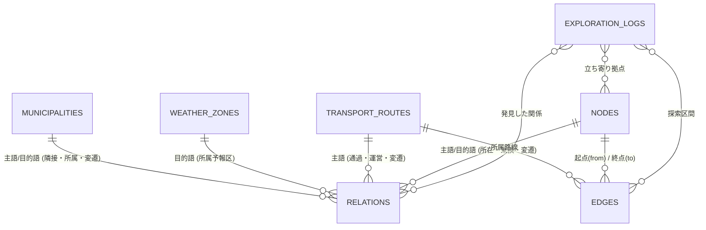

# 02. データベース設計書（確定技術正本・スキーマv3凍結）

- 最終更新日: 2026-11-02
- 原点ドキュメント: [構想.md](../構想.md)（編集不可・永久保存）
- 位置づけ: 本プロジェクトにおける唯一のデータベース設計技術正本。原点である `構想.md` の基本思想（「繋がり」「変遷」「机上探索」「深追いしない」「まず形を作る」）に基づき、**ナレッジグラフ中心設計**を取り入れた確定テーブル体系（**スキーマv3：全14テーブル**）およびデータ運用規則を規定する。
- **【スキーマ凍結ルール】**: 頻繁なスキーマ変更によるデータ消失・スクリプト破損を防ぐため、少なくともステップ2（北海道回廊パイロット）完了まで本スキーマ（全14テーブルの列定義・ID体系）を**凍結**する。列変更が必要な場合は、必ず移行スクリプトおよび `scripts/validators/audit_integrity.py` の同時更新を必須とする。

---

## 1. ナレッジグラフ中心設計の基本原則

### 1.1 探索を支援するデータ基盤の定義
本プロジェクトのデータ収集は、単なる台帳（行と列の件数集め）ではない。
**探索者（バーチャル旅人）が駅や街に降り立った瞬間、その土地の立体的な文脈（歴史・隣接自治体・気象・乗換路線・旧線遺構）がすべて繋がって立ち現れる「ナレッジグラフ（知識の網の目）」をあらかじめ組み上げておく支援活動**である。

### 1.2 物理エッジと意味関係エッジの分離
エッジ（繋がり）の混線を防ぐため、以下の2系統に分離して管理する。
1. **物理交通エッジ（`edges.csv`）**:
   - 電車や車が実際に辿る物理的な区間接続（起点ノード ➔ 終点ノード、駅順、距離_km）。
2. **意味関係エッジ（`relations.csv`）★新設**:
   - 知識と文脈の繋がりを表す汎用リレーション（主語ID ➔ 述語 ➔ 目的語ID）。
   - **ポリゴン（面データ）を持たない本プロジェクトにおいて、自治体間の「隣接」や「通過」を一級市民として表現する中核テーブル**。

### 1.3 探索で答えたい問い（コンピテンシークエスチョン）
本基盤は、以下の8つの問いに答えるためにデータを収集・結合する。これ以外の過度な属性収集は深追いしない。

| No | 答えたい問い（探索者の疑問） | 解決する関係（述語） |
| :-: | :--- | :--- |
| **Q1** | この路線を辿ると、各区間でどの自治体を通過するか？ | `(路線) --[通過]--> (自治体)` |
| **Q2** | この自治体に隣接している自治体はどこか？（隣町へ進む） | `(自治体) --[隣接]--> (自治体)` |
| **Q3** | この駅・施設は何線が通り、どの自治体に所在するか？ | `(駅) --[所在]--> (自治体)` / `(駅) --[乗換]--> (別路線駅)` |
| **Q4** | この街や峠の気象予報区・最寄アメダス観測点はどこか？ | `(自治体) --[所属予報区]--> (気象区)` / `(駅) --[最寄観測]--> (観測点)` |
| **Q5** | この駅・路線・自治体の前身（旧名・旧線・合併前町村）は何か？ | `(現行) --[前身/後継/改称]--> (過去実体)` |
| **Q6** | この駅や沿線の周辺にある中世史跡・名所は何か？ | `(史跡) --[近接]--> (駅/路線)` |
| **Q7** | この路線が合流・接続する上位路線や高速道路は何か？ | `(路線) --[接続]--> (路線)` |
| **Q8** | この自治体と提携している姉妹都市・友好都市はどこか？ | `(自治体) --[姉妹都市]--> (自治体)` |

---

## 2. テーブル一覧とアーキテクチャ

本基盤は、人間が管理しやすい「実体テーブル群」と、多様な繋がりを柔軟に吸収する「関係テーブル群」による**ハイブリッド構成（全14テーブル）**を採用する。

| 分類 | No | ファイル名 | 主キー | 役割・概要 |
| :--- | :---: | :--- | :--- | :--- |
| **実体 (Entities)** | 1 | `countries.csv` | `country_code` | 全世界250カ国・地域および国際枠（`INT`）マスタ |
| | 2 | `municipalities.csv` | `municipality_id` | 都道府県・振興局・支庁・郡・市区町村・政令区の行政区画マスタ（ID: `[CC]-AR-xxxxxx`） |
| | 3 | `weather_zones.csv` | `zone_id` | 地方・府県・一次・二次細分区域の気象予報区マスタ（ID: `[CC]-AR-xxxxxx`） |
| | 4 | `statistical_areas.csv` | `statistical_area_id` | 国勢調査区等の統計調査区マスタ（ID: `[CC]-ST-xxxxxx`） |
| | 5 | `operators.csv` | `operator_id` | 鉄道事業者・道路管理者・航空・海運・気象機関マスタ（ID: `[CC]-OP-xxxxxx`） |
| | 6 | `transport_routes.csv` | `route_id` | 鉄軌道路線・高速道路・一般国道・航路・航空路マスタ（ID: `[CC]-RT-xxxxxx`） |
| | 7 | `nodes.csv` | `node_id` | 駅・IC/JCT・SA/PA・道の駅・空港・港・観測点・拠点マスタ（ID: `[CC]-ND-xxxxxx`） |
| **関係 (Relations)** | 8 | `edges.csv` | `edge_id` | 物理交通エッジ（区間接続・駅順・距離・路線内番号、ID: `[CC]-ED-xxxxxx`） |
| | 9 | `relations.csv` | `relation_id` | 意味関係エッジ（隣接・通過・所在・所属・変遷・提携、ID: `[CC]-RL-xxxxxx`） |
| **管理・メタ (Meta)** | 10 | `country_progress.csv` | `country_code` | 国別のフェーズ・収集進捗管理マスタ |
| | 11 | `pilot_progress.csv` | `target_id` | パイロット検証対象路線・拠点のGate監査・進捗管理マスタ |
| | 12 | `area_types.csv` | `type_id` | 国ごとの行政・気象・統計の階層種別定義マスタ |
| | 13 | `data_sources.csv` | `source_id` | オープンデータ・出典・ライセンス管理マスタ |
| **探索ログ (Logs)** | 14 | `exploration_logs.csv` | `log_id` | 机上探索（バーチャル旅行）の記録・旅のログマスタ |

---

## 3. 全テーブル詳細カラム定義

### 3.1 実体テーブル群（Entities）

#### ① 国マスタ (`countries.csv`)
| 列名 | 型 | 必須 | 説明 |
| :--- | :--- | :---: | :--- |
| `country_code` | 文字列(2〜) | ● | ISO 3166-1 alpha-2（主キー。例: `JP`, `AT`） |
| `iso_alpha3` | 文字列(3) | ● | 3文字コード（例: `JPN`, `AUT`） |
| `日本語名` | 文字列 | ● | 日本語国名（例: `日本`） |
| `公用語名` | 文字列 |  | 現地語国名 |
| `車両通行側` | 文字列 | ● | `左` または `右` |
| `公式サイトURL` | URL |  | 国家機関・政府ポータル等のURL |
| `Wikipedia_ja` | URL |  | 日本語版Wikipedia記事URL |
| `Wikidata_id` | 文字列 |  | Wikidata Q識別子 |
| `開始日` / `終了日` | 日付 |  | 成立日 / 解体日（YYYY-MM-DD、空欄可） |
| `状態` | 文字列 |  | `現存`, `消滅`, `係争中` |

#### ② 行政区画マスタ (`municipalities.csv`)
| 列名 | 型 | 必須 | 説明 |
| :--- | :--- | :---: | :--- |
| `municipality_id` | 文字列 | ● | 主キー（例: `JP-AR-000001`） |
| `country_code` | 文字列 | ● | 所属国コード（`JP`） |
| `type_id` | 文字列 | ● | 区域種別ID（`area_types.csv` への外部キー） |
| `公的コード` | 文字列 |  | 全国地方公共団体コード（5〜6桁）等 |
| `親自治体ID` | 文字列 |  | 上位自治体の `municipality_id`（都道府県等。最上位は空欄） |
| `気象予報区ID` | 文字列 |  | 主たる所属気象二次細分区域ID（代表） |
| `名称` | 文字列 | ● | 日本語自治体名（例: `札幌市`, `中央区`） |
| `名称_公用語` | 文字列 |  | 現地公用語名称 |
| `よみ_かな` | 文字列 |  | ひらがな読み（空欄可） |
| `代表緯度` / `代表経度` | 小数 |  | 本庁舎等の代表Point座標（小数第6位） |
| `公式サイトURL` | URL |  | 自治体公式サイト等のURL |
| `Wikipedia_url` | URL |  | Wikipedia記事URL |
| `Wikidata_id` | 文字列 |  | Wikidata Q識別子 |
| `開始日` / `終了日` | 日付 |  | 設置日 / 廃止日（YYYY-MM-DD、空欄可） |
| `確定ステータス` | 文字列 | ● | `候補`, `台帳確認済`, `履歴確認済` |
| `備考` | 文字列 |  | 特記事項 |

#### ③ 気象予報区マスタ (`weather_zones.csv`)
| 列名 | 型 | 必須 | 説明 |
| :--- | :--- | :---: | :--- |
| `zone_id` | 文字列 | ● | 主キー（例: `JP-AR-002364`） |
| `country_code` | 文字列 | ● | 所属国コード（`JP`） |
| `type_id` | 文字列 | ● | 区域種別ID（`area_types.csv` への外部キー） |
| `気象庁コード` | 文字列 |  | 気象庁7桁コード（例: `0160100`）等 |
| `親予報区ID` | 文字列 |  | 上位予報区の `zone_id`（府県予報区等） |
| `管轄気象台` | 文字列 |  | 管轄気象台（例: `札幌管区気象台`） |
| `名称` | 文字列 | ● | 予報区名称（例: `石狩地方`, `札幌市`） |
| `名称_公用語` | 文字列 |  | 現地公用語名称 |
| `代表緯度` / `代表経度` | 小数 |  | 代表Point座標（小数第6位、空欄可） |
| `公式サイトURL` | URL |  | 気象機関公式URL |
| `Wikipedia_url` / `Wikidata_id` | 文字列 |  | Wikipedia記事URL / Wikidata Q識別子 |
| `開始日` / `終了日` | 日付 |  | 設置日 / 廃止日（空欄可） |
| `確定ステータス` | 文字列 | ● | `候補`, `台帳確認済`, `履歴確認済` |
| `備考` | 文字列 |  | 特記事項 |

#### ④ 統計調査区マスタ (`statistical_areas.csv`)
| 列名 | 型 | 必須 | 説明 |
| :--- | :--- | :---: | :--- |
| `statistical_area_id` | 文字列 | ● | 主キー（例: `JP-ST-000001`） |
| `country_code` | 文字列 | ● | 所属国コード（`JP`） |
| `type_id` | 文字列 | ● | 区域種別ID（`area_types.csv` への外部キー） |
| `公的コード` | 文字列 |  | 統計区コード |
| `親統計区ID` | 文字列 |  | 上位統計区ID |
| `名称` | 文字列 | ● | 統計区名称 |
| `名称_公用語` | 文字列 |  | 現地公用語名称 |
| `代表緯度` / `代表経度` | 小数 |  | 代表Point座標 |
| `公式サイトURL` / `Wikipedia_url` / `Wikidata_id` | 文字列 |  | 外部リンク |
| `開始日` / `終了日` | 日付 |  | 基準日 / 改定日（空欄可） |
| `確定ステータス` | 文字列 | ● | `候補`, `台帳確認済`, `履歴確認済` |
| `備考` | 文字列 |  | 特記事項 |

#### ⑤ 事業者マスタ (`operators.csv`)
| 列名 | 型 | 必須 | 説明 |
| :--- | :--- | :---: | :--- |
| `operator_id` | 文字列 | ● | 主キー（例: `JP-OP-000001`） |
| `country_code` | 文字列 | ● | 所属国コード（`JP`） |
| `親事業体ID` | 文字列 |  | 持株会社・上位機関ID |
| `公的コード` | 文字列 |  | 法人番号等 |
| `大分類` / `種別` | 文字列 | ●/ | `鉄道`, `道路`, `航空`, `海運` / `JR`, `大手私鉄` 等 |
| `事業者名` | 文字列 | ● | 事業者名称（例: `北海道旅客鉄道`） |
| `よみ_かな` | 文字列 |  | ひらがな読み（空欄可） |
| `公式サイトURL` / `Wikipedia_url` / `Wikidata_id` | 文字列 |  | 外部リンク |
| `開始日` / `終了日` | 日付 |  | 設立日 / 解散日（空欄可） |
| `確定ステータス` | 文字列 | ● | `候補`, `台帳確認済`, `履歴確認済` |
| `備考` | 文字列 |  | 特記事項 |

#### ⑥ 交通路線マスタ (`transport_routes.csv`)
| 列名 | 型 | 必須 | 説明 |
| :--- | :--- | :---: | :--- |
| `route_id` | 文字列 | ● | 主キー（例: `JP-RT-000001`） |
| `country_code` | 文字列 | ● | 所属国コード（`JP`） |
| `operator_id` | 文字列 | ● | 主たる運行・管理事業者ID（`operators.csv` への外部キー） |
| `路線名` | 文字列 | ● | 日本語路線名・営業道路名（例: `道央自動車道`, `札樽自動車道`, `函館線`） |
| `路線名_公用語` | 文字列 |  | 現地公用語路線名 |
| `路線名_通称` | 文字列 |  | 略称・法定路線名・愛称等（例: `道央道（北海道縦貫自動車道）`, `函館本線`） |
| `種別` | 文字列 | ● | `鉄道`, `新幹線`, `地下鉄`, `路面電車・LRT`, `モノレール`, `新交通システム`, `索道・鋼索`, `高速道路`, `都市高速`, `一般国道`, `主要地方道`, `旅客航路`, `航空路` |
| `起点ノード_id` | 文字列 |  | 起点となる `node_id`（`nodes.csv` への外部キー、空欄可） |
| `終点ノード_id` | 文字列 |  | 終点となる `node_id`（`nodes.csv` への外部キー、空欄可） |
| `全線開通日` | 日付 |  | 開通日（YYYY-MM-DD、空欄可） |
| `廃止日` | 日付 |  | 廃止日（YYYY-MM-DD、空欄可） |
| `総距離_km` | 小数 |  | 総営業キロ・延長距離（km、空欄可） |
| `確定ステータス` | 文字列 | ● | `候補`, `台帳確認済`, `接続確認済`, `履歴確認済` |
| `公式サイトURL` | URL |  | 事業者・路線の公式案内URL |
| `備考` | 文字列 |  | ナンバリング記号（`E5`, `E5A` 等）・区間範囲などの特記事項 |

> [!NOTE]
> **高速道路・鉄軌道の路線名ルール**:
> - 高速道路の探索・エッジ構築では、利用者が実際に辿る**営業路線名（道路名）**（例: `道央自動車道`, `札樽自動車道`, `後志自動車道`）を `路線名` とし、国土開発幹線自動車道等の法定路線名は `路線名_通称` に併記（例: `札樽道（北海道横断自動車道）`）する。
> - 鉄道は鉄道要覧等の公的台帳名（例: `函館線`）を `路線名` とし、一般的な呼称（例: `函館本線`）が異なる場合は `路線名_通称` に格納する。

#### ⑦ 交通拠点・ノードマスタ (`nodes.csv`)
| 列名 | 型 | 必須 | 説明 |
| :--- | :--- | :---: | :--- |
| `node_id` | 文字列 | ● | 主キー（例: `JP-ND-000001`） |
| `country_code` | 文字列 | ● | 所属国コード（`JP`） |
| `municipality_id` | 文字列 | ● | 所在自治体ID（`municipalities.csv` への外部キー） |
| `operator_id` | 文字列 |  | 主たる管理事業者ID |
| `大分類` / `種別` | 文字列 | ●/● | `交通拠点`, `気象` / `駅`, `IC`, `空港`, `港湾`, `観測点`, `史跡` |
| `公的コード` | 文字列 |  | 国土数値情報コード等 |
| `iata_code` / `icao_code` | 文字列 |  | 空港コード（例: `HND`, `RJTT`） |
| `名称` | 文字列 | ● | 施設名称（例: `札幌駅`） |
| `名称_公用語` | 文字列 |  | 現地公用語名称 |
| `よみ_かな` | 文字列 |  | ひらがな読み（空欄可） |
| `緯度` / `経度` | 小数 | ●/● | Point座標（十進数・小数第6位） |
| `公式サイトURL` / `Wikipedia_url` / `Wikidata_id` | 文字列 |  | 外部リンク |
| `開始日` / `終了日` | 日付 |  | 開業日 / 廃止日（空欄可） |
| `確定ステータス` | 文字列 | ● | `候補`, `台帳確認済`, `履歴確認済` |
| `備考` | 文字列 |  | 境界跨ぎ施設（例: `県境トンネル`）等 |

---

### 3.2 関係・エッジテーブル群（Edges & Relations）

#### ⑧ 物理交通エッジ (`edges.csv`)
電車や車が実際に辿る物理的な区間接続を管理。
| 列名 | 型 | 必須 | 説明 |
| :--- | :--- | :---: | :--- |
| `edge_id` | 文字列 | ● | 主キー（例: `JP-ED-000001`） |
| `route_id` | 文字列 | ● | 所属路線ID（`transport_routes.csv` への外部キー） |
| `from_node_id` | 文字列 | ● | 起点ノードID（`nodes.csv` への外部キー） |
| `to_node_id` | 文字列 | ● | 終点ノードID（`nodes.csv` への外部キー） |
| `順序` | 整数 | ● | 路線内の区間並び順（起点から `1`, `2`, `3`...） |
| `距離_km` | 小数 |  | 駅間営業キロ・区間距離（km。空欄可） |
| `路線内番号` | 文字列 |  | 駅ナンバリング等（例: `H75`, `JY17`。空欄可） |
| `状態` | 文字列 | ● | `現行`, `廃止`, `工事中`, `計画` |
| `開始日` / `終了日` | 日付 |  | 区間開通日 / 区間廃止日（空欄可） |
| `確定ステータス` | 文字列 | ● | `候補`, `接続確認済`, `履歴確認済` |
| `備考` | 文字列 |  | 特記事項 |

#### ⑨ 意味関係エッジ (`relations.csv`) ★新設
あらゆる知識と文脈の繋がり（隣接・通過・所在・所属・変遷・提携）を一元管理。
| 列名 | 型 | 必須 | 説明 |
| :--- | :--- | :---: | :--- |
| `relation_id` | 文字列 | ● | 主キー（例: `JP-RL-000001`） |
| `country_code` | 文字列 | ● | 対象国コード（`JP`） |
| `subject_id` | 文字列 | ● | 主語となる実体のID（例: `JP-AR-000002`） |
| `predicate` | 文字列 | ● | 述語（繋がりの種類。下表参照） |
| `object_id` | 文字列 | ● | 目的語となる実体のID（例: `JP-AR-000003`） |
| `context_id` | 文字列 |  | 文脈ID（例: 通過関係での `route_id` など。空欄可） |
| `開始日` / `終了日` | 日付 |  | 関係の成立日 / 解消日（合併・廃止など。空欄可） |
| `確定ステータス` | 文字列 | ● | `候補`, `確認済`, `履歴確認済` |
| `source_id` | 文字列 |  | 出典ID（`data_sources.csv` への外部キー） |
| `備考` | 文字列 |  | 特記事項 |

##### 【`relations.csv` で使用する標準述語（`predicate`）の語彙ルール】
| 述語 (`predicate`) | 主語種別 (`subject`) | 目的語種別 (`object`) | 具体例・役割 |
| :--- | :--- | :--- | :--- |
| **`隣接`** | 自治体 (`municipalities`) | 自治体 (`municipalities`) | **境を接する隣町同士を結ぶ（ポリゴンなしで隣接展開）** |
| **`通過`** | 路線 (`transport_routes`) | 自治体 (`municipalities`) | **その路線が経由・貫流する自治体** |
| **`所在`** | ノード (`nodes`) | 自治体 (`municipalities`) | 駅や施設が所在する自治体 |
| **`所属予報区`** | 自治体 (`municipalities`) | 気象区 (`weather_zones`) | 主所属および複数跨ぎの副所属予報区 |
| **`最寄観測`** | ノード (`nodes`) | 観測点 (`nodes`) | 駅や峠の最寄りアメダス観測地点 |
| **`乗換`** | ノード (`nodes`) | ノード (`nodes`) | 同一駅複合体・乗換可能な別路線の駅 |
| **`前身` / `後継`** | 実体全般 | 実体全般 | 合併・改称・路線移管などの歴史的変遷 |
| **`改称`** | 実体全般 | 実体全般 | 同一実体の名称変更 |
| **`姉妹都市`** | 自治体 (`municipalities`) | 自治体 (`municipalities`) | 都市提携ネットワーク |
| **`近接`** | 史跡ノード (`nodes`) | 駅ノード / 路線 | 探索で発見した周辺の名所・史跡 |

---

### 3.3 管理・メタテーブル群（Meta & Logs）

#### ⑩ 進捗管理マスタ (`country_progress.csv`)
国別のフェーズ、収集進捗、ステータスを管理。

#### ⑪ パイロット進捗管理マスタ (`pilot_progress.csv`)
北海道回廊パイロット等の重点検証対象路線・拠点のGate 1〜4合格状態およびノード・エッジ件数を管理。

#### ⑫ 区域種別マスタ (`area_types.csv`)
国ごとの行政・気象・統計の階層制度を定義。

#### ⑬ 出典マスタ (`data_sources.csv`)
公的オープンデータ、Wikipedia、事業者公式の出典・ライセンス・規約を管理。

#### ⑭ 机上探索ログマスタ (`exploration_logs.csv`)
机上探索（バーチャル旅行）の軌跡、発見メモ、旅の記録を永続化。

---

## 4. データ運用と品質管理ルール

1. **「深追いしない」「まず形を作る」の堅持**:
   - 不明な属性や未検証の繋がりは無理に埋めず、空欄または `確定ステータス: 候補` として残す。
   - 公的件数との100%完全一致を求めず、探索や段階的収集を通じて育てていく。
2. **Wikipediaと公的データの黄金律**:
   - **公的オープンデータ**: 実体の存在（実在性）および代表点Point座標の骨格として採用。
   - **Wikipedia・Wikidata**: 別名・概要の補助、および**路線の区間情報（駅順・キロ程・区間接続）の優先調達ソース**として活用。
3. **改称・移転・廃止時の不変ID運用**:
   - 駅・自治体・路線が改称・移転した際は、「旧レコード（終了日あり）」と「新レコード（開始日あり）」を別行・別IDとし、`relations.csv` の `前身` / `後継` / `改称` で接続する。
4. **自動変換によるSQLiteグラフDB生成**:
   - 手元のCSV群（13ファイル）から、いつでも自動変換スクリプトにより高速検索・検査用のSQLiteデータベース（`entities` 表および `relations` 表）をワンクリックで再生成できるようにする。
