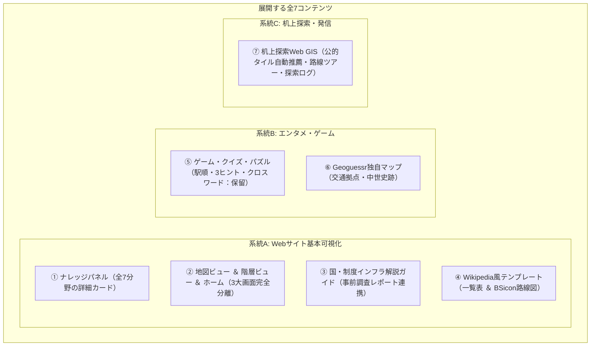

# 03. コンテンツと画面仕様書

- 最終更新日: 2026-11-02
- 位置づけ: Webサイト上で展開する全7コンテンツの表示項目・繋がり要件・Wikipediaテンプレート再現ロジック・机上探索ツールおよび管理ツールの画面仕様を定義する正本。

---

## 1. 展開する全7コンテンツの全体像

---

## 2. 各コンテンツの詳細要件

### ① ナレッジパネル（詳細情報カード）
地図上のピンや一覧をクリックした際、Wikipediaのインフォボックスのように構造化された詳細情報と「他ページへの繋がり（相互リンク）」を表示する。

| 対象分野 | 基本表示項目（Web先行公開） | 将来拡張・段階拡充項目（ステップ2以降） |
| :--- | :--- | :--- |
| **1. 国** | 日本語名、公用語名、ISOコード、通行側、外部リンク（公式/Wiki/Wikidata）、状態 | 人口・面積、通貨、成立・解体日、変遷リンク |
| **2. 行政区画** | 自治体名、公用語名、よみ_かな、種別、コード、代表座標、所属気象予報区、外部リンク | 面積、人口・基準年、設置・廃止日、前身・後継自治体、姉妹都市 |
| **3. 交通路線** | 路線名、路線名_通称、種別、運行事業者、外部リンク | 路線図（BSicon）、駅順一覧、距離_km、開通・廃止日 |
| **4. 交通拠点** | 施設名、よみ_かな、公的コード、種別、代表座標、所在自治体、事業者、外部リンク | 所属路線（前駅◀本駅▶次駅）、乗換路線、開業・廃止日 |
| **5. 気象予報区** | 予報区名、気象庁コード、種別、管轄気象台、親予報区、外部リンク | 公式天気予報リンク、気象警報・注意報連携 |
| **6. 事業者・管理者** | 事業者名、大分類、種別、親事業体、外部リンク | 運行路線一覧、前身・後継事業者リンク、設立・解散日 |

---

### ② 一般公開Webサイト（web/public: 世界交通網・地域データ基盤（仮） α版公開仕様）
一般公開Webサイトは、探索・管理ツールとの導線を完全遮断した独立サイトとして構築し、以下の3大モードを完全分離して提供する。

1. **🏠 ホーム画面（オープニング画面）**:
   - 初回アクセス時に表示される専用ランディングページ。初期アクセス時のちらつき（地図が一瞬描画される現象）を防止。
   - **ヒーローセクション**: プロジェクトの目的（世界中の交通網・国と地域を1つに統合）を端的に解説し、現在公開中の対象範囲を明記。
   - **2大ビュー案内カード**: 「🗺️ 地図ビューで探索」「📖 階層ビューで探索」へ即座にワンクリック遷移。
   - **ハイライト諸元**: 全251カ国・地域、全国2,356件の区域・自治体データ（都道府県・振興局・支庁・郡・市区町村・行政区）、気象観測地点（アメダス）1,286地点。
   - **直近更新履歴（Update History）**および**全体注記・免責事項**を表示。
2. **🗺️ 地図ビュー（フルスクリーン地図特化 ＆ MarkerCluster軽量化）**:
   - **フルスクリーン地図表示**: 画面全体を地図として活用。デフォルト背景地図は「国土地理院淡色地図」。
   - **クラスタリング描画（Leaflet.markercluster）**: 全国の市区町村役場ノードおよびアメダス観測点をクラスタ化し、広域ズーム時の描画負荷・操作重さを解消。
   - **クイックレイヤ切替バー**: 上部に常設された小型ピルボタンにより、ワンクリックで地物表示をトグル可能。
   - **ポップアップの充実 ＆ 外部リンク連携**:
     - ピンをクリックすると、自治体名・種別・コード・座標・Wikipedia記事リンクを展開。
     - 気象庁公式天気予報（対象市町村の予報ページ）、国土地理院地図、Google Mapsへの直結リンクを装備。
     - 「📖 所在自治体を開く / 階層ビューに戻る」ボタンにより、地図から階層ビューへシームレスに遷移可能。
   - **階層リストからのフォーカス連携**:
     - 階層ビューの自治体テーブルの「地図」ボタンを押すと、対象ノードへ地図が自動移動し、クラスタを展開してポップアップを自動オープン。
3. **📖 階層ビュー（テーブル型 ＆ 多層ツリー・制度解説）**:
   - 地図を一切表示せず、全幅画面で体系的にデータを閲覧できる独立画面。
   - **テーブル型世界一覧**: 全251カ国・地域を国旗・公用語・通行側・自治体数・開くボタン付きのテーブル形式（`data-table`）で一覧表示。
   - **日本の多層ツリー構造（地方 ➔ 都道府県 ➔ 振興局/支庁/政令市/郡/市区町村）**:
     - 全国の行政区画（2,356件）を多層ツリー＆テーブル形式で展開。ツリー見出しにも「詳細」ボタンを配備。
     - 「▼ 全地方を展開」「▶ 全地方を折りたたむ」の一括トグルボタンを配備。
   - **国概要・制度インフラ解説のアコーディオン化**:
     - 国詳細画面上部の国概要および制度解説ガイドを「📘 国概要・制度解説を表示 ▼ / 隠す ▲」ボタンで折りたたみ可能。

---

### ③ 📘 国・制度インフラ解説ガイド（事前調査レポート連携）
事前調査シート（`docs/research/*_制度調査.md`）の精査成果を加工し、一般読者向けにわかりやすく要約した国別ガイドコンテンツ。

- **表示場所**: 階層ビューの国画面ヘッダー直下（地図ビュー右上の「📘 制度解説」ボタンからも直通誘導）。
- **対象国**: 事前調査が完了した国（日本、オーストリア、台湾、韓国、スイス、イタリア、ドイツ）。
- **掲載タブ（モバイル対応・縦1列レイアウト統一）**:
  1. `🏛️ 基本情報・行政`: 国家体制、公用語、領土・地理的特徴、行政区画の制度階層（広域〜基礎自治体）
  2. `🌡️ 気象予報・観測`: 担当気象機関、予報区・警報区域の階層、地上気象観測網（アメダス等）の概要
  3. `🚆 交通インフラ体系`: 道路網（高速・国道・地方道等の分類）、鉄軌道（高速鉄道・都市交通等の分類）、国内定期航空路・主要空港、航路（旅客船・フェリー）
  4. `🔗 公式ポータル・地図`: 各国の公式Web GIS、政府統計・気象・交通の公式オープンデータポータル紹介
- **完全除外ルール（内部用項目）**:
  - データ収集作業で使用する内部コード（`type_id`）、収集フラグ（〇/×）、OSM/Wikidataタグ・クエリ、API仕様、内部検証ステータス等は正規表現サニタイズにより完全排除。

---

### ④ Wikipedia風テンプレート表示 ＆ 変遷タイムライン
1. **停車場・施設一覧表（駅一覧 / 道路IC・SA一覧）**:
   - 各駅停車・全施設ベースで自動生成（優等列車は運転系統扱いのため対象外）。
   - **表示列**: 路線内番号（`edges`）、駅/施設名、駅間キロ、累計営業キロ、接続路線、所在地自治体。
   - **上り／下り反転**: ボタン1つで「起点➔終点」と「終点➔起点」の並び順を反転可能。
2. **BSicon（縦型経路図・配線図）**:
   - Wikipedia標準の **「上（起点）から下（終点）へ」** 流れるアイコン路線図。
3. **変遷タイムライン（歴史スライダー ＆ ガントチャート系譜図）**:
   - **時間の向き**: **「左（古い時代・過去）から右（新しい時代・現在）」** へ流れる水平軸で統一。
   - `relations.csv`（`前身` / `後継` / `改称`）に基づき、合併・分立・改称をコネクタで結ぶ。

---

### ⑤ ゲーム・クイズ・パズル（保留）
DBのグラフ構造・属性・`よみ_かな` から自動生成するエンタメコンテンツ（※詳細種目は制作段階で再調整）。

---

### ⑥ Geoguessr独自マップ
- **作成フロー**: 探索で確認した地点データをCSV出力し、外部ツール **`https://map-making.app/`（Map Making App）** にインポートして編集・公開する。

---

### ⑦ 机上探索ツール ＆ 路線検査・エディタ（web/explorer）
- **机上探索ツール (`web/explorer/index.html`)**:
  - **地図分割表示**: 1画面／2画面（左右・上下）／4画面を切り替え、標準地図・航空写真・各国公的地図（日本・オーストリア・スイス・台湾・世界共通）を同期比較可能。
  - **地図右クリック・コンテキストメニュー**: Googleストリートビュー直通起動、座標コピー、探索ポイント追加。
  - **路線ツアーモード**: 全線エッジ構築済路線（道央自動車道、全国新幹線8路線、国内主要航空路・航路等）を起点から終点へ順番に辿るバーチャルツアー機能。
- **路線検査・フルエディタコンソール (`web/explorer/audit_editor.html`)**:
  - ステージングおよびマスター路線のノード並び替え、中間ノード挿入、削除、ピンのドラッグによる座標更新、Haversine距離再計算、および `tools/gate_audit.py`（Gate 1〜4）によるリアルタイム論理検査・マスター安全昇格を実行可能。

---

### ⑧ データ管理ツール（tools/admin.py）
- **概要**: ブラウザ（ポート8501）上で「5大ステップ＆パイロット進捗ダッシュボード」「大画面地図からのピンポイント属性編集」「確定14テーブル正本台帳の安全閲覧」を行えるWeb管理コンソール。
- **3大タブ体制（白背景UI標準）**:
  1. **【タブ1: 📈 進捗管理ダッシュボード】**:
     - 5大ステップ進行看板、北海道回廊パイロット進捗台帳（`pilot_progress.csv`）のGate 1〜4ステータス一覧・更新フォーム、および国別データ件数KPI・進捗更新カードを配備。
  2. **【タブ2: 🗺️ 地図データエディタ（点・路線修正）】**:
     - 大画面地図上で直接クリックしたピンの属性を編集し、`data/backup/{filename}_{timestamp}.bak` への自動退避付きで保存・ワンクリック直前復元が可能。
  3. **【タブ3: 📚 正本台帳ビューア（全14テーブル）】**:
     - 確定14テーブル（`countries.csv`, `country_progress.csv`, `pilot_progress.csv`, `area_types.csv`, `municipalities.csv`, `weather_zones.csv`, `statistical_areas.csv`, `data_sources.csv`, `operators.csv`, `transport_routes.csv`, `nodes.csv`, `edges.csv`, `relations.csv`, `exploration_logs.csv`）を閲覧専用データフレームで高速表示・検索・CSVダウンロード可能。
