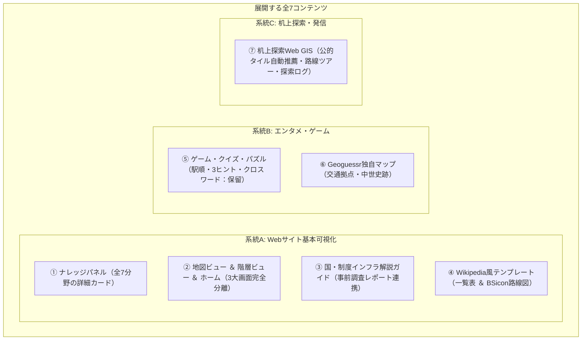

# 03. コンテンツと画面仕様書

- 最終更新日: 2026-10-28
- 位置づけ: Webサイト上で展開する全7コンテンツの表示項目・繋がり要件・Wikipediaテンプレート再現ロジック・机上探索ツールの画面仕様を定義する正本。

---

## 1. 展開する全7コンテンツの全体像

---

## 2. 各コンテンツの詳細要件

### ① ナレッジパネル（詳細情報カード）
地図上のピンや一覧をクリックした際、Wikipediaのインフォボックスのように構造化された詳細情報と「他ページへの繋がり（相互リンク）」を表示する。

| 対象分野 | 基本表示項目（フェーズ2A Web仮公開） | 将来拡張・段階拡充項目（フェーズ2B〜3以降） |
| :--- | :--- | :--- |
| **1. 国** | 日本語名、公用語名、ISOコード、通行側、外部リンク（公式/Wiki/Wikidata）、状態 | 人口・面積、通貨、成立・解体日、変遷リンク |
| **2. 行政区画** | 自治体名、公用語名、よみ_かな、種別、コード、代表座標、所属気象予報区、外部リンク | 面積、人口・基準年、設置・廃止日、前身・後継自治体、姉妹都市 |
| **3. 交通路線** | 路線名、路線記号・番号、種別、運行事業者、外部リンク | 路線図（BSicon）、駅順一覧、距離_km、軌間・電化、開通・廃止日 |
| **4. 交通拠点** | 施設名、よみ_かな、拠点コード、種別、代表座標、所在自治体、事業者、外部リンク | 所属路線（前駅◀本駅▶次駅）、乗換路線、配線種別、標高、開業・廃止日 |
| **5. 気象予報区** | 予報区名、気象庁コード、種別、管轄気象台、親予報区、外部リンク | 公式天気予報リンク、気象警報・注意報連携 |
| **6. 事業者・管理者** | 事業者名、大分類、種別、親事業体、外部リンク | 運行路線一覧、前身・後継事業者リンク、設立・解散日 |

> [!NOTE]
> **フェーズ2A（Web仮公開）の表示方針**:
> Web仮公開では「ノード（交通拠点・行政区画・気象予報区）の確実な情報」を先行公開します。未検証の駅間ライン（エッジ）や詳細諸元（配線種別・電化・軌間等）は画面に直接抱え込まず、Wikipedia・公式サイトへの外部リンクで担保し、フェーズ2B（主要幹線エッジ確立）以降に順次拡充します。

---

### ② 一般公開Webサイト（web/public: 世界交通網・地域データ基盤（仮） α版公開仕様）
一般公開Webサイトは、探索・管理ツールとの導線を完全遮断した独立サイトとして構築し、以下の3大モードを完全分離して提供する。

1. **🏠 ホーム画面（オープニング画面）**:
   - 初回アクセス時に表示される専用ランディングページ。初期アクセス時のちらつき（地図が一瞬描画される現象）を防止。
   - **ヒーローセクション**: プロジェクトの目的（世界中の交通網・国と地域を1つに統合）を端的に解説し、「※ 現在はα版として、日本国内のみの「国・地域・自治体データ」および「気象観測地点（アメダス）」を先行公開しています。」と明記。
   - **2大ビュー案内カード**: 「🗺️ 地図ビューで探索」「📖 階層ビューで探索」へ即座にワンクリック遷移（説明文を排したシンプルなカードUI）。
   - **ハイライト諸元**: 全251カ国・地域、全国1,965件の自治体データ、気象観測地点（アメダス）1,286地点。
   - **直近更新履歴（Update History）**: 2026-10-31の「🏛️ Webサイト α版（プロトタイプ）先行公開」のみを表示。
   - **全体注記・免責事項**: 「⚠️ ご利用上の注記・免責事項（α版）」として開発中のプロトタイプである旨を明記。
2. **🗺️ 地図ビュー（フルスクリーン地図特化 ＆ MarkerCluster軽量化）**:
   - **フルスクリーン地図表示**: 画面全体を地図として活用。デフォルト背景地図は「国土地理院淡色地図」。
   - **クラスタリング描画（Leaflet.markercluster）**: 全国の市区町村役場ノード（1,747件）およびアメダス観測点（1,286件）をクラスタ化し、広域ズーム時の描画負荷・操作重さを解消。
   - **クイックレイヤ切替バー**: 上部に常設された小型ピルボタン（🏛️ 都道府県庁、🏛️ 市区町村役場、🌡️ 気象観測地点 (アメダス)）により、ワンクリックで地物表示をトグル可能。※α版では交通拠点ノードおよび路線エッジは非公開。
   - **ポップアップの充実 ＆ 外部リンク連携**:
     - ピンをクリックすると、自治体名・種別・コード・座標・Wikipedia記事リンクを展開。
     - 気象庁公式天気予報（対象市町村の予報ページ）、国土地理院地図、Google Mapsへの直結リンクを装備。
     - 「📖 所在自治体を開く / 階層ビューに戻る」ボタンにより、地図から階層ビューへシームレスに遷移可能。
   - **階層リストからのフォーカス連携**:
     - 階層ビューの自治体テーブルの「地図」ボタンを押すと、対象ノードへ地図が自動移動し、クラスタを展開してポップアップを自動オープン。
3. **📖 階層ビュー（仮サイト仕様のテーブル型 ＆ 多層ツリー・制度解説）**:
   - 地図を一切表示せず、全幅画面で体系的にデータを閲覧できる独立画面。
   - **テーブル型世界一覧**: 全251カ国・地域を国旗・公用語・通貨・通行側・自治体数・開くボタン付きのテーブル形式（`data-table`）で一覧表示。
   - **日本の多層ツリー構造（地方 ➔ 都道府県 ➔ 市区町村/行政区）**:
     - 全国の行政区画を「8地方 ➔ 47都道府県 ➔ 1,747市区町村 / 171政令市行政区」の多層ツリー＆テーブル形式で展開。
     - 「▼ 全地方を展開」「▶ 全地方を折りたたむ」の一括トグルボタンを配備。
     - 自治体データ（種別・自治体名・かな・全国地方公共団体コード・代表座標・気象庁天気予報/外部URL/地図連携ボタン）を整然とした台帳テーブルで閲覧可能。
     - ※ α版では町村との親子リレーション未完了の「郡」および「支庁・総合振興局・振興局」は非公開。
   - **国概要・制度インフラ解説のアコーディオン化**:
     - 自治体リストへの到達を容易にするため、国詳細画面上部の国概要および制度解説ガイドを「📘 国概要・制度解説を表示 ▼ / 隠す ▲」ボタンで折りたたみ可能に改修（自治体データが存在する国は初期状態で折りたたみ）。

---

### ③ 📘 国・制度インフラ解説ガイド（事前調査レポート連携）
事前調査シート（`docs/research/*_制度調査.md`）の精査成果を加工し、一般読者向けにわかりやすく要約した国別ガイドコンテンツ。

- **表示場所**: 階層ビューの国画面ヘッダー直下（地図ビュー右上の「📘 制度解説」ボタンからも直通誘導）。
- **対象国**: 事前調査が完了した国（日本、オーストリア、台湾、韓国、スイス、イタリアの6カ国）。未調査国は「※現在、制度・インフラの事前調査を準備中です。」と案内。
- **掲載5大タブ（モバイル対応・縦1列レイアウト統一）**:
  1. `🏛️ 基本情報・行政`: 国家体制、公用語、領土・地理的特徴、行政区画の制度階層（広域〜基礎自治体）
  2. `🌡️ 気象予報・観測`: 担当気象機関、予報区・警報区域の階層、地上気象観測網（アメダス等）の概要
  3. `🚆 交通インフラ体系`: 道路網（高速・国道・地方道等の分類）、鉄軌道（高速鉄道・都市交通等の分類）、国内定期航空路・主要空港、航路（旅客船・フェリー）
  4. `🔗 公式ポータル・地図`: 各国の公式Web GIS、政府統計・気象・交通の公式オープンデータポータル紹介
- **完全除外ルール（内部用項目）**:
  - データ収集作業で使用する内部コード（`type_id`）、収集フラグ（〇/×）、OSM/Wikidataタグ・クエリ、API仕様、内部検証ステータス等は正規表現サニタイズにより完全排除。
- **生成AI免責バナー**:
  - ガイド最上部に「⚠️ 本解説は公的資料および事前調査に基づき生成AIが要約・作成したものであり、実際の制度や運行状況と異なる可能性があります。正確な情報は各公式機関の一次情報をご確認ください。」と明記。

---

### ③ 変遷タイムライン（歴史スライダー ＆ ガントチャート系譜図）
- **時間の向き**: **「左（古い時代・過去）から右（新しい時代・現在）」** へ流れる水平軸で統一。
- **ガントチャート型変遷タイムライン**:
  - 各自治体・路線・駅の存続期間（`開始日` 〜 `終了日`）を水平バーで描画。
  - `historical_transitions.csv` に基づき、新設合併・編入合併（複数バーの合流）、分立（分岐）、改称を点線コネクタで結ぶ。
- **ナレッジパネル内への個別埋め込み**:
  - 各自治体・駅ページ内に、その対象に直接関わる前身・後継のみを抽出した「ミニ変遷タイムライン」と「ミニ地図」を埋め込む。

---

### ④ Wikipedia風テンプレート表示（一覧表 ＆ BSicon縦型路線図）
1. **停車場・施設一覧表（駅一覧 / 道路IC・SA一覧）**:
   - 各駅停車・全施設ベースで自動生成（優等列車は運転系統扱いのため対象外）。
   - **表示列**: 路線内番号（`edges`）、駅/施設名、駅間キロ、累計営業キロ、線路配線記号（`||` 複線、`◇` 交換可、`|` 棒線、`∨`/`∧`）、接続路線、中間構造物（トンネル・橋・峠）、所在地自治体。
   - **上り／下り反転**: ボタン1つで「起点➔終点」と「終点➔起点」の並び順を反転可能。
2. **BSicon（縦型経路図・配線図）**:
   - Wikipedia標準の **「上（起点）から下（終点）へ」** 流れるアイコン路線図。
   - `edges.csv` の接続・区間種別（本線・支線・旧線）・中間構造物と、`nodes.csv` の種別・配線種別からHTML/SVGで自動描画。
3. **3つの歴史表示モード（タイムマシン機能）**:
   - **① 現在モード**: 現役の駅・区間のみを表示。
   - **② 全歴史総覧モード**: 過去の廃駅・旧線跡をすべて含む総覧図。
   - **③ 年月日指定（タイムマシン）モード**: 指定した年月日（例: `1975-03-10`）時点で存在していた駅、当時の駅名（改称前レコード）、当時の単複線・電化状態、旧線ルートをピンポイントで完全復元。

---

### ⑤ ゲーム・クイズ・パズル
DBのグラフ構造・属性・`よみ_かな` から自動生成するエンタメコンテンツ（※詳細種目は制作段階で再調整）。
1. **駅順並び替えパズル**: 路線内の駅カードを正しい順序に並べる（初級〜全駅タイムアタック）。
2. **3ヒント場所当てクイズ**: ①所属路線、②前後の隣駅、③所在自治体 から駅・施設名を当てる。
3. **消滅自治体クイズ**: 現在の市域に過去存在した旧町村名を当てる。
4. **峠・トンネルクイズ**: 標高・県境・通過路線から構造物を当てる。
5. **交通・地名クロスワードパズル**: `よみ_かな` を用いた文字交差パズルとヒント自動出題。

---

### ⑥ Geoguessr独自マップ
- **作成フロー**: 探索で確認した地点データをCSV出力し、外部ツール **`https://map-making.app/`（Map Making App）** にインポートして編集・公開する。
- **初期集中2大テーマ**:
  1. **交通拠点限定マップ**: 駅前、IC、道の駅、港湾、空港、峠のストリートビュー地点限定。
  2. **日本中世の歴史舞台限定マップ**: `theme_spots.csv`（城跡・館跡・古戦場・寺社・関所）のうち `SV確認済` の地点限定。

---

### ⑦ 机上探索ツール ＆ バーチャル旅行記（web/explorer）
- **画面レイアウト ＆ 操作性**:
  - **地図メイン表示**: ストリートビューおよび情報パネルはワンクリックで**非表示（折りたたみ）可能**。
  - **地図分割表示**: 1画面／2画面（左右・上下）／4画面を切り替え、標準地図・航空写真・各国公的地図等を同期比較可能。
  - **地図右クリック・コンテキストメニュー**: 地図上の任意地点で右クリックすることで、以下の機能をダイレクト起動可能。
    1. 👀 **この地点のストリートビューを開く**: 別タブでGoogleストリートビューを直通起動。
    2. 📋 **座標をコピー**: 緯度経度数値をクリップボードにコピー。
    3. 📍 **ここに探索ポイントを追加**: 記録パネルを開き、座標をセットしてピンを配置。
  - **ポイント可視化**: 下書きは光るオレンジのピン、保存済みは赤ピンで地図上にはっきりと表示。
- **背景地図タイル体系 ＆ 現在地動的自動推薦（2026-10-28 拡充）**:
  - **公的タイル収録国**:
    - 🗾 **日本**: 国土地理院（標準・淡色・写真・陰影起伏）
    - 🇦🇹 **オーストリア**: basemap.at（標準・グレースケール・オルソ高精細航空写真）
    - 🇨🇭 **スイス**: swisstopo（公式国土地図カラー・グレー・SWISSIMAGE航空写真）
    - 🇹🇼 **台湾**: NLSC（台湾通用電子地図・正射影像図航空写真・英語併記版）
    - 🌐 **世界共通**: OpenStreetMap、Esri World Imagery（世界衛星写真）、CartoDB Dark、Google Maps
  - **現在地連動スマートソート（`detectCountryFromCoord`）**:
    - 地図の中心座標から現在地国をリアルタイム自動判定し、各画面ペインのタイル切替セレクタの最上位に「📍 現在地の公的タイル」を自動推薦配置。
    - 続いて「🌐 世界標準・衛星写真」、その下に「その他の国のタイル」を `<optgroup>` で階層整理。現在表示中のタイルを維持したまま、セレクタを開いた瞬間に最適なタイルを最速で選択可能。
- **路線ツアーモードの強化（三重防御）**:
  - 全線エッジが構築された全国新幹線8路線（東海道、山陽、東北、上越、北陸、九州、西九州、北海道）および国内主要航空路をツアー対象の最上位（★表示）に優先配置。
  - **三重防御による名称・座標解決**: エッジ側情報 ➔ 路線ツアー開始時の一括ノード取得キャッシュ ➔ 近隣ノード検索 の順にフォールバックし、駅名・空港名の確実な太字名称表示と `focusOn(lat, lon, 14)` による確実な地図追従・ストリートビュー連動を保証。
- **データ記録と史跡振り分け**:
  - 探索中に見つけた旧線・旧道・トンネル・難所をワンクリックで保存。
  - 路線探索中であっても中世史跡を見つけた際は、**保存先として「中世史跡データ側（`theme_spots.csv`）」を選択して振り分け登録可能**。
  - ストリートビューの存在をその場で確認し、`SV確認済` チェックを記録。
- **発信連動**:
  - 蓄積した探索ログから、note連載用の「旅行記Markdownドラフト」およびX（旧Twitter）投稿用の短文サマリを自動出力。

---

### ⑧ データ管理ツール（tools/admin.py）
- **概要**: データベースやプログラミングの知識がなくても、ブラウザ（ポート8501）上で「収集進捗の可視化」「大画面地図からの直感的なピンポイント属性編集」「確定10テーブル正本台帳の安全閲覧」を行えるWeb管理コンソール。
- **3大タブ体制（2026-10-29 全面刷新・白背景UI最適化）**:
  - **白背景（Clean White Theme）**: 視認性に優れた清潔な白背景を標準採用。
  1. **【タブ1: 📈 収集進捗ダッシュボード】**:
     - **上段（次期対象国ハイライト）**: 事前調査完了6カ国（JP, AT, TW, KR, CH, IT）の状況、次期推奨着手国「007 DE (ドイツ)」の案内カード、全体KPI（登録国数・総自治体数・総拠点数）を表示。
     - **中段（4段階パイプライン概要）**: 4段階（🔍事前調査 ➔ 📑マスタ登録 ➔ 📦実データ収集 ➔ 🛡️品質監査）の役割と調達仕様をカード表示。
     - **下段（主要分野別データ件数一覧 ＆ 連動一括更新）**:
       - `areas.csv`（自治体・予報区等の内訳）、`operators.csv`、`transport_routes.csv`、`nodes.csv` の国別クロス集計表をフィルタ付きで表示。
       - **一覧連動の一括更新カード**: 対象国を選択すると、その国の実データ件数KPI（区域・種別・事業者・路線・拠点）と、進捗ステータス、収集方針、作業メモが1つのカードにまとめて表示され、その場で一度に更新（自動バックアップ保存付き）可能。
  2. **【タブ2: 🗺️ 地図データエディタ（点・路線修正）】**:
     - **大画面地図 ＆ 縦1列編集フォーム（比率 1.6 : 1.0、高さ600px）**: 地図エリアを大きく確保し、右側のフォームはスクロールしやすい縦1列に統一。
     - **地図ピン直接クリック連動（選択画面を全廃）**: 地物選択のセレクトボックスを完全に撤廃し、**地図上で直接クリックしたピンのみを編集対象**とする直感的操作体系を確立（未選択時はガイド表示）。
     - **ピンポイント属性修正**: 選択した地物（`nodes.csv`, `areas.csv`, `transport_routes.csv`）の名称、公用語名、種別、コード、緯度・経度等の属性編集フォームが縦1列に自動展開。
     - **厳格バリデーション**: 名称の必須チェック、座標の数値妥当性および範囲チェック（緯度 -90.0〜90.0、経度 -180.0〜180.0）を自動検査し、不正値の保存を遮断。
     - **自動バックアップとワンクリック復元**: 保存実行前に `data/backup/{filename}_{timestamp}.bak` に直前ファイルを自動退避した上で保存。「↩️ 直前のバックアップから復元する」ボタンにより、万が一の誤編集時もワンクリックで直前状態へ即時ロールバック可能。
  3. **【タブ3: 📚 正本台帳ビューア（全10テーブル）】**:
     - 確定10テーブル（`areas.csv`, `area_types.csv`, `countries.csv`, `country_progress.csv`, `data_sources.csv`, `operators.csv`, `transport_routes.csv`, `nodes.csv`, `edges.csv`, `exploration_logs.csv`）を閲覧専用データフレームで高速表示。
     - キーワード部分一致検索、国コード絞り込み、表示件数切り替え、ワンクリックCSVダウンロード機能を装備。
     - 誤操作による大量行破壊を防ぐため、旧スプレッドシート型直接編集（`st.data_editor`）および旧新規登録フォームは完全廃止。
