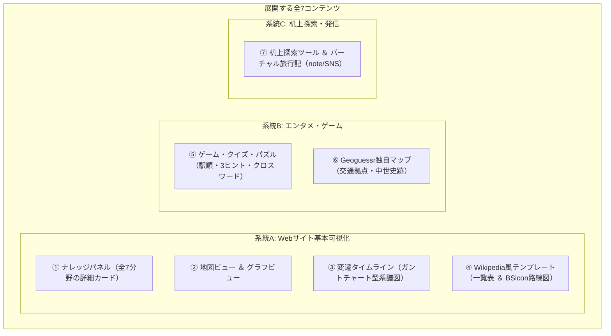

# 03. コンテンツと画面仕様書

- 最終更新日: 2026-10-21
- 位置づけ: Webサイト上で展開する全7コンテンツの表示項目・繋がり要件・Wikipediaテンプレート再現ロジック・机上探索ツールの画面仕様を定義する正本。

---

## 1. 展開する全7コンテンツの全体像

---

## 2. 各コンテンツの詳細要件

### ① ナレッジパネル（詳細情報カード）
地図上のピンや一覧をクリックした際、Wikipediaのインフォボックスのように構造化された詳細情報と「他ページへの繋がり（相互リンク）」を表示する。

| 対象分野 | 基本表示項目 | 画面上の「繋がり（リンク先）」と埋め込み要素 |
| :--- | :--- | :--- |
| **1. 国** | 日本語略名、日本語正式名、公用語名、ISOコード、通貨、通行側、人口・基準年、成立・解体日 | ・最上位行政区画（都道府県・州）一覧 ・主要交通路線・国際空港・主要港湾一覧 ・前身国家・後継国家へのリンク |
| **2. 地域・自治体** | 日本語名、公用語名、よみ、種別、コード、政庁座標、面積、人口・基準年、設置・廃止日 | ・上位区画（都道府県/郡）および下位区画リンク ・前身自治体（合併前旧町村）・後継自治体リンク ・**姉妹都市・提携都市**リンク ・市内の全交通拠点・通過路線一覧、管轄気象予報区リンク ・**🌤️ 外部天気予報リンク（気象庁・tenki.jp・ウェザーニュース・Yahoo!天気）** ・**🌡️ 管内アメダス公式実況データリンク** ・**🗺️ 個別ミニ地図** ＆ **⏱️ 個別ミニ変遷タイムライン** |
| **3. 交通路線** | 路線名、路線番号/記号、ラインカラー、種別、起点・終点、営業キロ、軌間、電化方式、開業・廃止日 | ・運行事業者/管理者リンク、起点・終点ノードリンク ・**全駅・全施設一覧表 ＆ BSicon縦型路線図** ・接続する他路線一覧、通過する自治体一覧（順序順） |
| **4. 交通拠点** | 施設名、よみ、拠点コード、種別・細品種別、緯度・経度、標高、配線種別、開業・廃止日 | ・所在自治体リンク ・**所属路線の前後の隣接拠点リンク**（［前駅］◀ 本駅 ▶［次駅］） ・乗換路線・接続道路一覧、改称前・移転前ノードリンク ・**Googleストリートビュー直接起動ボタン** |
| **5. 構造物（トンネル・橋・峠）** | 構造物名、よみ、種別、延長(m)、標高(m)、開通・廃止日 | ・通過する路線・道路リンク、前後の駅・ICリンク ・跨いでいる両側の自治体リンク、旧トンネル・旧道峠リンク |
| **6. 気象予報区・観測点** | 予報区名・コード・種別・担当気象台 / 観測所名・コード・標高 | ・予報区に含まれる自治体一覧、親予報区リンク ・観測点の所在自治体リンク、**気象庁公式実況データページURL** |
| **7. 事業者・管理者** | 事業者名、公用語名、略称、種別、本社国、設立・解散日 | ・運行・管理する全路線一覧、前身・後継事業者（国鉄➔JR等）リンク |

---

### ② 地図ビュー ＆ グラフビュー
- **地図ビュー**:
  - **背景タイル**: 全世界共通は **OpenStreetMap (OSM) ＋ グローバル衛星写真**。日本は **国土地理院地図（標準・淡色・航空写真）**。他国は各国の事前調査で公的タイル（例: オーストリア `basemap.at`）を特定して追加。
  - **レイヤ制御**: 鉄道、道路、拠点、構造物（トンネル・橋・峠）、行政区画、気象観測点、中世史跡を個別にON/OFF可能。
  - **ライン描画**: `edges.csv` に `ライン座標_geojson` がある区間（旧線・旧道等）は実形状を描画し、未登録区間はノード間直線で自動補完。
- **グラフビュー**:
  - 地理座標を無視し、駅や路線の接続トポロジー、自治体の合併ツリー、姉妹都市ネットワークを力学モデル等で可視化（※画面プロトタイプ実装時に操作感を再検証）。

---

### ③ 変遷タイムライン（歴史スライダー ＆ ガントチャート系譜図）
- **時間の向き**: **「左（古い時代・過去）から右（新しい時代・現在）」** へ流れる水平軸で統一。
- **ガントチャート型変遷タイムライン**:
  - 各自治体・路線・駅の存続期間（`開始日` 〜 `終了日`）を水平バーで描画。
  - `historical_transitions.csv` に基づき、新設合併・編入合併（複数バーの合流）、分立（分岐）、改称を点線コネクタで結ぶ。
- **ナレッジパネル内への個別埋め込み**:
  - 各自治体・駅ページ内に、その対象に直接関わる前身・後継のみを抽出した「ミニ変遷タイムライン」と「ミニ地図」を埋め込む。

---

### ④ Wikipedia風テンプレート表示（一覧表 ＆ BSicon縦型路線図）
1. **停車場・施設一覧表（駅一覧 / 道路IC・SA一覧）**:
   - 各駅停車・全施設ベースで自動生成（優等列車は運転系統扱いのため対象外）。
   - **表示列**: 路線内番号（`edges`）、駅/施設名、駅間キロ、累計営業キロ、線路配線記号（`||` 複線、`◇` 交換可、`|` 棒線、`∨`/`∧`）、接続路線、中間構造物（トンネル・橋・峠）、所在地自治体。
   - **上り／下り反転**: ボタン1つで「起点➔終点」と「終点➔起点」の並び順を反転可能。
2. **BSicon（縦型経路図・配線図）**:
   - Wikipedia標準の **「上（起点）から下（終点）へ」** 流れるアイコン路線図。
   - `edges.csv` の接続・区間種別（本線・支線・旧線）・中間構造物と、`nodes.csv` の種別・配線種別からHTML/SVGで自動描画。
3. **3つの歴史表示モード（タイムマシン機能）**:
   - **① 現在モード**: 現役の駅・区間のみを表示。
   - **② 全歴史総覧モード**: 過去の廃駅・旧線跡をすべて含む総覧図。
   - **③ 年月日指定（タイムマシン）モード**: 指定した年月日（例: `1975-03-10`）時点で存在していた駅、当時の駅名（改称前レコード）、当時の単複線・電化状態、旧線ルートをピンポイントで完全復元。

---

### ⑤ ゲーム・クイズ・パズル
DBのグラフ構造・属性・`よみ_かな` から自動生成するエンタメコンテンツ（※詳細種目は制作段階で再調整）。
1. **駅順並び替えパズル**: 路線内の駅カードを正しい順序に並べる（初級〜全駅タイムアタック）。
2. **3ヒント場所当てクイズ**: ①所属路線、②前後の隣駅、③所在自治体 から駅・施設名を当てる。
3. **消滅自治体クイズ**: 現在の市域に過去存在した旧町村名を当てる。
4. **峠・トンネルクイズ**: 標高・県境・通過路線から構造物を当てる。
5. **交通・地名クロスワードパズル**: `よみ_かな` を用いた文字交差パズルとヒント自動出題。

---

### ⑥ Geoguessr独自マップ
- **作成フロー**: 探索で確認した地点データをCSV出力し、外部ツール **`https://map-making.app/`（Map Making App）** にインポートして編集・公開する。
- **初期集中2大テーマ**:
  1. **交通拠点限定マップ**: 駅前、IC、道の駅、港湾、空港、峠のストリートビュー地点限定。
  2. **日本中世の歴史舞台限定マップ**: `theme_spots.csv`（城跡・館跡・古戦場・寺社・関所）のうち `SV確認済` の地点限定。

---

### ⑦ 机上探索ツール ＆ バーチャル旅行記（note / SNS）
- **画面レイアウト**:
  - **地図メイン表示**: ストリートビューおよび情報パネルはワンクリックで**非表示（折りたたみ）可能**。
  - **地図2画面分割**: 左右（または上下）に2つの地図を並べ、標準地図・航空写真・古地図等を同期比較可能。
- **2つの探索モード**:
  1. **路線ツアーモード**: 路線に沿って起点から終点へ1区間ずつ進むモード。
  2. **フリー探索モード**: 路線に縛られず自由に地図上を移動・調査するモード（中世史跡探索等）。
- **データ記録と史跡振り分け**:
  - 探索中に見つけた旧線・旧道・トンネル・難所をワンクリックで保存。
  - 路線探索中であっても中世史跡を見つけた際は、**保存先として「中世史跡データ側（`theme_spots.csv`）」を選択して振り分け登録可能**。
  - ストリートビューの存在をその場で確認し、`SV確認済` チェックを記録。
- **発信連動**:
  - 蓄積した探索ログから、note連載用の「旅行記Markdownドラフト」およびX（旧Twitter）投稿用の短文サマリを自動出力。
