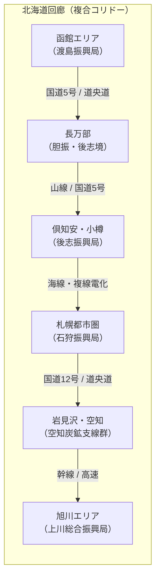

# 05. 北海道回廊パイロット設計書（函館〜小樽〜札幌〜旭川）

- 作成日: 2026-10-30
- 原点ドキュメント: [構想.md](../構想.md)（「日本：北海道→南へ」「探索の開始」「繋がり重視」）
- 位置づけ: 全国・世界展開に先立ち、象徴的な複合交通回廊（鉄道・高速道路・一般国道・旧線変遷）を1本縦に通す「垂直スライス検証」の設計書。ナレッジグラフ（実体・物理エッジ・意味関係エッジ）が机上探索ツール上でどのように立ち現れるかを実証するための開発・データ調達仕様を規定する。

---

## 1. パイロットの目的と検証目標

### 1.1 目的
全国のデータを一括で集めようとしてスタックした反省を踏まえ、**「函館〜小樽〜札幌〜旭川」の大動脈回廊にスコープを絞り、起点から終点まで立体的な文脈（ナレッジグラフ）が繋がった探索体験を先行して完成させる**。

### 1.2 達成すべき検証目標
1. **交通トポロジーの確立**: 函館本線（本線・支線・旧線）、道央自動車道、国道5号・12号の駅順・IC順・キロ程が途切れなく繋がること。
2. **地域間・交通地域間の繋がり（ポリゴン非保持の克服）**:
   - 沿線自治体同士の **`隣接`** 関係が登録され、探索ツール上で「隣町へ進む」ことができること。
   - 路線と自治体の **`通過`** 関係により、路線を辿るだけで通過自治体が自動連動すること。
   - 各駅・ICの **`所在`** 自治体が100%結びついていること。
3. **時間軸（変遷）の表現**:
   - 改称駅（渡島大野 ➔ 新函館北斗）、廃駅（流山温泉、本石倉、姫川など）、廃止支線（歌志内線、上砂川支線、幌内線など）が `relations.csv` の `前身` / `後継` / `改称` で現行ネットワークに正しく接続されていること。
4. **探索体験の成立**:
   - 探索ツール（`web/explorer`）で駅をクリックした瞬間、**「前後の駅」「乗換路線」「所在自治体」「管轄気象台」「歴史的旧線」が芋づる式にダッシュボード展開されること**。

---

## 2. 対象範囲と構成インフラの定義



### 2.1 対象交通インフラ一覧

| 分野 | 路線名称 | 区間 | 主たる役割・検証ポイント |
| :--- | :--- | :--- | :--- |
| **鉄道（幹線）** | **JR函館本線（本線）** | 函館 〜 長万部 〜 小樽 〜 札幌 〜 旭川 (423.1km) | 北海道の大動脈。非電化山線、複線電化都市圏、高規格電化幹線の3態を含む |
| **鉄道（別線）** | **函館本線（藤城線）** | 七飯 〜 大沼 (下り専用別線 15.4km) | 本線と並行する勾配緩和バイパス別線のトポロジー表現 |
| **鉄道（支線・廃線）** | **炭鉱支線群 ＆ 廃駅** | 砂川〜上砂川、砂川〜歌志内、岩見沢〜幌内、美唄〜南美唄 | 空知地方の近代産業遺産・廃線跡・廃駅の変遷リレーション |
| **高速道路** | **道央自動車道** | 七飯藤城IC 〜 大沼公園IC 〜 札幌JCT 〜 旭川鷹栖IC 〜 名寄IC (430.6km) | 函館本線に並行する高速大動脈。SA/PA・スマートIC・本線料金所・高速BS網羅（全70施設・69区間エッジ検証済、[詳細レポート](audit_report_douo_expressway_20261031.md) 参照） |
| **一般国道** | **国道5号** | 函館市 〜 札幌市 (中央区) | 函館〜札幌を結ぶ歴史的幹線道路（道の駅・峠越え） |
| **一般国道** | **国道12号** | 札幌市 〜 旭川市 | 日本最長直線道路（美唄〜滝川 29.2km）を含む幹線国道 |

### 2.2 通過する主要自治体（約30市町村）
- **渡島総合振興局**: 函館市、北斗市、七飯町、森町、八雲町、長万部町
- **後志総合振興局**: 黒松内町、蘭越町、ニセコ町、倶知安町、共和町、仁木町、余市町、小樽市
- **石狩振興局**: 札幌市（手稲区、西区、北区、中央区、東区、白石区、厚別区）、江別市
- **空知総合振興局**: 南幌町、岩見沢市、美唄市、奈井江町、砂川市、歌志内市、上砂川町、滝川市、深川市、妹背牛町、秩父別町
- **上川総合振興局**: 旭川市

---

## 3. ナレッジグラフ・データモデリング設計

### 3.1 登録・調達する実体ノード（Entities）

```text
[実体テーブル]
├── municipalities.csv    : 回廊沿線の上記30自治体（代表点Point、公的コード、親自治体ID）
├── weather_zones.csv     : 石狩地方、空知地方、上川地方、後志地方、渡島地方の府県・細分区域
├── transport_routes.csv  : 函館本線、藤城線、上砂川支線、道央自動車道、国道5号、国道12号
└── nodes.csv             : 
    ├── 鉄道駅 (現存)     : 函館駅 〜 旭川駅の全駅（約90駅）
    ├── 鉄道駅 (廃駅・旧駅): 流山温泉駅、池田園駅、東山駅、姫川駅、張碓駅、炭鉱支線廃駅
    ├── 高速道路施設      : 道央道 全70施設（IC/JCT/SIC 44件、SA/PA/展望所 19件、高速BS 7件：供用中63件、計画中5件、廃止2件）
    ├── 道の駅・主要交差点: 国道5号・12号の結節点（道の駅なないろ・ななえ、道の駅ライスランド深川等）
    └── アメダス観測点    : 函館、森、八雲、長万部、倶知安、小樽、札幌、岩見沢、滝川、旭川等
```

### 3.2 物理エッジ（`edges.csv`）の定義

| 路線ID | 起点ノード ➔ 終点ノード | 順序 | 距離_km | 状態 | 備考 |
| :--- | :--- | :---: | :---: | :---: | :--- |
| `JP-RT-HAKODATE` | 函館駅 ➔ 五稜郭駅 | 1 | 3.4 | 現行 | 複線・交流電化区間 |
| `JP-RT-HAKODATE` | 五稜郭駅 ➔ 桔梗駅 | 2 | 4.9 | 現行 | 複線区間 |
| ... | ... | ... | ... | ... | ... |
| `JP-RT-HAKODATE` | 七飯駅 ➔ （藤城線経由） ➔ 大沼駅 | (別) | 15.4 | 現行 | 下り専用バイパスエッジ |
| ... | ... | ... | ... | ... | ... |
| `JP-RT-KAMISUNAGAWA`| 砂川駅 ➔ 上砂川駅 | 1 | 7.3 | 廃止 | 1994年廃止支線エッジ |

### 3.3 意味関係エッジ（`relations.csv`）の定義

#### ① 自治体間の「隣接」リレーション（ポリゴンなしでの隣町展開）
- `(函館市) --[隣接]--> (北斗市)`
- `(函館市) --[隣接]--> (七飯町)`
- `(北斗市) --[隣接]--> (木古内町)`
- `(七飯町) --[隣接]--> (森町)`
- `(森町) --[隣接]--> (八雲町)`
- `(八雲町) --[隣接]--> (長万部町)`
- `(長万部町) --[隣接]--> (黒松内町)`
- ...（旭川市まで一連の隣接トポロジーを構築）

#### ② 路線と地域の「通過」リレーション
- `(函館本線) --[通過]--> (函館市)`
- `(函館本線) --[通過]--> (北斗市)`
- `(函館本線) --[通過]--> (七飯町)`
- ...（通過順序を `context_id` や順序番号で管理）

#### ③ 結節点の「乗換」リレーション
- `(函館駅) --[乗換]--> (道南いさりび鉄道 函館駅)`
- `(新函館北斗駅) --[乗換]--> (北海道新幹線 新函館北斗駅)`
- `(長万部駅) --[乗換]--> (室蘭本線 長万部駅)`
- `(小樽駅) --[乗換]--> (函館本線小樽都市圏区間)`
- `(札幌駅) --[乗換]--> (千歳線・学園都市線・札幌市営地下鉄さっぽろ駅)`
- `(深川駅) --[乗換]--> (留萌本線 深川駅)`
- `(旭川駅) --[乗換]--> (宗谷本線・石北本線・富良野線 旭川駅)`

#### ④ 時間軸の「前身・後継・改称」リレーション
- `(新函館北斗駅) --[改称]--> (旧・渡島大野駅)` [移行日: 2016-03-26]
- `(函館本線旧ルート) --[前身]--> (現・小沼跨線バイパス)`
- `(砂川駅) --[分岐・後継]--> (上砂川支線・歌志内線)` [廃止日記録]

---

## 4. 探索シナリオと画面連動の検証要件

探索ツール（`web/explorer`）において、以下の3つの旅のシーンを再現し、ナレッジグラフが正しく連動するかを検証する。

### シーン1：大沼・駒ヶ岳越えの旅（函館 ➔ 森）
- **操作**: 探索ツール上で「函館駅」から「七飯駅」へ進む。
- **画面連動要件**:
  - 七飯駅で「本線（峠越え）」と「藤城線（下りバイパス）」の分岐が明示されること。
  - 新函館北斗駅を開いた際、「旧駅名: 渡島大野駅」「北海道新幹線乗換」が表示されること。
  - 大沼駅周辺で、廃止された「流山温泉駅」「東山駅」の遺構ノードが歴史レイヤーとして選択できること。
  - 森町に入った瞬間、管轄気象区が「渡島北部」へ切り替わり、アメダス森の実況データリンクが立ち現れること。

### シーン2：山線越えと羊蹄山の旅（長万部 ➔ 小樽）
- **操作**: 「長万部駅」からニセコ・倶知安・小樽へ進む。
- **画面連動要件**:
  - 長万部駅で室蘭本線との結節・乗換が示されること。
  - 倶知安駅で、所在自治体「倶知安町」の隣接自治体（ニセコ町・京極町等）が展開されること。
  - 国道5号との並行・交差状況が把握できること。

### シーン3：空知炭鉱支線と直線道路の旅（札幌 ➔ 旭川）
- **操作**: 「札幌駅」から「岩見沢」「砂川」「滝川」を経て「旭川駅」へ進む。
- **画面連動要件**:
  - 砂川駅で、かつて分岐していた「上砂川支線」「歌志内線」の廃線エッジと前身関係が表示されること。
  - 並行する国道12号（日本最長直線道路）の解説・道の駅が連動すること。
  - 旭川駅に到着した瞬間、道北・道東へ分岐する4大幹線（宗谷・石北・富良野・函館）のハブ結節が可視化されること。

---

## 5. データ調達元と構築手順（ロードマップ）

### 5.1 調達ソースの分担
1. **空間アンカー（ノード座標・自治体代表点）**:
   - 国土交通省 国土数値情報（鉄道N02・役場P05・道路N06）
2. **駅順・キロ程・区間接続（物理エッジ）**:
   - Wikipedia路線記事「函館本線」「道央自動車道」「国道5号」「国道12号」の駅一覧・施設一覧テーブル
3. **自治体隣接・通過関係（意味関係エッジ）**:
   - 自治体の公的境界データ（空間判定）またはWikipedia「隣接する自治体」記事
4. **変遷・廃駅（歴史リレーション）**:
   - Wikipedia「函館本線」「上砂川支線」の沿革・廃止駅節

### 5.2 構築・検証フェーズ
- **フェーズ1（骨格抽出）**: 回廊沿線の30自治体・約100ノードを抽出し、IDと座標の完全性を確認。
- **フェーズ2（物理エッジ接続）**: 函館〜旭川の駅間エッジ（`edges.csv`）を順序・距離付きで1本通す。
- **フェーズ3（関係エッジ付与）**: `relations.csv` に沿線自治体の「隣接」「通過」「乗換」「変遷」を登録。
- **フェーズ4（探索ツール結合テスト）**: `web/explorer` で函館〜旭川のツアーを実行し、コンピテンシークエスチョン Q1〜Q8 が画面上で正しく答えられるかを実機検証。
