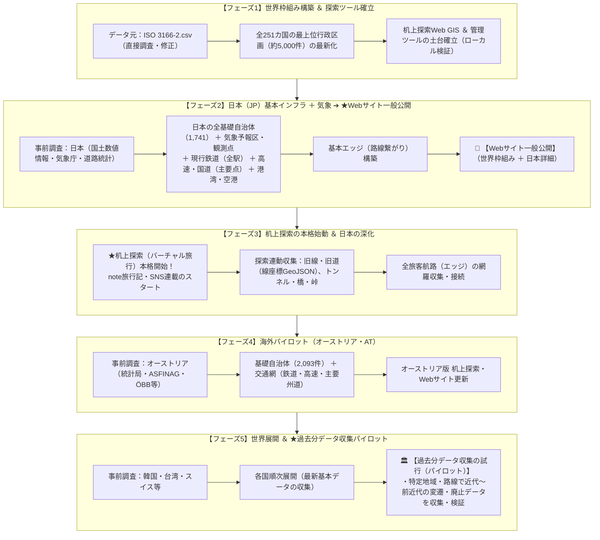
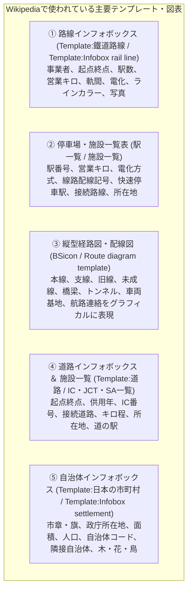

# 仕様再検討：確定事項と次期引継ぎドキュメント

- 作成日: 2026-10-20
- 目的: 本スレッドで再検討・合意した「新基本方針」「データ収集ロードマップ」を整理し、次スレッドで行う「コンテンツ要件の検討」「Wikipediaテンプレートの調査」「新テーブル設計（スキーマ）の確定」へスムーズに引き継ぐための記録。

---

## 1. 本スレッドでの確定事項サマリ

### 1.1 即時対応（完了済み）
- **自治体ID列名の正式統一**:
  - 正本CSV（`municipalities.csv`, `transport_nodes.csv`）、全スクリプト、管理ツール、Webフロントエンド、仕様書において、仮名 `municipality_id_tmp` から正式名 **`municipality_id`** への完全移行を完了。

---

### 1.2 新基本方針（基本設計・思想）

| 項目 | 確定した仕様・ルール |
| :--- | :--- |
| **① 歴史・変遷（時間軸）** | **日単位（YYYY-MM-DD）管理を原則**とする。 ・年のみ判明 ➔ **その年の大晦日（12月31日）**を格納（例: `1890-12-31`）。 ・年月のみ判明 ➔ **その月の末日**を格納（例: `1890-04-30`）。 ・各テーブルに `開始日_精度`, `終了日_精度`（`日`, `月`, `年`, `推定`, `世紀`）を持たせる。 ・Webサイトやタイムラインでは年単位等の粗い粒度で操作可能とする。 |
| **② 変遷の繋がり（前身・後継）** | 自治体の合併（新設・編入・分立）や路線の改称、駅の移転・改称など、複数対複数の変遷を保持する**専用の変遷テーブル（`historical_transitions.csv`）を新設**する。 |
| **③ 線の表現 & グラフ構造** | 「点と駅順」から**「ノード（点）」と「エッジ（区間）」のグラフ構造へ刷新**する。 ・エッジ自身に「起点ノードID」「終点ノードID」「開始日」「終了日」「状態」、そして**「ライン座標（GeoJSON）」**を持たせる。 ・現状は探索箇所（旧線・旧道・手動記録）から順次線座標を蓄積し、最終的に全区間のライン保持（案C）を目指す。 |
| **④ データ管理 & DB移行** | 初期は費用0円のCSV（Git管理）で進め、件数増加時はローカルDB（SQLite）へ自然移行。 データ構造を「ノードとエッジ」にしておくことで、将来的に予算や体制が整った段階で**Neo4j等の本格グラフDBへスクリプト1つでそのまま移行可能**とする。 |
| **⑤ 収集対象範囲の復権** | ・**インフラ構造物（トンネル・橋・峠）**: ノード（交通拠点）の種別として最初からスキーマ定義（収集は後工程）。 ・**自然地名（山・河川・海峡等）**: 探索時の記録（手動追加）を基本とする。 ・**気象・気候（予報区・気象観測点等）**: 地域・ノード枠に最初から組み込み、**日本分を早期先行収集**。 ・**旅客航路**: すべて対象。港湾（点）先行、航路（エッジ）は後工程。 |
| **⑥ 品質の担保方式** | 当初は「事前調査シートとの数量チェック＋基本エラー検知」に留めて軽快に進め、最終段階で公的基準との厳密な突合へ移行する。 |
| **⑦ 探索の早期開始** | 日本の基本データが揃った段階で即座に机上探索（note旅行記・SNS発信）を開始し、探索しながら旧道・旧線・史跡等を肉付けするサイクルを回す。 |

---

### 1.3 改訂版：データ収集ロードマップ（全5フェーズ）

- **修正点**:
  - フェーズ1では事前調査は行わず、`ISO 3166-2.csv` を元に直接調査・修正して作成。
  - Webサイトの一般公開は**フェーズ2完了時**（日本詳細が完成した段階）に実施。
  - 過去分データの収集試行（パイロット）は**フェーズ5**で実施。

---

## 2. 次スレッドで検討・実施すること（引継ぎ事項）

次スレッドでは、**「①データベースを使って展開したいコンテンツ」** と **「②Wikipediaの表・図テンプレートの活用」** を突き合わせ、それらを過不足なく実現できる **「③新テーブル設計（スキーマ）の最終確定」** を行います。

### 2.1 検討テーマ1：展開したいコンテンツの要件定義
- **ナレッジパネル（詳細情報表示）**:
  - Wikipedia風のインフォボックス、駅・施設一覧表、縦型路線図（配線図）をDBから自動生成。
- **変遷タイムライン**:
  - 年代スライダーを操作した際に、旧線・旧道・旧自治体が動的に出現・消滅する表示。
- **机上探索（バーチャル旅行記）**:
  - ルート沿いの写真・メモ・史跡・難所の記録とnote・SNS埋め込み。
- **ゲーム・クイズ・Geoguessr**:
  - 駅順並び替え、路線当て、旧自治体当て、交通拠点限定マップ等。

---

### 2.2 検討テーマ2：Wikipediaの表・図テンプレートの活用検討材料

本プロジェクトのデータベースから自動生成・再現できる可能性のある、Wikipediaの代表的なテンプレート・表現形式です。

1. **BSicon（経路図・配線図テンプレート）**:
   - 路線図をアイコン（直線、カーブ、分岐、トンネル、橋梁、交差）の組み合わせで縦方向に描くWikipedia標準の仕組み。
   - **DBとの親和性**: 「ノード（駅・トンネル・橋）」と「エッジ（区間・旧線・支線）」のデータから、HTML/SVGで自動組み立てが可能。
2. **駅一覧表テンプレート**:
   - 快速・特急の停車駅パターン（●、▲、｜）や線路配線（`||` 複線、`◇` 交換可能、`|` 交換不可）。
   - **DBとの親和性**: エッジ属性（線路数、電化）や停車駅属性を保持することで完全自動生成が可能。
3. **道路（高速・国道）施設一覧表**:
   - IC、JCT、SA、PA、道の駅、主要交差点、トンネルの連続表。
   - **DBとの親和性**: 道路エッジとノードから同様のフォーマットで出力可能。

---

### 2.3 検討テーマ3：新テーブル設計（スキーマ）の最終確定
コンテンツおよびWikipediaテンプレートの出力要件を満たすよう、以下のテーブル設計を最終確定します。

1. **`nodes.csv`（ノードマスタ）**: 駅、IC、空港、港湾、トンネル、橋、峠、気象観測点等
2. **`edges.csv`（エッジマスタ）**: 区間、起点終点、キロ程、電化、線路数、ライン座標GeoJSON
3. **`transport_routes.csv`（路線マスタ）**: 路線記号、電報略号、ラインカラー、起点終点
4. **`municipalities.csv`（地域・区域マスタ）**: 自治体属性、政庁座標、開始日・終了日
5. **`weather_zones.csv`（気象予報区マスタ）**: 一次・二次細分区域、親予報区
6. **`historical_transitions.csv`（変遷履歴マスタ）**: 前身・後継ID、合併・改称種別、日付
7. **`operators.csv` / `countries.csv` / `exploration_logs.csv` / `country_progress.csv`**

---

## 3. 次のスレッド開始時の案内文（コピー用）

次スレッド開始時は、以下のメッセージを入力することでスムーズに議論を再開できます。

> **次スレッドへの投入メッセージ（例）**:
> 「前スレッドの引き継ぎドキュメント（[docs/仕様再検討_決定事項と引継ぎメモ.md](file:///c:/Users/user/Documents/PJT/docs/仕様再検討_決定事項と引継ぎメモ.md)）に基づき、
> ① 展開したいコンテンツ要件の洗い出し
> ② Wikipediaテンプレート（インフォボックス、駅一覧、BSicon縦型路線図等）の活用検討
> ③ それらを過不足なく実現する新テーブル設計（スキーマ）の最終確定
> を進めて下さい。」
