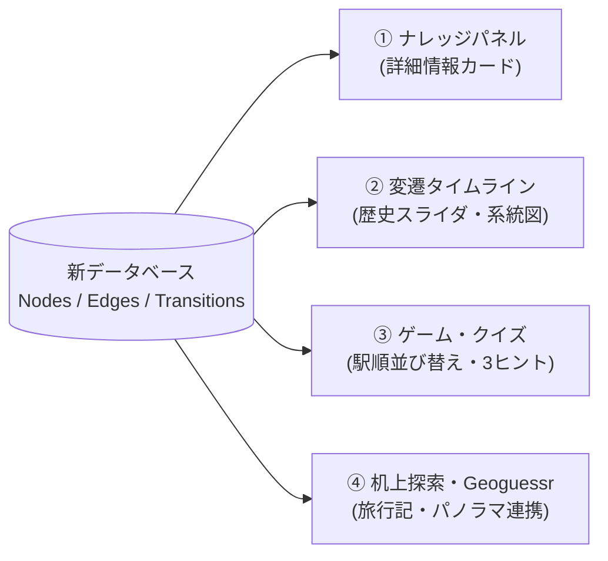
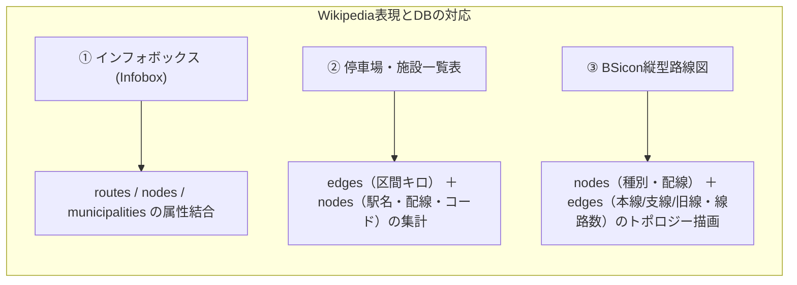
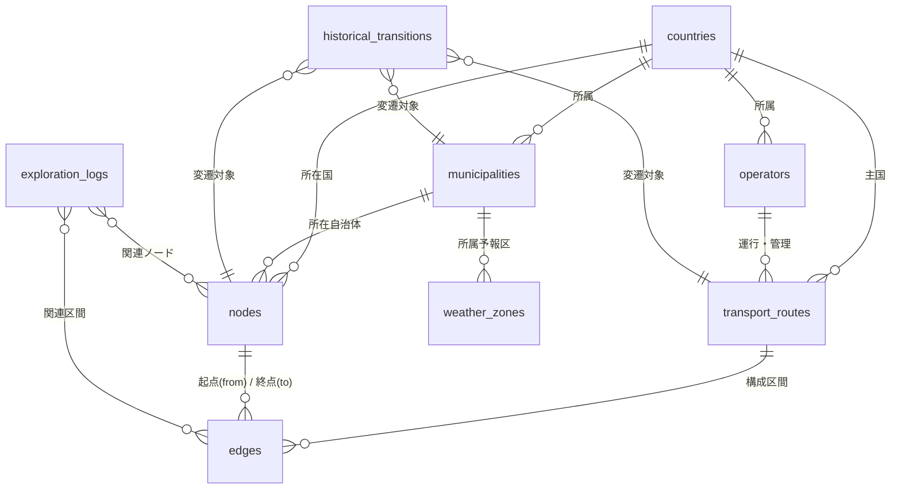

# 新テーブル設計（スキーマ）およびコンテンツ・テンプレート活用設計書

- 作成日: 2026-10-21
- 参照元: [docs/仕様再検討_決定事項と引継ぎメモ.md](仕様再検討_決定事項と引継ぎメモ.md)
- 目的: 「展開したいコンテンツ」「Wikipediaテンプレートの自動生成」に必要な要件を整理し、それらを過不足なく実現する新テーブル設計（全10テーブルのスキーマ）を確定する。

---

## 1. 展開コンテンツの要件整理

データベースに蓄積されたデータを用いて、Webフロントエンドや各種発信で展開する4大コンテンツの機能要件と必要データ項目です。

### 1.1 ナレッジパネル（詳細情報カード）
- **概要**: 地図上のピン（駅・自治体・IC・峠等）や路線名をクリックした際、Wikipediaのインフォボックスのように構造化された詳細情報を瞬時に表示する。
- **必要データ要件**:
  - **自治体**: 自治体名（日・公用語）、種別、コード、所属（都道府県/郡）、政庁座標、人口・面積、変遷履歴（前身自治体/合併先）。
  - **路線**: 路線名、路線番号/記号、事業者名、種別、起点終点、営業キロ、電化方式、軌間、全駅一覧、ラインカラー。
  - **ノード（駅・施設）**: 施設名、コード（駅番号/IATA/IC番号）、種別、所在自治体、所属路線、開業日、配線構造（単線/複線/島式ホーム等）。
  - **構造物（トンネル・橋・峠）**: 名称、よみ、延長（長さ）、開通年、通過路線、標高。

### 1.2 変遷タイムライン（歴史スライダー）
- **概要**: 画面上の年代スライダー（例: 1872年〜現在）を動かすと、その時点で存在していた自治体・路線・駅・道路のみが地図上に出現・消滅する。
- **必要データ要件**:
  - 全主要テーブルに「開始日（`開始日`・`開始日_精度`）」と「終了日（`終了日`・`終了日_精度`）」を日単位（YYYY-MM-DD）で保持。
  - 自治体や路線の合併・改称・分立の前後関係を `historical_transitions.csv` から取得し、「〇〇村 ➔ 1954年合併 ➔ △△町 ➔ 2005年編入 ➔ □□市」という変遷ツリーを表示。

### 1.3 ゲーム・クイズ
- **概要**: データベースの構造（グラフと属性）をそのまま活用した自動生成型クイズ。
  1. **駅順並び替えクイズ**: 路線内の駅がランダムにシャッフルされ、起点から終点までの正しい順序に並べ替える（`edges.csv` の順序データを使用）。
  2. **3ヒント場所当てクイズ**: ①所属路線、②隣の駅/施設、③所属自治体 から駅名・施設名を当てる。
  3. **消滅自治体クイズ**: 現在の〇〇市域に過去存在した町村名を当てる（`historical_transitions.csv` を使用）。
  4. **峠・トンネル当てクイズ**: 都道府県境や標高、通過路線から構造物名を当てる。

### 1.4 机上探索・Geoguessr連動
- **概要**: ストリートビューや写真、手動探索メモを連動させたバーチャル旅行・データ収集機能。
- **画面構成・操作要件**:
  - **地図メイン画面**: ストリートビューや情報パネルはワンクリックで「表示／非表示（折りたたみ）」可能。
  - **地図2画面分割機能**: 左右（または上下）で異なる地図タイル（標準地図と航空写真、新旧地図など）を並べて比較・探索可能。
  - **2大探索モード**:
    1. **路線ツアーモード**: 起点から終点へエッジを1区間ずつ進む旅行記向け探索。
    2. **フリー探索モード**: 路線に縛られず自由に地図上を移動・調査できる探索（中世史跡の収集などに活用）。
  - **史跡・Geoguessr振り分け機能**:
    - 路線探索の途中で中世史跡（城跡・寺社等）を発見した際、記録先として「中世史跡データ側（Geoguessr史跡用など）」を選択・登録可能。
  - **Geoguessr連携**: `https://map-making.app/` へのインポート用CSV出力に対応。探索ツール上でストリートビュー確認済フラグを付与。
- **必要データ要件**:
  - 各ノードの緯度・経度から、Googleストリートビュー公式リンク（`https://www.google.com/maps/@?api=1&map_action=pano&viewpoint=緯度,経度`）を自動生成。
  - `exploration_logs.csv` に探索ルート（GeoJSON線）、訪問写真、現地メモ、note旅行記URL、Geoguessr候補フラグを記録し、地図上に探索アーカイブとして重畳表示。

---

## 2. Wikipediaテンプレートの活用検討

Wikipediaで実績のある主要表現形式を、自作データベースからどのように自動生成・再現するかを整理しました。

### 2.1 インフォボックス（Template:Infobox rail line / 道路 / 日本の市町村）
- **再現性**: **100% 完全自動生成可能**。
- **対応関係**:
  - 路線インフォボックス: `transport_routes.csv` の属性（事業者、軌間、電化、起点終点）＋ `edges.csv` から算出した駅数・総延長。
  - 自治体インフォボックス: `municipalities.csv` の属性（コード、政庁、種別）＋ `historical_transitions.csv` の合併履歴。

### 2.2 駅一覧表・道路施設一覧表
- **再現性**: **各駅停車・基本施設ベースで完全自動生成可能**。
- **表示・操作仕様**:
  - **ソート切り替え**: 「起点 ➔ 終点（下り）」と「終点 ➔ 起点（上り）」をボタン1つで反転可能。
  - **表示モード切り替え**: 「現在のみ」「全歴史総覧（廃駅・旧線含む）」「年月日指定タイムマシン表示（指定日時点の配線・営業駅・電化を完全再現）」の3モード切り替えに対応。
- **表の各列とDBカラムの対応**:
  - **駅ナンバリング / IC番号**: `nodes.csv` の `拠点コード`
  - **駅名 / 施設名**: `nodes.csv` の `日本語名`（＋ `公用語名`、`よみ_かな`）
  - **駅間キロ**: `edges.csv` の `距離_km`
  - **累計キロ（営業キロ）**: 各エッジの `距離_km` を起点から合算
  - **接続路線**: 当該ノードIDを共有する他路線の `transport_routes.csv` から自動抽出
  - **線路配線記号** (`||`, `◇`, `|`): `nodes.csv` の `配線種別`（棒線・交換可）および `edges.csv` の `線路数`（単線/複線）から自動記号化
  - **所在地**: `nodes.csv` の `municipality_id` ➔ `municipalities.csv` の日本語名
- **優等列車停車パターン（快速●、特急｜など）の扱い方針**:
  - 優等列車等は「運転系統」扱いとし、当初の収集対象から除外。各駅停車ベースを基準とする。

### 2.3 BSicon（縦型経路図・配線図テンプレート）
- **概要**: Wikipediaで鉄道の路線図を描くために使われるアイコン組み合わせ記法（線、カーブ、分岐、駅、トンネル、橋、車両基地等）。
- **表示・操作仕様**:
  - **方向**: Wikipedia標準に合わせて **「上（起点）から下（終点）へ」** 縦にスクロールして進む形式。
  - **年月日指定タイムマシン表示**: 指定年月日時点で存在していた駅・線路（単線/複線/電化/非電化）・旧線ルートをグラフィカルに自動復元。
- **再現ロジック**:
  - `edges.csv` の接続関係（`from_node_id` ➔ `to_node_id`）と `区間種別`（本線、支線、旧線）を読み込む。
  - `nodes.csv` の `種別`（駅、信号場、トンネル、橋梁、車庫）と `配線種別`（単線、複線、交換駅）を判定。
  - これにより、HTML/SVGのパーツ（直線の線、分岐アイコン、駅丸印、トンネル記号）を上から下へ自動配置して縦型路線図を動的描画できます。

---

## 3. 新テーブル設計（全11テーブル確定スキーマ）

前スレッドでの合意（グラフ構造化、日単位変遷、変遷テーブル新設、気象・構造物復権）および上記コンテンツ要件を過不足なく満たす全テーブル定義です。

---

### 3.1 国マスタ (`countries.csv`)
- **役割**: 全世界250カ国・地域のメタデータ正本。

| 列名（物理名） | 型 | 必須 | 説明・具体例 |
| :--- | :--- | :---: | :--- |
| `country_code` | 文字列(2) | ● | ISO 3166-1 alpha-2（主キー。例: `JP`, `AT`） |
| `日本語略名` | 文字列 | ● | 日本語の慣用国名（例: `日本`, `オーストリア`） |
| `日本語正式名` | 文字列 | ● | 日本語の公的正式国名（例: `日本国`, `大日本帝国`, `ドイツ連邦共和国`） |
| `iso_3166_1_a3` | 文字列(3) | ● | 3文字コード（例: `JPN`, `AUT`） |
| `iso_3166_1_nu` | 数値(3) | ● | 3桁数字コード（例: `392`, `040`） |
| `地域_国連区分` | 文字列 |  | 国連地理区分（例: `東アジア`, `西ヨーロッパ`） |
| `公用語` | 文字列 |  | 公用語（例: `日本語`, `ドイツ語`） |
| `通貨` | 文字列 |  | 通貨コード（例: `JPY`, `EUR`） |
| `車両通行側` | 文字列 | ● | `左` または `右` |
| `人口` | 整数 |  | 最新の推計・公的統計人口 |
| `人口_調査年` | 数値(4) |  | 人口の統計基準年（例: `2020`） |
| `ccTLD` | 文字列 |  | 国別ドメイン（例: `.jp`, `.at`） |
| `国際電話番号` | 文字列 |  | 国番号（例: `+81`, `+43`） |
| `開始日` | 日付 |  | 成立日・独立日（YYYY-MM-DD）。不明時は大晦日 |
| `開始日_精度` | 文字列 |  | `日`, `月`, `年`, `世紀`, `推定` |
| `終了日` | 日付 |  | 滅亡・解体日（現存は空欄） |
| `終了日_精度` | 文字列 |  | `日`, `月`, `年`, `世紀`, `推定` |
| `状態` | 文字列 | ● | `現存`, `消滅`, `係争中` |
| `Wikipedia_ja` | URL |  | 日本語版Wikipedia記事URL |
| `Wikipedia_en` | URL |  | 英語版Wikipedia記事URL |
| `Wikipedia_local` | URL |  | 現地公用語版Wikipedia記事URL |
| `Wikidata` | 文字列 |  | WikidataエンティティID（例: `Q17`） |
| `OpenStreetMap` | 文字列 |  | OSM Relation ID |
| `GoogleMap` | URL |  | Google Maps代表URL |

---

### 3.2 地域・自治体マスタ (`municipalities.csv`)
- **役割**: 国の内部を構成する最上位行政区画（都道府県・州等）から基礎自治体（市区町村・ゲマインデ等）、および過去の旧自治体を保持。

| 列名（物理名） | 型 | 必須 | 説明・具体例 |
| :--- | :--- | :---: | :--- |
| `municipality_id` | 文字列 | ● | 主キー（例: `JP-MN-000001`） |
| `country_code` | 文字列(2) | ● | 国コード（外部キー: `countries.country_code`） |
| `区域大分類` | 文字列 | ● | `行政区画`（※気象予報区は別テーブルへ分離） |
| `自治体コード` | 文字列 |  | 公的コード（日本の総務省6桁コード、ATのGemeindecode等） |
| `iso_3166_2_code` | 文字列 |  | ISO 3166-2コード（最上位区画のみ。例: `JP-01`, `AT-9`） |
| `国際_統計コード` | 文字列 |  | NUTSコード（欧州統計区画等） |
| `日本語名` | 文字列 | ● | 日本語表記（例: `北海道`, `札幌市中央区`, `ウィーン`） |
| `公用語名` | 文字列 |  | 現地公用語表記（例: `Wien`, `Innsbruck`） |
| `よみ_かな` | 文字列 |  | 日本語の読み仮名（ソート・検索用） |
| `種別` | 文字列 | ● | `都道県`, `道庁`, `市`, `区`, `町`, `村`, `Bundesland`, `Gemeinde` 等 |
| `階層レベル` | 数値(1) | ● | `1`（最上位・都道府県/州）, `2`（中間・郡/支庁等）, `3`（基礎・市町村等） |
| `親自治体_id` | 文字列 |  | 上位区画のID（自己参照外部キー） |
| `中間行政区画` | 文字列 |  | 日本の振興局・郡、海外のBezirk等の名称 |
| `政庁_緯度` | 小数 | ● | 役所・庁舎の緯度（小数第6位） |
| `政庁_経度` | 小数 | ● | 役所・庁舎の経度（小数第6位） |
| `面積_km2` | 小数 |  | 行政面積（km²） |
| `人口` | 整数 |  | 直近の公的統計人口 |
| `人口_調査年` | 数値(4) |  | 人口の統計基準年（例: `2020`） |
| `公式サイト` | URL |  | 自治体公式ホームページURL |
| `天気予報_URL` | URL |  | 各気象機関（気象庁等）の公式天気予報URL（空欄時はコードから自動生成） |
| `開始日` | 日付 | ● | 設置日（YYYY-MM-DD）。不明時は大晦日 |
| `開始日_精度` | 文字列 | ● | `日`, `月`, `年`, `世紀`, `推定` |
| `終了日` | 日付 |  | 廃止日（合併等。現存時は空欄） |
| `終了日_精度` | 文字列 |  | `日`, `月`, `年`, `世紀`, `推定` |
| `状態` | 文字列 | ● | `現存`, `廃止` |
| `時代区分` | 文字列 | ● | `現代`, `近代`, `中世`, `古代` |
| `Wikipedia_ja` | URL |  | 日本語版Wikipedia記事URL |
| `Wikipedia_en` | URL |  | 英語版Wikipedia記事URL |
| `Wikipedia_local` | URL |  | 現地公用語版Wikipedia記事URL |
| `Wikidata` | 文字列 |  | WikidataエンティティID（例: `Q6968`） |
| `OpenStreetMap` | 文字列 |  | OSM Relation ID |
| `GoogleMap` | URL |  | Google Maps代表URL |

---

### 3.3 気象予報区マスタ (`weather_zones.csv`) ★新設
- **役割**: 自治体とは境界が異なる「気象予報区（一次細分区域・二次細分区域・府県予報区等）」を専用管理。日本の先行収集対象。

| 列名（物理名） | 型 | 必須 | 説明・具体例 |
| :--- | :--- | :---: | :--- |
| `zone_id` | 文字列 | ● | 主キー（例: `JP-WZ-000001`） |
| `country_code` | 文字列(2) | ● | 国コード（`JP` 等） |
| `予報区コード` | 文字列 | ● | 気象庁予報区コード（例: `011000`） |
| `予報区名` | 文字列 | ● | 予報区名称（例: `石狩・空知・後志地方`, `石狩北部`） |
| `予報区種別` | 文字列 | ● | `地方予報区`, `府県予報区`, `一次細分区域`, `二次細分区域` |
| `親予報区_id` | 文字列 |  | 上位予報区ID（自己参照外部キー） |
| `担当気象台` | 文字列 |  | 管轄する気象台（例: `札幌管区気象台`） |
| `代表_緯度` | 小数 |  | 代表点・気象台緯度 |
| `代表_経度` | 小数 |  | 代表点・気象台経度 |
| `関連自治体_ids` | 文字列 |  | 当該予報区に含まれる `municipality_id` のカンマ区切り一覧 |
| `状態` | 文字列 | ● | `現行`, `廃止` |

---

### 3.4 事業者・管理者マスタ (`operators.csv`)
- **役割**: 鉄道事業者、道路管理者（国交省、NEXCO、自治体等）、航空会社、海運会社。

| 列名（物理名） | 型 | 必須 | 説明・具体例 |
| :--- | :--- | :---: | :--- |
| `operator_id` | 文字列 | ● | 主キー（例: `JP-OP-000001`） |
| `country_code` | 文字列(2) | ● | 本社所在国コード |
| `日本語名` | 文字列 | ● | 日本語事業者名（例: `東日本旅客鉄道`, `東日本高速道路`） |
| `公用語名` | 文字列 |  | 現地公用語名（例: `ÖBB-Personenverkehr AG`） |
| `略称` | 文字列 |  | 略称（例: `JR東日本`, `NEXCO東日本`, `ÖBB`） |
| `種別` | 文字列 | ● | `鉄道`, `道路管理者`, `航空`, `海運`, `索道`, `バス` |
| `開始日` | 日付 |  | 設立日・事業開始日 |
| `開始日_精度` | 文字列 |  | `日`, `月`, `年`, `世紀`, `推定` |
| `終了日` | 日付 |  | 解散日・民営化日 |
| `終了日_精度` | 文字列 |  | `日`, `月`, `年`, `世紀`, `推定` |
| `状態` | 文字列 | ● | `現存`, `廃止`, `再編` |
| `Wikipedia_ja` | URL |  | 日本語版Wikipedia記事URL |
| `Wikipedia_en` | URL |  | 英語版Wikipedia記事URL |
| `Wikipedia_local` | URL |  | 現地公用語版Wikipedia記事URL |
| `Wikidata` | 文字列 |  | WikidataエンティティID |

---

### 3.5 交通路線マスタ (`transport_routes.csv`)
- **役割**: 鉄軌道路線、高速道路・主要国道、主要旅客航路などの路線全体メタデータ。

| 列名（物理名） | 型 | 必須 | 説明・具体例 |
| :--- | :--- | :---: | :--- |
| `route_id` | 文字列 | ● | 主キー（例: `JP-RT-000001`） |
| `country_code` | 文字列(2) | ● | 主たる所属国コード |
| `通過国コード` | 文字列 |  | 国際路線の通過国（例: `AT,DE`） |
| `路線番号_記号` | 文字列 |  | 公式記号・番号（例: `JY`, `E1`, `1`, `A1`） |
| `日本語名` | 文字列 | ● | 日本語路線名（例: `山手線`, `東名高速道路`, `国道1号`） |
| `公用語名` | 文字列 |  | 現地正式名（例: `West Autobahn`） |
| `別称_愛称` | 文字列 |  | 愛称（例: `宇都宮線`, `ロマンチック街道`） |
| `種別` | 文字列 | ● | `新幹線`, `JR在来線`, `私鉄`, `地下鉄`, `高速道路`, `一般国道`, `航路` 等 |
| `operator_id` | 文字列 | ● | 運行事業者/管理者ID（外部キー: `operators.operator_id`） |
| `上位_国際路線_ids` | 文字列 |  | 系統・上位路線ID（例: アジアハイウェイ、欧州自動車道路等） |
| `ラインカラー` | 文字列(7) |  | HEXカラーコード（例: `#80C241`, `#007AC9`） |
| `ライン記号` | 文字列 |  | 路線シンボル文字（例: `JY`, `M`） |
| `起点ノード_id` | 文字列 |  | 正式な起点ノードID（外部キー: `nodes.node_id`） |
| `終点ノード_id` | 文字列 |  | 正式な終点ノードID（外部キー: `nodes.node_id`） |
| `営業キロ` | 小数 |  | 公式営業キロ・実延長（km） |
| `軌間` | 文字列 |  | 鉄道の線路幅（例: `1067mm`, `1435mm`） |
| `電化方式` | 文字列 |  | 路線全体の代表電化方式（例: `直流1500V`, `交流20kV 50Hz`, `非電化`） |
| `開始日` | 日付 | ● | 開業日・供用日（YYYY-MM-DD）。不明時は大晦日 |
| `開始日_精度` | 文字列 | ● | `日`, `月`, `年`, `世紀`, `推定` |
| `終了日` | 日付 |  | 廃止日（現存時は空欄） |
| `終了日_精度` | 文字列 |  | `日`, `月`, `年`, `世紀`, `推定` |
| `状態` | 文字列 | ● | `現用`, `廃止`, `休止`, `計画`, `未成` |
| `時代区分` | 文字列 | ● | `現代`, `近代`, `中世`, `古代` |
| `Wikipedia_ja` | URL |  | 日本語版Wikipedia記事URL |
| `Wikipedia_en` | URL |  | 英語版Wikipedia記事URL |
| `Wikipedia_local` | URL |  | 現地公用語版Wikipedia記事URL |
| `Wikidata` | 文字列 |  | WikidataエンティティID |
| `OpenStreetMap` | 文字列 |  | OSM Relation ID |
| `GoogleMap` | URL |  | Google Maps代表URL |

---

### 3.6 ノードマスタ (`nodes.csv`) ★旧 `transport_nodes.csv` から汎用拡張
- **役割**: 駅、電停、IC、JCT、SA、PA、道の駅、空港、港湾に加え、**トンネル、橋梁、峠、気象観測点（アメダス）** などの「点」データを一元管理。

| 列名（物理名） | 型 | 必須 | 説明・具体例 |
| :--- | :--- | :---: | :--- |
| `node_id` | 文字列 | ● | 主キー（例: `JP-ND-000001`） |
| `country_code` | 文字列(2) | ● | 所属国コード |
| `拠点コード` | 文字列 |  | 公式コード（駅ナンバリング `JY17`, IATA `HND`, IC番号 `1` 等） |
| `日本語名` | 文字列 | ● | 日本語施設名（例: `東京駅`, `海老名SA`, `笹子トンネル`, `碓氷峠`） |
| `公用語名` | 文字列 |  | 現地公用語名（例: `Wien Hauptbahnhof`） |
| `よみ_かな` | 文字列 |  | 日本語の読み仮名（ソート・検索・クイズ用） |
| `種別` | 文字列 | ● | `駅`, `IC`, `JCT`, `SA`, `PA`, `道の駅`, `交差点`, `境界点`, `空港`, `港湾`, `信号場`, `トンネル`, `橋梁`, `峠`, `気象観測点` |
| `細品種別` | 文字列 |  | `地上駅`, `地下駅`, `新幹線駅`, `スマートIC`, `定期空港`, `アメダス` 等 |
| `municipality_id` | 文字列 | ● | 所在自治体ID（境界を跨ぐ峠・トンネル等はカンマ区切りで複数ID可。例: `JP-MN-00010,JP-MN-00020`） |
| `緯度` | 小数 | ● | 緯度（小数第6位） |
| `経度` | 小数 | ● | 経度（小数第6位） |
| `標高_m` | 小数 |  | 標高（m。特に峠・山間駅・観測点で重要） |
| `延長_m` | 小数 |  | 構造物の長さ（m。トンネル・橋梁のみ） |
| `配線種別` | 文字列 |  | 駅配線・構造（`単線棒線`, `単線交換可`, `複線相対式`, `島式`, `高架`, `地下`）※BSicon・駅一覧用 |
| `開始日` | 日付 | ● | 開業日・供用日（YYYY-MM-DD）。不明時は大晦日 |
| `開始日_精度` | 文字列 | ● | `日`, `月`, `年`, `世紀`, `推定` |
| `終了日` | 日付 |  | 廃止日（現存時は空欄） |
| `終了日_精度` | 文字列 |  | `日`, `月`, `年`, `世紀`, `推定` |
| `状態` | 文字列 | ● | `現用`, `廃止`, `休止`, `建設中`, `計画` |
| `時代区分` | 文字列 | ● | `現代`, `近代`, `中世`, `古代` |
| `Wikipedia_ja` | URL |  | 日本語版Wikipedia記事URL |
| `Wikipedia_en` | URL |  | 英語版Wikipedia記事URL |
| `Wikipedia_local` | URL |  | 現地公用語版Wikipedia記事URL |
| `Wikidata` | 文字列 |  | WikidataエンティティID |
| `OpenStreetMap` | 文字列 |  | OSM Node ID |
| `GoogleMap` | URL |  | Google Maps代表URL（ストリートビュー生成兼用） |
| `観測データ_URL` | URL |  | 気象観測点（アメダス等）の公式実況データページURL（空欄時はコードから自動生成） |

---

### 3.7 エッジマスタ (`edges.csv`) ★旧 `route_nodes.csv` からグラフ構造へ刷新
- **役割**: 2つのノード間の「区間・繋がり」。本線・支線・旧線・未成線のトポロジーと幾何ライン（GeoJSON）を保持する心臓部テーブル。

| 列名（物理名） | 型 | 必須 | 説明・具体例 |
| :--- | :--- | :---: | :--- |
| `edge_id` | 文字列 | ● | 主キー（例: `JP-ED-000001`） |
| `route_id` | 文字列 | ● | 所属路線ID（外部キー: `transport_routes.route_id`） |
| `区間順序` | 整数 | ● | 路線内の基本並び順（1, 2, 3...。並び替えクイズ・一覧用） |
| `from_node_id` | 文字列 | ● | 起点側ノードID（外部キー: `nodes.node_id`） |
| `to_node_id` | 文字列 | ● | 終点側ノードID（外部キー: `nodes.node_id`） |
| `from_路線内番号` | 文字列 |  | 当該路線における起点側ノードの駅番号・IC番号（例: 東京駅の山手線は `JY17`, 中央線は `JC01`） |
| `to_路線内番号` | 文字列 |  | 当該路線における終点側ノードの駅番号・IC番号 |
| `中間構造物_node_ids` | 文字列 |  | 区間内にあるトンネル・橋梁・峠のノードID一覧（カンマ区切り・起点から順。駅間エッジを壊さず後から挿入可能） |
| `区間種別` | 文字列 | ● | `本線`, `支線`, `短絡線`, `連絡線`, `旧線`, `未成線`, `別線` |
| `距離_km` | 小数 | ● | 駅間営業キロ・区間距離（km） |
| `線路数` | 文字列 | ● | `単線`, `複線`, `複々線`, `3線` （道路は `2車線`, `4車線`, `6車線` 等） |
| `電化方式` | 文字列 | ● | `非電化`, `直流1500V`, `交流20kV 50Hz`, `交流20kV 60Hz` 等 |
| `ライン座標_geojson` | 文字列 |  | 区間の走行軌跡（GeoJSON LineString形式。探索時に順次格納） |
| `開始日` | 日付 | ● | 供用開始日（YYYY-MM-DD）。不明時は大晦日 |
| `開始日_精度` | 文字列 | ● | `日`, `月`, `年`, `世紀`, `推定` |
| `終了日` | 日付 |  | 廃止日（旧線廃止時など。現存時は空欄） |
| `終了日_精度` | 文字列 |  | `日`, `月`, `年`, `世紀`, `推定` |
| `状態` | 文字列 | ● | `現用`, `廃止`, `休止`, `建設中`, `計画` |

---

### 3.8 変遷履歴マスタ (`historical_transitions.csv`) ★新設
- **役割**: 自治体の合併（新設合併・編入合併・分立）、路線の改名・移管、駅の改称・移転・統合など、**複数対複数の歴史的繋がり（前身・後継関係）** をすべて一元管理する。

| 列名（物理名） | 型 | 必須 | 説明・具体例 |
| :--- | :--- | :---: | :--- |
| `transition_id` | 文字列 | ● | 主キー（例: `JP-TR-000001`） |
| `対象カテゴリ` | 文字列 | ● | `自治体`, `路線`, `ノード`, `エッジ`, `事業者` |
| `前身_ids` | 文字列 | ● | 変更前のエンティティID（複数時はカンマ区切り。例: 3村合併なら3つのID） |
| `後継_ids` | 文字列 | ● | 変更後のエンティティID（複数時はカンマ区切り。新設市や分割先） |
| `変遷種別` | 文字列 | ● | `新設合併`, `編入合併`, `分立`, `改称`, `移転`, `事業者移管`, `電化`, `複線化`, `廃止` |
| `移行日` | 日付 | ● | 効力発生日（YYYY-MM-DD）。不明時は大晦日 |
| `移行日_精度` | 文字列 | ● | `日`, `月`, `年`, `世紀`, `推定` |
| `事由_詳細` | 文字列 |  | 変遷の詳細説明（例: `昭和の大合併に伴い3村が対等合併して新設`, `新幹線開業に伴いJRから第三セクターへ移管`） |
| `出典_根拠` | 文字列 |  | 官報、自治体史、公的告示等の出典記録 |

---

### 3.9 机上探索ログマスタ (`exploration_logs.csv`)
- **役割**: バーチャル探索（机上旅行）の記録、写真、メモ、note・SNS発信アーカイブ。

| 列名（物理名） | 型 | 必須 | 説明・具体例 |
| :--- | :--- | :---: | :--- |
| `log_id` | 文字列 | ● | 主キー（例: `LOG-20261021-01`） |
| `探索日` | 日付 | ● | 探索実施日（YYYY-MM-DD） |
| `タイトル` | 文字列 | ● | 旅行記タイトル（例: `旧国鉄手宮線跡をたどる旅`） |
| `記録種別` | 文字列 | ● | `鉄道探索`, `古道・街道探索`, `峠・トンネル探訪`, `境界探訪` |
| `対象路線_ids` | 文字列 |  | 関連路線ID（カンマ区切り） |
| `対象ノード_ids` | 文字列 |  | 訪問・言及した駅・IC・峠等のノードID（カンマ区切り） |
| `対象自治体_ids` | 文字列 |  | 通過した自治体ID（カンマ区切り） |
| `緯度` | 小数 |  | 代表地点の緯度 |
| `経度` | 小数 |  | 代表地点の経度 |
| `ルート座標` | 文字列 |  | 探索ルートのGeoJSON座標列（任意） |
| `タグ` | 文字列 |  | カンマ区切りタグ（例: `廃線跡,明治遺構,北海道`） |
| `本文` | 文字列 | ● | 探索メモ・みどころ・旅行記ドラフト |
| `Webリンク` | URL |  | note記事URL、XポストURL等 |
| `公開ステータス` | 文字列 | ● | `下書き`, `公開済`, `非公開` |

---

### 3.10 国別進捗管理マスタ (`country_progress.csv`)
- **役割**: 全250カ国のデータ収集・整備ステータス管理。

| 列名（物理名） | 型 | 必須 | 説明・具体例 |
| :--- | :--- | :---: | :--- |
| `country_code` | 文字列(2) | ● | ISO 3166-1 alpha-2（主キー） |
| `国名` | 文字列 | ● | 日本語国名 |
| `段階区分` | 文字列 | ● | `フェーズ1（世界枠組み）`, `フェーズ2（日本詳細）`, `フェーズ3（日本深化）`, `フェーズ4（ATパイロット）`, `フェーズ5（世界展開）` |
| `収集方針_自治体` | 文字列 |  | 自治体データの取得ソース・基準 |
| `収集方針_交通網` | 文字列 |  | 交通網データの取得ソース・基準 |
| `ステータス` | 文字列 | ● | `未着手`, `枠組み完了`, `詳細収集完了`, `エッジ構築完了`, `公開可能` |
| `更新日` | 日付 | ● | 最終更新日（YYYY-MM-DD） |
| `備考` | 文字列 |  | 進捗に関する特記事項 |

---

### 3.11 都市間提携マスタ (`city_partnerships.csv`) ★新設
- **役割**: 自治体同士の姉妹都市・友好都市・提携都市・防災協定等の繋がりを保持（※収集は各国データが揃った後工程）。

| 列名（物理名） | 型 | 必須 | 説明・具体例 |
| :--- | :--- | :---: | :--- |
| `partnership_id` | 文字列 | ● | 主キー（例: `PRT-000001`） |
| `municipality_id_1` | 文字列 | ● | 一方の自治体ID（例: `JP-MN-000002` 札幌市） |
| `municipality_id_2` | 文字列 | ● | もう一方の自治体ID（例: `DE-MN-000120` ミュンヘン市） |
| `相手先_名称_自由記述` | 文字列 |  | 相手都市がDB未登録の場合の一時表記（例: `ポートランド市（アメリカ）`） |
| `提携種別` | 文字列 | ● | `姉妹都市`, `友好都市`, `観光提携`, `ツインシティ`, `防災協定` |
| `提携日` | 日付 |  | 締結年月日（YYYY-MM-DD）。不明時は大晦日 |
| `提携日_精度` | 文字列 |  | `日`, `月`, `年`, `推定` |
| `状態` | 文字列 | ● | `提携中`, `解消`, `休止` |
| `備考_詳細` | 文字列 |  | 提携理由・経緯（例: `1972年冬季五輪開催地同士として提携`） |

---

### 3.12 テーマ別スポット・史跡マスタ (`theme_spots.csv` ほか拡張可) ★新設・プラグイン方式
- **役割**: 交通・行政の本流データとは独立したテーマ地点（第1弾: **日本中世の歴史舞台・史跡**）を管理し、Geoguessr独自マップや探索レイヤとして展開する。
- **マスタの拡張方式（マルチテーマ対応）**:
  1. 基本は `theme_spots.csv` 内の `テーマコード` 列で複数のコレクションを区別・管理する。
  2. 将来、特定のテーマ（例: 「近代産業遺産」「世界の城郭」「古戦場」「名勝・自然地形」等）の件数が大きくなった場合は、**同一のカラム構造のまま `spots_medieval.csv`（中世史跡）, `spots_heritage.csv`（近代遺産）のようにマスタファイルを複数追加できるプラグイン構造**とする（無秩序な乱立を防ぐため、共通フォーマットを厳守）。

| 列名（物理名） | 型 | 必須 | 説明・具体例 |
| :--- | :--- | :---: | :--- |
| `spot_id` | 文字列 | ● | 主キー（例: `JP-SP-000001`） |
| `テーマコード` | 文字列 | ● | マスタ・マップ分類コード（例: `JP_MEDIEVAL` 日本中世史跡, `MODERN_IND` 近代化遺産） |
| `country_code` | 文字列(2) | ● | 所在国コード（例: `JP`） |
| `municipality_id` | 文字列 | ● | 所在自治体ID（複数跨ぎ時はカンマ区切り可） |
| `日本語名` | 文字列 | ● | 史跡・スポット名（例: `勝山館跡`, `五稜郭`, `関ヶ原古戦場`） |
| `公用語名` | 文字列 |  | 現地語表記 |
| `よみ_かな` | 文字列 |  | 読み仮名（クイズ・パズル用） |
| `種別` | 文字列 | ● | `城跡`, `館跡`, `古戦場`, `寺社`, `関所`, `宿場`, `遺跡` 等 |
| `時代区分` | 文字列 | ● | `鎌倉`, `南北朝`, `室町・戦国`, `安土桃山`, `江戸`, `近代`, `中世全般` 等 |
| `関連人物_出来事` | 文字列 |  | 関連する歴史上の人物や合戦（例: `武田信玄,川中島の戦い`） |
| `緯度` | 小数 | ● | 緯度（小数第6位） |
| `経度` | 小数 | ● | 経度（小数第6位） |
| `標高_m` | 小数 |  | 標高（m。山城などで重要） |
| `近隣ノード_id` | 文字列 |  | 最寄りの駅・IC・峠等の `node_id`（交通網との繋がり用） |
| `SV確認済` | 文字列 | ● | `確認済`, `未確認`, `SVなし`（`map-making.app` 出力フィルタ用） |
| `Wikipedia_ja` | URL |  | 日本語版Wikipedia記事URL |
| `Wikidata` | 文字列 |  | WikidataエンティティID |
| `GoogleMap` | URL |  | Google Maps / ストリートビューURL |
| `備考_解説` | 文字列 |  | 探索時のメモ・見どころ解説 |

---

## 4. 旧テーブルからの移行・対応関係（全12テーブル体制）

今回の新スキーマ確定により、マスターデータは以下の構成となります（既存CSVはすべてリセットして新規収集）。

| 旧ファイル名 | 新ファイル名 | 主な変更点 |
| :--- | :--- | :--- |
| `countries.csv` | `countries.csv` | `日本語正式名`, `人口`, `人口_調査年`, `開始日`, `終了日` を追加。歴史上の国家対応を準備。 |
| `municipalities.csv` | `municipalities.csv` | `よみ_かな`, `面積_km2`, `人口`, `人口_調査年`, `天気予報_URL`, `開始日`, `終了日` を追加。日本偏重列は `中間行政区画` へ統合済。気象予報区は別テーブルへ分離。 |
| *(新規)* | `weather_zones.csv` | 気象予報区（一次・二次細分区域等）を独立マスタ化。 |
| *(新規)* | `city_partnerships.csv` | 姉妹都市・友好都市・提携関係を保持する専用テーブルを新設（収集は後工程）。 |
| `operators.csv` | `operators.csv` | `略称`, `開始日`, `終了日` を追加。 |
| `transport_routes.csv` | `transport_routes.csv` | `ラインカラー`, `ライン記号`, `起点ノード_id`, `終点ノード_id`, `営業キロ`, `軌間`, `電化方式`, `開始日`, `終了日` を追加。 |
| `transport_nodes.csv` | `nodes.csv` | **汎用化改名**。`よみ_かな`, `細品種別`, `標高_m`, `延長_m`, `配線種別`, `観測データ_URL`, `開始日`, `終了日` を追加。種別に `交差点`, `境界点` を追加。`municipality_id` の複数ID格納を許容。 |
| `route_nodes.csv` | `edges.csv` | **グラフ構造へ刷新**。「区間（from_node ➔ to_node）」を定義するエッジテーブルへ移行。`from_路線内番号`, `to_路線内番号`, `中間構造物_node_ids`, `区間種別`, `距離_km`, `線路数`, `電化方式`, `ライン座標_geojson`, `開始日`, `終了日` を保持。 |
| *(新規)* | `historical_transitions.csv` | 自治体合併、駅改称・移転、路線改編等の「前身 ➔ 後継」関係を記録する専用テーブルを新設。 |
| *(新規)* | `theme_spots.csv` *(+拡張可)* | 日本中世史跡をはじめとするテーマ別スポット・Geoguessr用マスタを新設。将来テーマごとにマスタ追加が可能。 |
| `exploration_logs.csv` | `exploration_logs.csv` | `Geoguessr候補`（SV確認済フラグ）を追加。 |
| `country_progress.csv` | `country_progress.csv` | 既存維持（新フェーズ定義に更新）。 |

---

## 5. 最終設計監査で確定した重要運用ルール

1. **乗換駅・JCTの路線別番号（指摘1解決）**:
   - `edges.csv` の `from_路線内番号`・`to_路線内番号` で路線ごとの駅ナンバリング・IC番号を保持する。
2. **トンネル・橋梁・峠の後付け挿入（指摘2解決）**:
   - エッジは駅・IC・交差点間を繋ぐものとし、途中の構造物は `edges.csv` の `中間構造物_node_ids` にカンマ区切りで紐付けることで、既存の駅間エッジやキロ程を壊さずに後から自由に追加できる。
3. **県境・市町村境を跨ぐ構造物の所在地（指摘3解決）**:
   - `nodes.csv` の `municipality_id` にカンマ区切りで複数自治体IDを格納可能とし、両自治体のナレッジパネルに表示させる。
4. **テーマ別マスタの独立と拡張性（指摘4解決）**:
   - 中世史跡等は `theme_spots.csv` として交通ノードと分離し、将来別テーマが増えた際も同一フォーマットでマスタを追加できるプラグイン方式とする。
5. **改称・移転時のレコード分割ルール（指摘5解決）**:
   - 駅や自治体が改称・移転した際は、旧名レコード（終了日あり）と新名レコード（開始日あり）を別行で分け、`historical_transitions.csv` で接続する。これにより「年月日指定タイムマシン表示」で当時の旧名称が100%正確に再現される。
6. **一般国道の起終点対応（指摘6解決）**:
   - `nodes.csv` の種別に `交差点` および `境界点` を追加。
