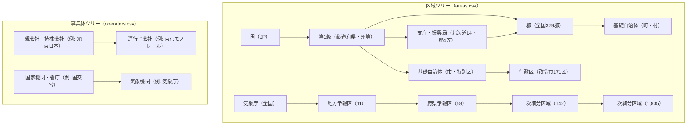
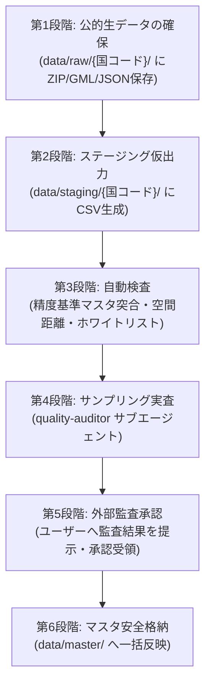

# 新方針「基盤の基盤」基本設計仕様書（確定版）

- 作成日: 2026-10-24
- 最終改訂日: 2026-10-28（公的データ直結・6段階品質保証パイプラインおよび外部監査合意を反映）
- 位置づけ: 手に余る仕様の肥大化・無差別Webスクレイピングによるデータ汚染を排除し、「公的オープンデータ直結」と「段階的品質保証」によって「まず形を作る」「広く浅く展開」するための基盤設計正本。

---

## 1. 方針転換の背景と堅持する前提

### 1.1 背景
これまでの仕様（日単位管理、改称レコード分割、全12テーブル・20〜32カラム、独立品質監査ALL PASS・公的件数100%一致等）は、現在のLLM自動化レベルおよび単独作業では運用負荷が極めて高く、手に余る状況となった。
さらに、Wikidata/Wikipedia等の無差別スクレイピングに依存した結果、商業施設・ホテル・廃駅・未成新幹線・ディズニー遊具の混入や偽装割当といった致命的汚染が多発した。
そのため、LLMの自動化が高度に運用できるまでの当面（概ね1年間）は、**「公的一次データ直結」**を徹底し、**「まず形を作る」ことを最優先**とし、**「広く浅く」展開**する。

### 1.2 堅持する前提条件
1. **目的・基本設計思想の保持**: 世界中の過去から現在・計画に至る「国・地域」「交通網」「気候気象」のデータを収集・統合し、「繋がり」を可視化・探索する。
2. **将来の拡張性担保**: 将来のLLM高性能化・複数人作業を見据え、後から属性拡張（詳細化）や本格グラフDB移行がスクリプト1つで可能なID体系とリレーション構造を崩さない。
3. **対象分野の限定**: 「国地域」「交通網」「気候気象」に限定（Geoguessrマップは例外として維持）。
4. **段階的展開**:
   - まず日本を公的生データからクリーンに再構築し、その後他国へ拡大。
   - 国の作業順は変えず（オーストリアの優先度002も変更なし）。
5. **探索・発信の継続**: 机上探索（Web GIS）を重視し、note・SNS発信も簡素化せず継続する。

---

## 2. 「基盤の基盤」設計原則

1. **「繋がり」の最優先**:
   - ノード（点）とエッジ（線）、区域（エリア）と事業体（主体）の「所属関係」と「接続関係」を最優先で確立する。
2. **カラムの大幅削減（コア属性への圧縮）**:
   - 各テーブルの属性を必須5〜15列程度に絞り込む。
   - 人口、面積、首長、軌間、電化、最高速度、駅ホーム数、乗降客数などの詳細スペックはローカルDBに持たず、**「公式サイトURL」「Wikipedia URL」「Wikidata ID」への外部リンクで代用**する。
3. **現行データの先行網羅**:
   - 全件の日単位履歴や改称分割は一時凍結し、まずは「現行（最新）の繋がり」を100%成立させる。
4. **代表点座標の公的確定ルール**:
   - 自治体代表点: **国土交通省 国土数値情報（P05/P34）**の役場本庁舎座標を公的絶対値として採用。
   - 交通拠点: 国土数値情報（鉄道N02・空港C28・港湾C02・高速N06・道の駅P35）の公的Point座標を採用。
   - 複数ソースでズレがある場合は、**公的オープンデータ ➔ OSM ➔ Wikidata ➔ Wikipedia** の順序で機械的に採用する。
5. **路線図テンプレート自動生成の担保**:
   - `edges.csv` に「順序（路線内の並び順）」を保持することで、GeoJSONの曲線座標がなくても、縦型路線図（BSicon等）や乗換案内図を100%自動生成可能とする。

---

## 3. 上下関係（親子階層）の構造設計

自己参照型の「親区域ID」「親事業体ID」を持たせることで、何段階の階層でも完全に追跡可能とする。

- **自治体と気象予報区の横の繋がり**: 自治体レコードの `気象予報区ID` に所属二次細分区域ID（気象庁7桁コード対応）を格納し直結。

---

## 4. 確定テーブル定義（全7テーブル ＋ 区域種別マスタ・出典マスタ）

### 4.1 区域種別マスタ (`area_types.csv`)
国ごとに異なる行政・気象階層制度を独立マスタ化。

| カラム名 | 型 | 説明・具体例 |
| :--- | :--- | :--- |
| `type_id` | 文字列 | 主キー（例: `JP_ADMIN_PREF_TO`, `JP_ADMIN_CITY_DESIGNATED`, `JP_MET_CLASS10`） |
| `country_code` | 文字列 | 対象国コード（`JP`, `AT`, `INT` 等） |
| `大分類` | 文字列 | `行政` または `気象` または `統計` |
| `階層レベル` | 整数 | 国直下が `1`、下位へ `2`, `3`, `4` |
| `種別名_日本語` | 文字列 | 日本語呼称（例: `都道府県`, `政令指定都市`, `一次細分区域`） |
| `種別名_公用語` | 文字列 | 現地呼称（例: `都`, `指定都市`, `一次細分区域`） |
| `規模目安` | 整数/文字列 | 事前調査に基づく公的件数規模（例: `47`, `20`, `142`） |
| `検証状態` | 文字列 | `公的リスト確認済`, `API確認済`, `統計参照`, `推計` |
| `説明` | 文字列 | 制度上の位置づけ・法的根拠 |
| `Wikipedia_url` | URL | その国の制度を解説したWikipedia記事リンク |

---

### 4.2 区域マスタ (`areas.csv`) ※自治体＋気象予報区を統合（13列）
| カラム名 | 型 | 説明・具体例 |
| :--- | :--- | :--- |
| `area_id` | 文字列 | 主キー（例: `JP-MN-000001`, `JP-WZ-000001`） |
| `country_code` | 文字列 | 所属国コード（`JP`） |
| `type_id` | 文字列 | `area_types.csv` の種別ID（例: `JP_ADMIN_PREF_TO`） |
| `公的コード` | 文字列 | 地方公共団体コード（6桁/5桁）、気象予報区コード（6桁/7桁）、ISO 3166-2 |
| `親区域ID` | 文字列 | 上位の区域ID（上下関係ツリー） |
| `気象予報区ID` | 文字列 | 所属する二次細分区域ID（横の繋がり） |
| `名称` | 文字列 | 日本語名（例: `千代田区`, `東京地方`） |
| `名称_公用語` | 文字列 | 現地公用語名 |
| `代表緯度` | 小数 | 代表点緯度（国土数値情報P05または気象庁中心点、小数第6位） |
| `代表経度` | 小数 | 代表点経度（国土数値情報P05または気象庁中心点、小数第6位） |
| `公式サイトURL` | URL | 自治体・予報区の公式HP |
| `Wikipedia_url` | URL | Wikipedia記事URL |
| `Wikidata_id` | 文字列 | Wikidata Q番号 |

---

### 4.3 事業体マスタ (`operators.csv`)（10列）
気象機関（気象庁等）や道路管理者（国交省・高速3社等）を含め、運行・管理主体を一元化。

| カラム名 | 型 | 説明・具体例 |
| :--- | :--- | :--- |
| `operator_id` | 文字列 | 主キー（例: `JP-OP-000001`） |
| `country_code` | 文字列 | 国コード |
| `親事業体ID` | 文字列 | 親会社・上位機関ID（上下関係ツリー） |
| `公的コード` | 文字列 | 法人番号、国交省事業者コード等 |
| `大分類` | 文字列 | `交通`, `気象`, `行政` |
| `種別` | 文字列 | `鉄道`, `道路管理者`, `気象機関`, `航空`, `海運` 等 |
| `事業者名` | 文字列 | 日本語名（例: `東日本旅客鉄道`, `気象庁`, `国土交通省道路局`） |
| `公式サイトURL` | URL | 公式サイトトップURL |
| `Wikipedia_url` | URL | Wikipedia記事URL |
| `Wikidata_id` | 文字列 | Wikidata Q番号 |

---

### 4.4 路線マスタ (`transport_routes.csv`)（11列）
| カラム名 | 型 | 説明・具体例 |
| :--- | :--- | :--- |
| `route_id` | 文字列 | 主キー（例: `JP-RT-000001`） |
| `country_code` | 文字列 | 主たる国コード |
| `operator_id` | 文字列 | 運行・管理者ID（`operators.csv` 参照） |
| `大分類` | 文字列 | `陸上交通`, `航路・空路` |
| `種別` | 文字列 | `新幹線`, `鉄道`, `地下鉄`, `高速道路`, `一般国道`, `旅客航路`, `航空路` 等 |
| `路線記号・番号` | 文字列 | 国道番号（`1`）、高速ナンバリング（`E1`）、路線記号等 |
| `路線名` | 文字列 | 日本語路線名 |
| `路線名_公用語` | 文字列 | 現地公用語路線名 |
| `公式サイトURL` | URL | 路線公式ページ等 |
| `Wikipedia_url` | URL | Wikipedia記事URL |
| `Wikidata_id` | 文字列 | Wikidata Q番号 |

---

### 4.5 ノードマスタ (`nodes.csv`)（16列）
| カラム名 | 型 | 説明・具体例 |
| :--- | :--- | :--- |
| `node_id` | 文字列 | 主キー（例: `JP-ND-000001`） |
| `country_code` | 文字列 | 国コード |
| `area_id` | 文字列 | 所在区域ID（`areas.csv` 参照） |
| `operator_id` | 文字列 | 管理者ID（`operators.csv` 参照） |
| `大分類` | 文字列 | `交通拠点`, `気象`, `インフラ構造物` |
| `種別` | 文字列 | `鉄道駅`, `IC・JCT`, `空港`, `主要港湾`, `道の駅`, `気象観測点` 等 |
| `公的コード` | 文字列 | 駅グループコード（N02）、アメダス番号（`44132`）、UN/LOCODE等 |
| `iata_code` | 文字列 | IATA空港コード（3文字: `HND`, `NRT`、空港以外は空欄） |
| `icao_code` | 文字列 | ICAO空港コード（4文字: `RJTT`, `RJAA`、空港以外は空欄） |
| `名称` | 文字列 | 施設名称（例: `東京駅`, `東京（アメダス）`, `羽田空港`） |
| `名称_公用語` | 文字列 | 現地公用語名称 |
| `緯度` | 小数 | 代表点緯度（国土数値情報等の公的座標、小数第6位） |
| `経度` | 小数 | 代表点経度（国土数値情報等の公的座標、小数第6位） |
| `公式サイトURL` | URL | 駅・空港・観測点の公式案内URL |
| `Wikipedia_url` | URL | Wikipedia記事URL |
| `Wikidata_id` | 文字列 | Wikidata Q番号 |

---

### 4.6 エッジマスタ (`edges.csv`)（6列）
| カラム名 | 型 | 説明・具体例 |
| :--- | :--- | :--- |
| `edge_id` | 文字列 | 主キー（例: `JP-ED-000001`） |
| `route_id` | 文字列 | 所属路線ID（`transport_routes.csv` 参照） |
| `from_node_id` | 文字列 | 起点ノードID（`nodes.csv` 参照） |
| `to_node_id` | 文字列 | 終点ノードID（`nodes.csv` 参照） |
| `順序` | 整数 | 路線内の並び順（1, 2, 3...） ★路線図自動生成用 |
| `状態` | 文字列 | `現行`, `廃止`, `計画` |

---

### 4.7 国マスタ (`countries.csv`)（8列）
| カラム名 | 型 | 説明・具体例 |
| :--- | :--- | :--- |
| `country_code` | 文字列 | 主キー（ISO 2文字コード: `JP`, `AT` 等） |
| `iso_alpha3` | 文字列 | ISO 3文字コード（`JPN`, `AUT` 等） |
| `日本語名` | 文字列 | 日本語慣用国名 |
| `公用語名` | 文字列 | 現地公用語国名 |
| `車両通行側` | 文字列 | `左` または `右` |
| `公式サイトURL` | URL | 政府・公的ポータルURL |
| `Wikipedia_ja` | URL | 日本語版Wikipedia記事URL |
| `Wikidata_id` | 文字列 | Wikidata Q番号 |

---

### 4.8 出典マスタ (`data_sources.csv`)（10列）
WEBサイト・探索ツールでの適法な権利表示・クレジット明記用マスタ。

| カラム名 | 型 | 説明・具体例 |
| :--- | :--- | :--- |
| `source_id` | 文字列 | 主キー（例: `JP_SRC_MLIT_KSJ`, `JP_SRC_JMA`, `INT_SRC_OSM`） |
| `country_code` | 文字列 | 対象国（国際共通は `INT`、日本は `JP` 等） |
| `データ分野` | 文字列 | `行政`, `交通`, `気象`, `統計`, `背景地図` |
| `データセット名` | 文字列 | 正式名称（例: `国土数値情報（鉄道データ N02）`） |
| `提供機関・組織` | 文字列 | 提供主体（例: `国土交通省`, `気象庁`） |
| `ライセンス` | 文字列 | 利用規約・ライセンス（例: `政府標準利用規約2.0`, `CC BY 4.0`） |
| `公式URL` | URL | データ配布元URL |
| `利用規約URL` | URL | ライセンス・利用規約ページURL |
| `クレジット表示文_ja` | 文字列 | WEB表示用日本語表記（例: `出典：国土交通省「国土数値情報（鉄道データ）」`） |
| `クレジット表示文_en` | 文字列 | WEB表示用英語表記 |

---

### 4.9 継続運用テーブル
- `exploration_logs.csv`: 机上探索（バーチャル旅行）のログ、note記事リンク、Geoguessrマップリンクの記録。

### 4.10 当面凍結テーブル
- `historical_transitions.csv`（前身・後継関係）
- `city_partnerships.csv`（姉妹都市提携）
- `theme_spots.csv`（`nodes.csv` の大分類「史跡・名所」に統合可能とし、独立収集は一時停止）

---

## 5. データ収集と品質保証の6段階パイプライン（確定フロー）

データ汚染の再発を防ぐため、`data/master/` への直接書き込みを全面禁止し、以下の**6段階パイプライン**を厳格に適用する。

1. **第1段階：公的生データの確保 (`data/raw/{国コード}/`)**
   - 国土数値情報、気象庁JSON、総務省Excel等の一括公式データを直接ダウンロードして保管。
   - 生データが存在しない分野（私鉄主要地方道、都市間高速バス等）のみ、別途切り分けて対応。
2. **第2段階：ステージング仮出力 (`data/staging/{国コード}/`)**
   - 生データをパースし、新方針スキーマの各CSV（`areas`, `operators`, `transport_routes`, `nodes`, `edges`）へ変換。
3. **第3段階：自動検査（合否判定ゲート）**
   - `docs/精度基準マスタ.csv` の公的基準件数（許容範囲）と完全突合。
   - エッジ距離検査（新幹線駅間100km超、在来線駅間20km超の異常ワープを自動検知）。
   - ホワイトリスト検査（廃線・未成線・商業施設・遊具等の禁止キーワード検知）。
4. **第4段階：サンプリング実査 (`quality-auditor`)**
   - 独立品質監査サブエージェント（`Model: flash`）が各テーブルからランダム抽出して実地検証。
5. **第5段階：外部監査承認**
   - 監査レポートを作成し、ユーザーへ提示して承認を得る。
6. **第6段階：マスタ安全格納 (`data/master/`)**
   - 承認後、ステージングデータをマスタCSVへ安全にマージ・更新する。

---

## 6. 各国の事前調査の新仕様（データ調達設計図の確立）

事前調査は省略せず、**「データ収集を迷わず確実に走らせるための『データ調達設計図』としてさらに充実」**させる。

1. **構造・階層・一次入手先への集中と数値厳密主義からの脱却**:
   - 事前調査の主目的は「データベースの型（`area_types.csv` 等）、制度の階層構造、種類の体系、および公式リスト・API等の一次入手先と調達仕様の確立」である。
   - LLMによる無理な件数の暗記・推測・内訳検算の義務を撤廃し、件数は公的統計・白書・台帳による「規模目安（件数）」とし、「検証状態（公的リスト確認済／API確認済／統計参照／推計）」を明記する。
2. **公的生データ・APIサンプルの所持・保管方針**:
   - 後工程での収集・照合の確実性を担保するため、事前調査段階で入手可能な公的リスト（CSV/Excel等）やAPI現データ（JSON等）は、実際に取得してリポジトリ内（`docs/research/` 等）に保管・検証する。
3. **過去変遷・歴史調査の完全排除（現行特化ルール）**:
   - 過去の合併沿革、廃線・廃駅史、旧制度変遷は**一切調査しない（現行最新情報のみに特化）**。
   - 変遷調査は後工程の独立フェーズへ完全分離する。
4. **`area_types.csv` 登録データの事前確定**:
   - 事前調査レポート内に、その国の全行政・気象・統計階層の定義を完全作成。
5. **国勢調査（統計調査区）の体系ストック**:
   - 将来の人口・メッシュ連携のための資料として事前調査で階層・単位・件数・コード・入手先をストックする。
6. **交通網の全分野網羅（陸・海・空）**:
   - 道路、鉄軌道・索道、バス（※路線バスは対象外、都市間高速バス・空港連絡バス・BRTのみ）、航路（旅客定期航路、渡船・フェリー）、航空路（国内定期航空路）、交通拠点（駅コード、IC/JCT、旅客空港IATA/ICAO、港湾UN/LOCODE）を網羅する。
7. **探索環境・ストリートビュー各社カバレッジの網羅**:
   - 机上探索（Web GIS）環境の事前把握として、公式背景地図タイル（WMTS/XYZ）に加え、ストリートビュー各社（Google、Apple、Yandex、Baidu、Mapillary、現地独自サービス）のカバレッジ状況を明記する。
8. **出典データの完全特定 (`data_sources.csv`)**:
   - 登録に必要なライセンス種別、提供機関、クレジット表記文を事前調査で100%確定。
9. **Webアプリ版Gemini（Deep Research）の標準運用**:
   - 汎用プロンプトを活用し、「行政・統計・気象編」と「交通網・インフラ編」の2分冊で調査を実施。
   - 出力結果はリネーム等の加工を行わず、既定ファイル名（`docs/research/{国コード}_行政・気象_制度調査.md` / `docs/research/{国コード}_交通_制度調査.md`）のままリポジトリに保存する。

---

## 7. 1年間の優先ロードマップ骨子

- **Q1（1〜3ヶ月目）**: 基盤の基盤化 ＆ 日本の交通骨格接続（公的一次データ直結での日本再構築完了、JR・大手私鉄・主要高速道の駅順エッジ完成、探索＆note・SNS連載スタート）
- **Q2（4〜6ヶ月目）**: 探索・発信の定常化 ＆ オーストリア（海外試行パイロット）着手
- **Q3（7〜9ヶ月目）**: 海外作業順の上位国（台湾・韓国・スイス・イタリア・ドイツ等）への定型フロー横展開
- **Q4（10〜12ヶ月目）**: 1年成果総括 ＆ 次世代LLMを活用した属性自動拡充の実験検証
