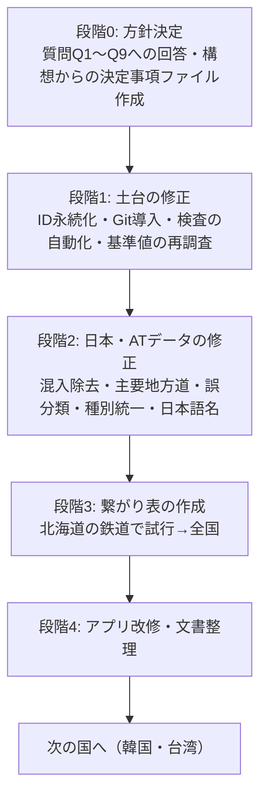

# 問題点・改善点一覧

- 作成日: 2026-10-14
- 目的: プロジェクトの現況監査と構想.mdのレビューで見つかった問題点を1か所にまとめ、対応状況を管理する
- 対象: [構想.md](../構想.md)、[プロジェクト仕様書.md](../プロジェクト仕様書.md)、[精度管理表.md](精度管理表.md)、`data/master/*.csv`、`scripts/`、`app.py`

> 状態の凡例: **未対応** / **回答待ち**（ユーザーの判断が必要） / **対応中** / **完了**

---

## 0. 結論

1. 仕様書の「日本分は全分野合格」は実態と一致していない。次の国（韓国・台湾・スイス）に進む前に土台を直す必要がある。
2. 根本原因は次の2つ。
   - 作業フロー上、**作る人と検査する人が同じ（AI）**で、ユーザーが確認する仕組みがない。
   - 構想の段階で**範囲・定義・完了条件が決まっていない**ため、収集範囲が広がり続けている。

---

## 第1部: 現況（データ・仕様・作業フロー）の問題点

### 🔴 重大（次の国に進む前に必ず直す）

| No. | 問題 | 内容・根拠 | 修正方針 | 状態 |
| :---: | :--- | :--- | :--- | :---: |
| 1 | **IDが永続しない** | 全収集スクリプトが毎回 `000001` から採番し直している。取得順が変わると同じ駅でも別IDになる。探索ログ2件は旧形式ID（`JP-RT-00001`）を参照したままで、すでにリンク切れ。 | 一度発行したIDは変更・再利用しない。再収集時はWikidata IDや公的コードで既存レコードと照合し、新規分のみ採番する共通処理を作る。消えたレコードは削除せず `状態` を変更して残す。 | 未対応 |
| 2 | **精度管理が自己申告** | 仕様書は「自動突合」と書いているが、`check_integrity.py` に件数突合の機能はない。判定ルールと矛盾する「合格」がある（下表）。出典URLの記録もない。 | 基準件数を出典URL・確認日付きのファイルで管理し、検査スクリプトで自動突合する。精度管理表は検査結果から自動生成する。公式出典を確認できない基準値は「基準未確定」と明記する。 | 未対応 |
| 3 | **主要地方道の過剰取得の疑い** | 「Wikipediaの県道カテゴリのうち番号120以下」をすべて主要地方道としている。全国の主要地方道は数百〜700路線程度と推定される（要公式確認）のに対し、3,011路線ある。各県最大100件しか取得しない設定のため、取りこぼしも同時に発生している可能性がある。 | 国交省等の公式指定リストに基づく抽出方法に変更する。 | 未対応 |
| 4 | **日本のデータに外国の拠点が混入** | JPの拠点に台湾・ロンドン・北京・LA・パキスタンのIC/交差点が56件混入している。ATにも国外座標のICが2件ある。既存チェックは地球上の座標かどうかしか見ていない。 | 混入分を除去する。国ごとの範囲外座標を検出する検査を追加する。 | 未対応 |
| 5 | **「繋がり」が0件** | `route_nodes.csv` が空。拠点に所属路線の情報もないため、「山手線の駅一覧」すら出せず、起点から終点へ辿る探索ができない。構想の「路線→拠点→区間」の3段目が未着手。 | Wikidata（路線P81・隣の駅P197等）から路線と駅を順序付きで紐付ける。北海道の鉄道で試行し、確認後に全国展開する。 | 未対応 |

**問題2の矛盾例**

| 項目 | 基準 | 実績 | 表の判定 | 表のルールに従った場合の判定 |
| :--- | :---: | :---: | :---: | :--- |
| AT 基礎自治体 | 2,093 | 2,113 | 合格 | 要調査（過剰）。さらに35件は親（郡）が未設定 |
| AT 地下鉄駅 | 109 | 100 | 合格「全109駅網羅」 | 要調査（不足）。説明文が事実と矛盾 |
| JP 主要地方道 | 約2,500〜3,000 | 3,011 | 合格 | 範囲外。基準値自体も疑わしい |
| JP 鉄軌道事業者 | 約220 | 表216 / 実データ278 | 合格 | 表の実績値が実データと不一致 |

### 🟡 中（早めに直す）

| No. | 問題 | 内容・根拠 | 修正方針 | 状態 |
| :---: | :--- | :--- | :--- | :---: |
| 6 | **アプリが旧スキーマのまま** | `app.py` は10/12以降更新されておらず、廃止された列（`支庁_振興局`、事業者の `名称`）を参照している。 | 新スキーマに対応させる。 | 未対応 |
| 7 | **「日本語名」に外国語が入る** | ATの拠点2,743/2,812件、路線336/497件、自治体1,376/2,216件で `日本語名` にドイツ語が入っている。`公用語名` の充填率は拠点で17%。 | 日本語名と公用語名を振り分け直す（方式は質問Q4の回答次第）。 | 回答待ち |
| 8 | **仕様書と実装が食い違っている** | 下表の通り。 | 実装を仕様に合わせるか、仕様を改訂する。 | 未対応 |
| 9 | **種別名が国ごとにバラバラ** | JPは `IC / SA / 港`、ATは `インターチェンジ / サービスエリア / 港湾`。事業者の種別は自由記述で20種類以上ある。 | 共通の用語リスト（コード表）を作り、全データを統一する。 | 未対応 |
| 10 | **変更履歴・バックアップがない** | バージョン管理がなく、`.bak` ファイルが `master/` に混在している。1世代前までしか戻せない。 | Gitを導入する。`.bak` は撤去する。 | 未対応 |

**問題8の詳細**

| 仕様書の記載 | 実際 |
| :--- | :--- |
| 林道・農道は「探索時の個別追加対象」 | 林道84・農道351路線を自動取得済み |
| 道路はOSMの `highway=primary` 以上が基準 | 実装はWikipediaカテゴリから取得（OSMは不使用） |
| Wikipedia_en = 英語版URL | 「日本語版があれば英語版は空欄」という仕様書にないルールで処理 |
| 座標は小数第6位 | 6桁未満が約5,300件（うち1〜2桁＝誤差1km以上が135件） |
| AT 郡79＋憲章都市15 | 94件すべてが種別「憲章都市」で登録（郡を誤分類） |

### 🟢 軽（方針確認・整理）

| No. | 内容 | 状態 |
| :---: | :--- | :---: |
| 11 | 構想は「収集段階はGoogleスプレッドシートで管理」だが、現状はPC内のCSVのみ（→質問Q1） | 回答待ち |
| 12 | 各レコードに「取得元」「取得日」がない。将来、情報の鮮度や根拠を追えない | 未対応 |
| 13 | `データ構造・収集検証レポート.md` の件数・内容が古い。仕様書の進捗「全分野合格」も事実と異なる | 未対応 |
| 14 | 列名 `municipality_id_tmp` の「tmp（仮）」が正式IDとして使われ続けている | 未対応 |
| 15 | OpenStreetMap / GoogleMap 列が全件空欄。座標から自動生成できるため、列として持つ必要があるか再検討する | 未対応 |
| 16 | Wikidataの重複：ATの主要州道でB1/B1a/B1bが同じWikidataを共有（26組）、JPの自治体で1組 | 未対応 |
| 17 | 所在自治体が空欄の拠点1,515件、事業者が空欄の路線331件（ATの主要州道271件は管理者＝州として埋められる） | 未対応 |

### 作業フローの問題（PM観点）

| No. | 問題 | 内容 | 修正方針 | 状態 |
| :---: | :--- | :--- | :--- | :---: |
| F1 | **第三者確認がない** | AIがスクリプトを作成・実行し、基準値を設定し、合格と判定し、仕様書に「完了」と記載するまでを一人で行っている。 | 検査を自動化し、各段階の終わりにユーザーによる抜き取り確認を入れる（→質問Q2）。 | 回答待ち |
| F2 | **不明点を残す場所がない** | 構想は「不明点は深追いせずに残す」としているが、`要確認` フラグ等がないため、無理に「合格」「完全一致」と書かれてしまう。 | `要確認` の印と理由を記録できる仕組みを作る。 | 未対応 |
| F3 | **基本データの完了条件がない** | 収集範囲が広がり続け（林道・農道等）、構想の「まず形を作る」が後回しになっている。 | 段階ごとの完了条件を定める（→K1）。 | 未対応 |

---

## 第2部: 構想.mdへの指摘

| No. | 指摘 | 内容 | 提案 | 状態 |
| :---: | :--- | :--- | :--- | :---: |
| K1 | **範囲と区切りが決まっていない**（最重要） | 「世界×古代〜計画×交通網・地域・気象」は10年でも終わらない規模。「一区切り」の基準がなく、「必要最低限のデータ」の定義もない。林道・農道の自動収集はこれが原因。 | 段階ごとに完了条件を定める。例：「日本の現存する鉄道・国道・自治体があり、Webで検索でき、1路線を探索できたら第1段階は完了」。 | 回答待ち |
| K2 | **言葉の定義が曖昧** | 下表の通り。 | 用語の定義を決定事項として文書化する。 | 回答待ち |
| K3 | **変遷の可視化に必要なデータが抜けている** | ①境界（ポリゴン）：地域の変遷を地図で見せるには自治体の範囲の形が必要だが、現状は役所の位置（点）のみ。過去の境界データは入手が難しく、量も膨大。②時間の持ち方：開始年・終了年と不確かさ（〜頃、諸説あり）を持てないと、タイムラインが作れない。 | 境界を持つかどうかを決める（→質問Q7）。時代区分に加えて開始年・終了年の列を追加する。 | 回答待ち |
| K4 | **権利・利用規約の確認が必要**（公開前に必須） | Googleマップ・航空写真・ストリートビューから読み取った座標・情報を公開DBに転載すること、画像をnote・SNSに載せることは規約で制限されている可能性が高い。OSMのデータを使うと公開データにもODbLが及ぶことがある。Wikipedia本文の転載にはCC BY-SAの表示義務がある（URLだけなら問題なし）。GeoGuessrの独自マップも規約確認が必要。 | 各サービスの規約を調査し、「公開してよい情報・してはいけない情報」のルールを作る（→質問Q8）。 | 未対応 |
| K5 | **一人で運用するには負担が大きい** | 発信先が5つ（Web・X・Threads・Facebook・note）あり、「最新情報の収集・公開」も加わる。グラフDBとRDBの併用は初心者には保守が困難。AIへの依存が大きいのに、引き継ぎ文書と確認の仕組みがない。費用（サーバ代・ドメイン代・AI利用料）の見積もりもない。 | 発信は当初Xのみに絞る。DBは当初CSVかSQLiteと繋がり表で運用し、グラフDBは必要になってから検討する。費用の上限を決める（→質問Q9）。 | 回答待ち |
| K6 | **作業順の記述が互いにぶつかる** | 「最新→過去→計画」「日本→AT→韓台→スイス→全世界」「路線→拠点→区間」「自治体→統計区→気象区」の4つの順序を組み合わせたときの優先順位が書かれていない。例：日本の過去データと韓国の最新データはどちらが先か。「北海道→南へ」は収集の順番か、探索の順番か。 | 優先順位を一本化した作業順を決定事項として文書化する。 | 回答待ち |
| K7 | **その他** | ①日本中世史跡のGeoGuessrマップは、構想自身が書く通り「分野違い」。②構想.mdは「編集不可」だが、10年の間に方針は必ず変わる。③Webサイトの対象者（誰向けか、多言語対応するか）が未定。 | ①本体とは別のプロジェクトとして分ける。②原本は残したまま「構想からの変更・決定事項」を記録する別ファイルを作る。③対象者を決める（→質問Q6）。 | 回答待ち |

**K2：定義が必要な用語**

| 用語 | 決める必要があること |
| :--- | :--- |
| 交通網 | 道路・鉄道・航空・航路以外に、索道・運河・バス路線・街道や古道・自転車道を含めるか |
| 区間 | 拠点と拠点の間という意味か。地図に線（ルートの形）を描くデータも持つのか |
| 繋がり | 交通網同士（接続・乗換・並行・旧道と新道）、地域間（隣接・合併や分割の前後関係）、交通網と地域（通過・所在）のどれを指すか |
| 変遷 | 年単位で管理するか、時代区分（江戸・明治など）で十分か |

---

## 第3部: ユーザーへの質問一覧

| No. | 質問 | 選択肢 | 関連 | 回答 |
| :---: | :--- | :--- | :---: | :--- |
| Q1 | 収集段階のデータ管理方法 | (a) CSVのまま進め、スプレッドシートは閲覧・手入力用に一部だけ使う ／ (b) スプレッドシート管理に移行する | 11 | 初めはスプレッドシートでの管理をメインに考えていましたが、csv→DBの方向に変わりつつありますが知識不足のため判断できません。|
| Q2 | データの確認にどこまで関わるか | (a) 各段階で抜き取り確認（20件程度を地図リンク付きで提示） ／ (b) 件数の検査結果だけ見る ／ (c) 任せる | F1 | (a)の抜き取りチェックで。なおここで漏れても探索で全自治体・全路線を嫌でもチェックすることになります。|
| Q3 | 林道・農道（435路線）の扱い | (a) 残す ／ (b) 削除して仕様通りにする | 8 | 一度全て削除します。ただし探索で復活する可能性はあります。|
| Q4 | 日本語表記がない外国地名の「日本語名」 | (a) 空欄にして公用語名のみ入れる ／ (b) カタカナを自動生成して入れる（自動生成の印を付ける） | 7 | (a)の空欄にします。|
| Q5 | 優先順位 | (a) データ修正（第1部）を先に行い、その後に探索を試行する ／ (b) 探索の試行を早める | F3, K1 | (a)です。|
| Q6 | Webサイトの主な対象者 | 自分用の記録 ／ 交通・地理好きの一般の方 ／ 研究者 など | K7 | 一般向けがメインですが半分は自分の趣味です。|
| Q7 | 地図に描くもの | (a) 路線の形（線）や自治体の範囲（境界）まで描く ／ (b) 点と一覧表で十分 | K2, K3 | (b)です。|
| Q8 | Googleの航空写真・ストリートビューから得た情報・画像を公開する想定か | はい ／ いいえ ／ 未定 | K4 | Google関連はSNSではリンク、note等は埋め込みで表示します。|
| Q9 | 毎月の費用（サーバ・AI等）の上限 | 金額を記入 | K5 | 最大1万円|

---

## 第4部: 修正の進め方（案）

各段階の終わりにユーザー確認を挟む。**段階1が完了するまで、他国のデータ収集は停止する。**

| 段階 | 対応する問題 | 完了の確認方法 |
| :--- | :--- | :--- |
| 0 | K1〜K7, Q1〜Q9 | 決定事項ファイルをユーザーが承認 |
| 1 | 1, 2, 10, 12, F2 | 収集スクリプトを2回連続実行してもIDが1件も変わらない。検査スクリプトが基準値と自動突合する |
| 2 | 3, 4, 7, 8, 9, 14〜17 | 検査スクリプトの警告件数の減少。抜き取り確認 |
| 3 | 5 | アプリで北海道の路線の駅一覧が起点から終点まで順に表示される |
| 4 | 6, 13, F3 | アプリが新スキーマで正常に表示される。仕様書の進捗が事実と一致する |
