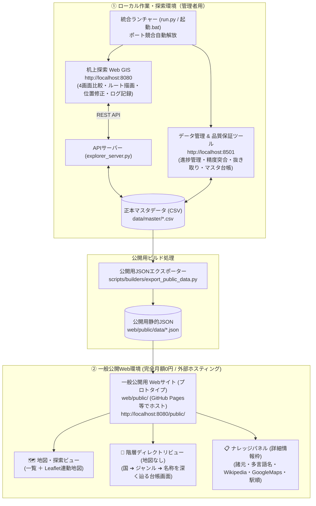

# プロジェクト仕様書・設計書

本ドキュメントは「世界交通網・国・地域データ基盤」プロジェクトの確定した仕様、進捗状況、データ構造および実装内容を記録・管理する設計ファイルです。
今後の機能追加・データ構造の修正・運用ルールの決定事項は、本ファイルに追記・更新していきます。

---

## 1. プロジェクト基本方針

### 1.1 目的・ゴール
- 世界各地に古代から現在・計画された「国・地域（自治体・行政区画・各種区域）」および「交通網（路線・拠点・区間）」のデータを収集・整理し、1つに統合する。
- 変遷および繋がり（交通網同士、地域間、交通網と地域）を可視化するWebサイト・探索基盤の構築。
- 10年単位の長期構想を見据え、実際に軽快に動く探索・管理ツールおよび完全月額0円で配信可能な公開Webサイトを構築・運用する。

### 1.2 全体進捗ステータス

| フェーズ / ステップ | 内容 | 進捗状況 |
| :--- | :--- | :--- |
| **ステップ1: 国・自治体データ閲覧基盤** | 国ナレッジパネル、行政区画リスト、検索・絞り込み、個別ページの構築 | **完了** |
| **ステップ2: 自治体 & 交通網データの枠組み** | 確定テーブル設計（国、自治体、事業者、路線、拠点）のCSV配備とWeb統合 | **完了** |
| **ステップ3: 交通網探索支援ワークステーション** | 2画面連動地図（左右/上下）、ノードスナップ描画、Wikidataレイヤー、自由メモ・下書き生成 | **完了** |
| **ステップ4: 骨格再定義・ID永続化・自動整合性検査** | 点と一覧へのスコープ集約、Git導入、ID永続化マネージャー、4大自動検査（件数・異常座標・迷子・ルール） | **完了** |
| **ステップ5: 機動的ツール群の全面刷新** | ①机上探索Web GIS一本化（4画面集約・ルート描画・位置ドラッグ修正・Wikidata自動表示）<br>②データ管理ツールの品質保証特化（5タブ構成・国レベル進捗管理・デザイン統一） | **完了** |
| **ステップ6: 一般公開用Webサイト（プロトタイプ）構築** | 完全月額0円静的配信（GitHub Pages対応）、全251カ国選択UI、地図なし階層ビュー、詳細ナレッジパネル、路線駅順シーケンス | **完了** |
| **ステップ7: 世界枠組み先行自動収集（第1段階-A）** | 全世界約200カ国＋最上位行政区画（都道府県・州・県等 約3,500件）の先行自動収集 | **次回着手予定** |
| **ステップ8: コンテンツ展開** | note（バーチャル旅行記）、SNS連携、クイズ・Geoguessr独自マップ | 未着手（将来課題） |

---

## 2. データ構造・テーブル設計仕様

### 2.1 データ表現の原則
1. **点（Point）と一覧表のみで構成**:
   - 線（ラインGeoJSON）や面（ポリゴン境界）の重厚な幾何データは保持しない。
   - 自治体は「政庁所在地（点）」、交通網は「路線（メタデータ）」と「拠点（駅・IC等の点）」および「繋がり（順序関係）」で表現する。
2. **ID永続化ルール**:
   - 一度発行されたID（`JP-ND-000001` 等）は、再収集時にも**絶対に変更・再利用しない**。
   - `scripts/common/id_manager.py` により、照合キー（Wikidata QID、公的コード、または「国コード＋種別＋正規化名称」）で既存マスタと突合し、新規レコードのみ最大連番+1を採番する。
   - ソースから消えたレコードは削除せず、`状態 = 要確認` または `廃止` に更新して履歴を維持する。
3. **座標精度ルール**:
   - すべての緯度・経度は**十進数・小数第6位まで取得（四捨五入、約0.11m精度）**を厳格に適用する。
4. **多言語表記ルール**:
   - 日本語版WikipediaやWikidataに日本語ラベルが存在しない外国地名・施設名について、**「日本語名」列は空欄とする**（公用語名列にのみ原語を保持）。

### 2.2 テーブル一覧とID体系

| テーブル | ID形式 | 例 | 概要 |
| :--- | :--- | :--- | :--- |
| 国 (`countries.csv`) | `[2文字コード]` / `INT` | `JP`, `AT`, `INT` | ISO 3166-1準拠。国際交通網は仮想コード `INT` |
| 地域・区域 (`municipalities.csv`) | `[国コード]-M-[6桁]` | `JP-M-000001` | 行政区画・統計区・歴史的地域等を統合。政庁座標・公式サイトURL保持 |
| 事業者 (`operators.csv`) | `[国コード]-OP-[6桁]` | `JP-OP-000001` | 運営・管理主体（鉄道各社、道路公社等） |
| 交通路線 (`transport_routes.csv`) | `[国コード]-RT-[6桁]` | `JP-RT-000001`<br>`INT-RT-000001` | 鉄軌道、高速道路、主要国道、主要地方道、国際道路 |
| 交通拠点 (`transport_nodes.csv`) | `[国コード]-ND-[6桁]` | `JP-ND-000001` | 駅、電停、地下鉄駅、空港、港湾、IC/JCT/SA、道の駅、国境 |
| 路線・拠点繋がり (`route_nodes.csv`) | `[国コード]-RN-[6桁]` | `JP-RN-000001` | 路線と拠点の起点〜終点順序・区間別称・結節関係を保持 |
| 探索ログ (`exploration_logs.csv`) | `[国コード]-LOG-[6桁]` | `JP-LOG-000001` | バーチャル旅行メモ、探索追加点・ルート座標 |
| 収集進捗管理 (`country_progress.csv`) | `[国コード]` | `JP`, `AT` | 全251カ国の段階区分・収集ステータス（国レベルで管理） |

---

## 3. システム・ツール構成仕様

本基盤は「**ローカル作業基盤（探索・管理）**」と「**一般公開Web基盤（完全月額0円・静的配信）**」の二重構造で稼働します。



### 3.1 机上探索 Web GIS 仕様
- **URL**: `http://localhost:8080/`（`web/explorer/`）
- **画面分割（4パターン）**: 「🔲 1画面」「◫ 2画面 (左右)」「⊟ 2画面 (上下)」「⊞ 4画面」に集約。
- **マーカー色差別化**:
  - 🔵 **マスタ登録交通拠点**: 青 (`#2563eb`)
  - 🟠 **探索追加ポイント (自分)**: 橙 (`#f97316`)
  - 🔴 **探索追加ルート (自分)**: 赤色実線 (`#ef4444`)
  - 🟣 **Wikidata 史跡・旧跡**: 紫 (`#a855f7`)
- **ルート描画機能**: 〰️ ツールによる連続クリック描画・ダブルクリック確定・頂点ドラッグ微調整・右クリック削除・GeoJSON座標列保存。
- **追加データの位置修正・削除**: 地図上のピンをドラッグして位置保存、編集・削除ダイアログ。
- **Wikidata自動表示**: 初期状態常時ON。中心周辺15kmのスポットを自動フェッチ。
- **バックエンドAPI (`scripts/servers/explorer_server.py`)**: 軽量スレッド型HTTPサーバー。CSVマスタおよび探索ログのCRUD・範囲検索・Wikidataプロキシを提供。

### 3.2 データ管理 & 品質保証ツール仕様
- **URL**: `http://localhost:8501/`（Streamlit `tools/admin.py`）
- **役割**: 探索機能をWeb GISへ譲渡し、「データ管理 & 品質保証」に専念。
- **5大タブ構成**:
  1. 📈 **収集進捗管理 (国レベル)**: 段階別（第1段階-B、第2段階、第1段階-A）の集計および実績件数（自治体・路線・拠点・繋がり）。※地域別管理は上位行政区画収集後に検討。
  2. 🛡️ **精度管理・公的基準突合**: `docs/精度基準マスタ.csv` に登録された公式基準値との動的突合・合否判定。
  3. 🔍 **抜き取りチェック**: 20件のランダム抽出とGoogleマップリンクによる人間確認レポート生成。
  4. ⚠️ **不整合・要修正データ**: 重複、国境逸脱、迷子外部キーの自動検知。
  5. 📚 **マスタデータ台帳**: CSVの直接閲覧・編集・保存。
- **デザイン連動**: 黒背景トグル（ダークテーマCSS適用）、上部余白最適化（`padding-top: 4.8rem` によるヘッダー潜り込み防止）。

### 3.3 一般公開用 Webサイト（プロトタイプ）仕様
- **URL**: `http://localhost:8080/public/`（`web/public/`）
- **ホスティング方針**: バックエンド不要の完全静的配信（GitHub Pages、Cloudflare Pages等の完全月額0円ホスティングに対応）。
- **静的JSONエクスポーター (`scripts/builders/export_public_data.py`)**:
  - マスタCSVから公開用軽量JSONを一括生成。
  - `web/public/data/summary.json`: 全251カ国の統合サマリー・統計。
  - `web/public/data/[国コード].json`: 国別データ（自治体、事業者、路線、拠点、繋がりシーケンス、ナレッジ用外部リンク）。
- **全251カ国選択UI**:
  - メイン画面の「🌍 国・地域」タブ（地域別カードグリッド）。
  - 上部国名バーの「🔍 全251カ国から選ぶ...」検索セレクトボックス。
- **2つの表示モード切替**:
  - **🗺️ 地図ビュー**: 一覧リスト（路線・自治体・拠点）とLeaflet連動地図の2カラム構成。
  - **📖 階層ディレクトリビュー (地図なし)**: 地図を表示せず、パンくずリスト（`世界 ➔ 国 ➔ ジャンル ➔ 名称`）を見ながら台帳・百科事典のように深く辿る全幅画面。
- **ナレッジパネル（詳細情報表示枠）**:
  - 路線・自治体・拠点を選択した際に、Google風の詳細情報パネルを展開（地図ビュー時は右側ドロワー、階層ビュー時は全幅カード）。
  - 多言語表記、諸元テーブル、駅順序シーケンス、および **Google Maps / Wikipedia (日・英) / Wikidata / OSM / 公式サイトへの直行ボタン**。

### 3.4 統合ランチャーと相互連携
- **ランチャー (`run.py` / `起動.bat`)**: ポート8080/8501の占有プロセスを自動解放し、探索Web GIS・管理画面・公開サイトを一括起動。
- **相互連携**: 全ツールのヘッダーに相互リンクボタンを設置し、3つの画面間を自由に往復可能。

---

## 4. ディレクトリ構成仕様

```text
PJT/
├── 起動.bat                              # ワークステーション起動バッチ
├── run.py                                # 統合ランチャー（ポート自動解放・2プロセス管理）
├── app.py                                # データ管理Streamlitエントリーポイント
├── プロジェクト仕様書.md                  # 全体設計書・進捗管理（本ドキュメント）
├── 構想.md                               # 基本構想原本（編集不可・永久保存）
├── docs/                                 # 設計資料・品質管理・調査ドキュメント
│   ├── 決定事項.md                        # 確定仕様・基本骨格・ルール集（Q1〜Q9、改訂仕様）
│   ├── 精度管理表.md                      # 公式基準件数・突合チェック表（国レベル管理）
│   ├── 精度基準マスタ.csv                 # 検査スクリプトが読み込む公的基準値CSV
│   ├── データ構造・収集検証レポート.md
│   ├── 問題点・改善点一覧.md
│   ├── 検証_函館本線_繋がりシーケンス.md    # 函館本線85駅の検証ログ
│   ├── 抜き取り確認_JP_20261015.md
│   ├── 抜き取り確認_AT_20261015.md
│   └── research/                         # 国別制度事前調査シート
│       ├── 事前調査テンプレート.md
│       ├── JP_制度調査.md
│       ├── JP_道路_制度調査.md
│       └── AT_制度調査.md
├── data/
│   ├── master/                           # 正本マスタCSV
│   │   ├── countries.csv
│   │   ├── municipalities.csv
│   │   ├── operators.csv
│   │   ├── transport_routes.csv
│   │   ├── transport_nodes.csv
│   │   ├── route_nodes.csv               # 路線と拠点の繋がりマスタ
│   │   ├── country_progress.csv          # 国別収集進捗台帳
│   │   └── exploration_logs.csv          # 探索ログ・手動追加データ
│   └── backup_pre_reset_20261015/        # リセット前バックアップ退避領域
├── tools/                                # 管理ツール（Streamlit）
│   ├── admin.py                          # データ管理 & 品質保証ダッシュボード
│   └── common.py                         # 共通ヘッダー・CSS・データロード
├── web/
│   ├── explorer/                         # 机上探索 Web GIS（ローカル作業用メイン）
│   │   ├── index.html
│   │   ├── css/style.css
│   │   └── js/
│   │       ├── app.js
│   │       ├── records.js                # ログ・追加データのCRUD
│   │       ├── api.js
│   │       └── tiles.js
│   └── public/                           # 一般公開用 Webサイト（GitHub Pages配信対応）
│       ├── index.html                    # ポータル・地図・階層ディレクトリ統合画面
│       ├── css/style.css                 # レスポンシブ・テーマ・ナレッジパネルスタイル
│       ├── js/
│       │   ├── app.js                    # 画面制御、検索、階層ナビ、ナレッジパネル
│       │   └── map.js                    # Leaflet連動地図・シーケンスプロット
│       └── data/                         # ビルドされた公開用軽量静的JSON
│           ├── summary.json              # 全251カ国サマリー
│           ├── jp.json                   # 日本データ
│           └── at.json                   # オーストリアデータ
└── scripts/                              # 収集・加工・検証・配信スクリプト
    ├── common/
    │   └── id_manager.py                 # ID永続化マネージャー
    ├── builders/
    │   └── export_public_data.py         # 公開用静的JSON自動生成スクリプト
    ├── servers/
    │   └── explorer_server.py            # Web GIS用REST APIサーバー（ポート8080）
    ├── processors/
    │   └── build_route_nodes.py          # 繋がりマスタ構築スクリプト
    └── validators/
        └── check_integrity.py            # 自動整合性検査スクリプト
```

---

## 5. 変更履歴（チェンジログ）

- **2026-10-09**: 初版作成。ステップ1（閲覧基盤）およびステップ2（確定テーブル）配備。
- **2026-10-10**: ステップ3（交通網探索ワークステーション、2画面連動地図、ノードスナップ描画、探索ログ蓄積）実装。
- **2026-10-12**: 日本およびオーストリアの全分野（地域、鉄軌道、道路、空海）最新データ先行収集完了。
- **2026-10-14**:
  - ステップ4（データ基盤・スキーマ改定および精度管理）の確定。
  - ID体系を「国別 ＋ 6桁連番（`000001`〜）」に拡大。国際交通網用に `INT` コードを新設。
  - 座標精度ルールを「十進数・小数第6位まで取得（四捨五入、約0.11m精度）」に確定。
  - `route_nodes.csv`（路線・拠点繋がりマスタ）の新設。
- **2026-10-15**:
  - 現況監査（Claudeレビュー）およびユーザー回答（Q1〜Q9）に基づく基本骨格の再定義：
    - 地図には線や面を描かず「点と一覧表のみ」とする。林道・農道は全除外。
    - 正本をローカルCSV ＋ Git連携とし、月額費用1万円以内（原則0円）を厳守。
    - 日本語表記がない外国地名は空欄化。時代区分は前近代・近代・現代の3区分に集約。
  - `scripts/common/id_manager.py`（ID永続化マネージャー）の新設。
  - `scripts/validators/check_integrity.py`（4大自動検査スクリプト）の配備。
  - 函館本線（85駅、起点・函館〜終点・旭川および砂原支線）の繋がりシーケンス構築・実証完了。
- **2026-10-16**:
  - **机上探索ツールのWeb GIS一本化**: 旧Streamlit探索画面を撤去し、4画面集約（1画面、2画面左右、2画面上下、4画面）、アイコン色差別化（青/橙/赤/紫）、ルート描画・頂点ドラッグ、位置修正・削除、Wikidata自動表示を実装。
  - **データ管理ツールの刷新**: 品質保証特化（5タブ構成）、進捗管理の国レベル限定、黒背景テーマ連動、ヘッダー上部余白最適化（`padding-top: 4.8rem`）。
  - **一般公開用 Webサイト（プロトタイプ）の構築**:
    - 完全月額0円・サーバー不要の静的配信（GitHub Pages対応）。
    - `scripts/builders/export_public_data.py` による静的JSONビルド。
    - 全251カ国クイック検索・選択UI（国タブ ＋ 上部検索セレクト）。
    - 「🗺️ 地図ビュー」 vs 「📖 階層ディレクトリビュー (地図なし)」の画面モード切替。
    - パンくずリストナビゲーション（世界 ➔ 国 ➔ ジャンル ➔ 名称）。
    - 詳細ナレッジパネル（諸元テーブル、駅順シーケンス、Google Maps / Wikipedia / Wikidata / OSM 直行ボタン）。
  - **統合ランチャー (`run.py`)**: ポート8080/8501の自動解放と3ツール相互リンクを配備。
